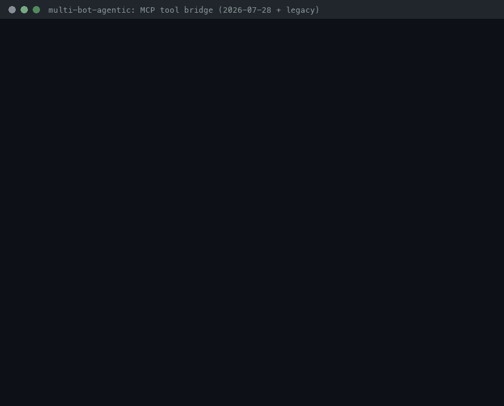
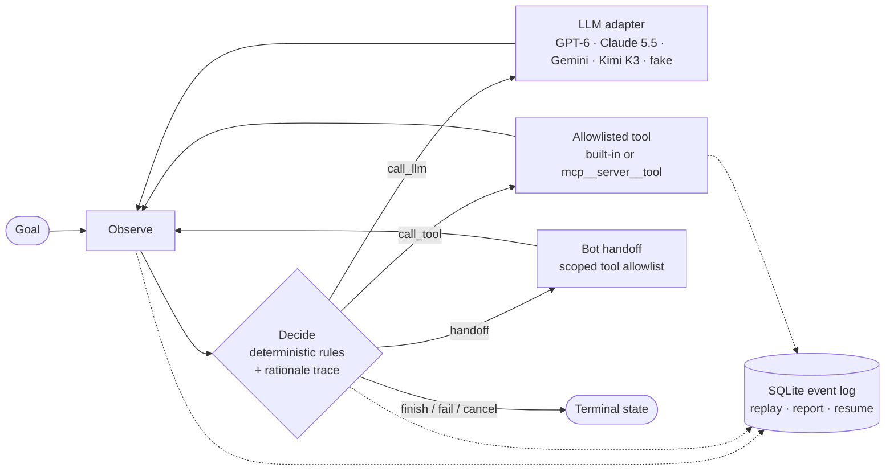
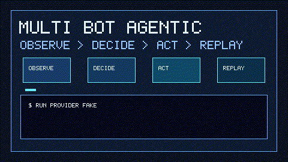

# multi-bot-agentic

[](https://github.com/Francis1998/multi-bot-agentic/actions/workflows/ci.yml)
[](pyproject.toml)
[](LICENSE)
[](docs/guides/MCP_TOOLS_GUIDE.md)

**A deterministic, auditable orchestrator for multi-bot AI agents.** Models propose, and a rule-based
**Observe → Decide → Act** engine decides. Every decision, tool call, and MCP call is written to a
replayable SQLite event log. It runs fully offline with a deterministic fake provider, and it works with GPT-6,
Claude 5.5, Gemini, Kimi K3, and any [Model Context Protocol](https://modelcontextprotocol.io) server. It is
a portfolio-quality, local-first reference implementation.



## Why

- **The model is an input, not the control plane.** LLM output becomes an observation. A deterministic decision
  engine picks the next action and records a `RationaleTrace`: the rule, the observations it used, and the
  actions it rejected.
- **Every run is auditable.** Lifecycle transitions, observations, decisions, and tool and MCP calls are
  persisted per run. `replay` and `report` never call a provider, so postmortems are safe and deterministic.
- **Tools are explicit and bounded.** Built-in and MCP tools pass the same allowlist and per-bot scopes. MCP
  calls also get per-call timeouts and result byte caps. Built-in tools run offline and in-process with
  size-limited inputs. A model can only request a tool; the engine decides whether it runs.
- **Provider-neutral.** One adapter interface covers GPT-6, the Claude Code CLI, Gemini, and Kimi K3, and every
  adapter sends parameters that current reasoning models accept.
- **CI-friendly.** The fake provider exercises the real runtime, so lint, types, tests, a smoke run, and
  offline evaluation need no API keys.

## How It Works



The model only ever returns text: `TOOL:<name>:<payload>`, `HANDOFF:<bot>:<summary>`, or `DONE:<answer>`. It
never executes anything itself. See [Architecture](docs/ARCHITECTURE.md) and [Safety](docs/SAFETY.md).



## 60-Second Quickstart

```bash
python -m venv .venv && . .venv/bin/activate
python -m pip install -e ".[dev]"

# Offline run with the deterministic fake provider, then inspect the durable log
multi-bot-agentic run --goal "Create a launch checklist" --provider fake --event-log data/runs.sqlite --run-id demo
multi-bot-agentic replay --event-log data/runs.sqlite --run-id demo --event-type decision --format text
multi-bot-agentic report --event-log data/runs.sqlite --run-id demo

# Tools from an MCP server (bundled demo server, works offline)
multi-bot-agentic mcp-tools --mcp-config examples/mcp/mcp.json
MULTIBOT_FAKE_TOOL=mcp__notes__search_notes multi-bot-agentic run --provider fake \
  --mcp-config examples/mcp/mcp.json --goal "release checklist"
```

To use a real model, export its key and pick the provider, for example
`export OPENAI_API_KEY=... && multi-bot-agentic run --provider openai --goal "..."`. For a full scenario, see the
[release-readiness walkthrough](docs/use-cases/USE-CASE-mcp-release-readiness.md).

## Feature Map

| Capability | What you get | Code | Docs |
| --- | --- | --- | --- |
| Deterministic ODA loop | Rule-based decisions with rationale traces and an explicit run state machine | `runner.py`, `decision.py`, `lifecycle.py` | [Architecture](docs/ARCHITECTURE.md) |
| Durable event log | Append-only SQLite log per run. `replay` and `report` never call providers | `event_log.py`, `cli.py` | [Replay diff](docs/guides/RUN_REPLAY_DIFF_GUIDE.md) |
| Checkpoint & resume | Resume an interrupted run; the active bot's tool scope is restored | `checkpoint.py` | [Checkpoint resume](docs/guides/CHECKPOINT_RESUME_GUIDE.md) |
| Multi-bot handoffs | `HANDOFF:<bot>:<summary>` with per-bot tool allowlists | `bots.py` | [Bot handoff](docs/guides/BOT_HANDOFF_GUIDE.md) |
| **MCP tool bridge** | Tools from any MCP server, with a dual-era (2026-07-28 + legacy) stdio client and no dependencies | `mcp/` | [MCP tools](docs/guides/MCP_TOOLS_GUIDE.md) |
| Provider adapters | GPT-6, Claude Code CLI, Gemini, Kimi K3, and a fake provider, all sending reasoning-safe parameters | `llm/` | [Configuration](docs/CONFIGURATION.md) |
| Safety controls | Step budgets, timeouts, cancellation file, tool allowlists, prompt bounds | `safety.py` | [Safety](docs/SAFETY.md) |
| Human-in-the-loop | File-backed approval gate for sensitive tools | `approval.py` | [HITL gate](docs/guides/HITL_APPROVAL_GATE_GUIDE.md) |
| Parallel fan-out | Capped, order-preserving task batches | `fanout.py` | [Fan-out](docs/guides/PARALLEL_FANOUT_GUIDE.md) |
| Tool-call hygiene | Rate limits, PII redaction, result truncation, per-bot permissions | `tool_runner.py`, `observation_redactor.py`, `tool_result_truncator.py`, `tool_permission.py` | [Rate limiter](docs/guides/RATE_LIMITED_TOOL_RUNNER_GUIDE.md) |
| Offline evaluation | Golden-path fixtures scored on tool sequence and answer | `eval/` | [Eval harness](docs/guides/EVAL_HARNESS_GUIDE.md) |
| 122 built-in tools | Offline, in-process tools for text, JSON, CSV, HTML, MIME, and encodings | `tools/` | [Tools catalog](docs/TOOLS.md) |
| Advisors & guards | 150+ offline HITL guards for multi-bot failure modes | `*_band.py` and friends | [Advisor catalog](docs/ADVISOR_CATALOG.md) |

## Current Model Stack

| Provider (`--provider`) | Adapter | Default | Also current | Credential |
| --- | --- | --- | --- | --- |
| OpenAI (`openai`) | `OpenAIAdapter` | `gpt-6.1-sol` | `gpt-6-astra`, `gpt-6.1-terra`, `gpt-6-luna` | `OPENAI_API_KEY` |
| Anthropic via Claude Code CLI (`claude_code`) | `ClaudeCodeCLIAdapter` | the CLI's configured model (recommended: `CLAUDE_CODE_COMMAND="claude -p --model claude-opus-5-5"`; keep `-p`, print mode) | `claude-sonnet-5-5`, `claude-haiku-5-5`, `claude-fable-5-1` | local `claude` |
| Google Gemini (`gemini`) | `GeminiAdapter` | `gemini-3.8-flash` | `gemini-4-argon` | `GEMINI_API_KEY` |
| Kimi / Moonshot (`kimi`) | `KimiAdapter` | `kimi-k3.1-pro` | `kimi-k3.1-pro-highspeed`, `kimi-k3` | `KIMI_API_KEY` |
| Deterministic (`fake`) | `FakeLLMAdapter` | offline, used by CI | n/a | none |

Verified against provider docs on 2026-11-06. Every adapter normalizes output into `ModelOutput`, which the runner
treats as an observation. `OPENAI_BASE_URL` points the OpenAI adapter at any OpenAI-compatible gateway. No adapter
sends `temperature`, `top_p`, or `top_k`: current GPT-6, Claude 5.5, Gemini 3.x, and Kimi K3 models reject, fix, or
ignore them ([parameter rules](docs/CONFIGURATION.md#provider-parameter-rules)).

## Documentation Map

- **Start:** [Quickstart](docs/QUICKSTART.md), [Configuration](docs/CONFIGURATION.md) (model stack, MCP, safety
  settings), and the [release-readiness walkthrough](docs/use-cases/USE-CASE-mcp-release-readiness.md)
- **Concepts:** [Architecture](docs/ARCHITECTURE.md), [Safety](docs/SAFETY.md)
- **Core guides:** [MCP tools](docs/guides/MCP_TOOLS_GUIDE.md),
  [Bot handoff](docs/guides/BOT_HANDOFF_GUIDE.md),
  [Checkpoint resume](docs/guides/CHECKPOINT_RESUME_GUIDE.md),
  [HITL approval gate](docs/guides/HITL_APPROVAL_GATE_GUIDE.md),
  [Parallel fan-out](docs/guides/PARALLEL_FANOUT_GUIDE.md),
  [Eval harness](docs/guides/EVAL_HARNESS_GUIDE.md),
  [Rate-limited tool runner](docs/guides/RATE_LIMITED_TOOL_RUNNER_GUIDE.md),
  [Observation redactor](docs/guides/OBSERVATION_REDACTOR_GUIDE.md)
- **Catalogs:** [Built-in tools](docs/TOOLS.md), [Advisor & guard catalog](docs/ADVISOR_CATALOG.md),
  [All guides](docs/guides/), [Use cases](docs/use-cases/README.md)
- **Project:** [CHANGELOG](CHANGELOG.md) and demo assets ([`assets/demo/`](assets/demo/); `docs/demo.gif` is
  rendered by `scripts/render_demo_gif.py`, and `docs/demo.svg` is a static architecture card)

## Use Cases

These are the problems the project was built for. Each one is explained in
[Problems this solves](docs/use-cases/PROBLEMS_THIS_SOLVES.md), and the
[issue index](docs/use-cases/README.md) links regression stories from real fixes.

1. "My agent did something, but I can't explain why." Rationale traces and replay answer that.
2. "I don't want the model executing tools directly." Text directives go through an allowlisted engine.
3. "The same agent flow must work across GPT-6, Claude, Gemini, and Kimi." One adapter interface covers them.
4. "I need a safe demo path without API keys." The deterministic fake provider runs the real runtime.
5. "Runs fail silently or leave no audit trail." Every run gets a durable SQLite event log plus `report`.
6. "The agent loops or burns tokens." Step budgets, timeouts, and cancellation stop it.
7. "I want to compare providers without rewriting orchestration." Swap `--provider`; nothing else changes.
8. "Agents should produce artifacts, not just chat." Allowlisted tools with recorded results do the work.
9. "I need a clean example of agent architecture." Each module has one clear job.
10. "CI must prove the agent works without credentials." `scripts/check.sh` runs on Python 3.10–3.12.

## Repository Layout

```text
src/multi_bot_agentic/   runtime, decision engine, event log, adapters (llm/), tools (tools/), MCP bridge (mcp/)
tests/                   deterministic unit and integration tests (MCP server fixtures in tests/fixtures/mcp/)
examples/mcp/            demo MCP server and mcpServers configs (bundled + official servers)
scripts/                 check, demo, and GIF rendering scripts
migrations/              sqlite schema scaffold
docs/                    architecture, safety, configuration, quickstart, guides, catalogs, use cases
.github/workflows/       CI for lint, format, typecheck, tests, demo smoke
```

## Verification

```bash
scripts/check.sh
```

`scripts/check.sh` runs `ruff check`, `ruff format --check`, `mypy src tests`, `pytest`, and a fake-provider
smoke run with replay and report. CI runs the same script on Python 3.10, 3.11, and 3.12. For a richer local
demo, run `scripts/run_demo.sh`.

## Contributing

- Run `scripts/check.sh` before pushing. It's exactly what CI runs.
- **New advisor, guard, or limiter entries go in [`docs/ADVISOR_CATALOG.md`](docs/ADVISOR_CATALOG.md), not in
  this README.** Use a `### ClassName` heading, a demo GIF, a one-paragraph summary, and a guide link.
- New built-in tools need four things: registration in `build_default_tools()`, an entry in the
  `SafetyPolicy.allowed_tools` default, an entry in [`docs/TOOLS.md`](docs/TOOLS.md), and a guide in
  `docs/guides/`.
- Keep this README a short showcase. Link new guides from the Documentation Map only if they're core.

## License

MIT. See [LICENSE](LICENSE).
