# Advisor & Guard Catalog

Offline, HITL-safe advisors, guards, and limiters for multi-bot runs. They were moved here **verbatim**
from the former README so the README can stay a short showcase. Each entry links to its guide in
[`docs/guides/`](guides/) and its demo GIF in [`assets/demo/`](../assets/demo/).

> **Model names in these entries are historical.** Entries such as `Stack: GPT-5.5 / Claude Sonnet 4.6 /
> Gemini 3.x / Kimi K2` name the models that were current when each entry was written. The verified
> current stack is in [Configuration › Current Model Stack](CONFIGURATION.md#current-model-stack).

**Adding an entry:** add new advisor, guard, or limiter entries **here, not in the README**. Use a
`### ClassName` heading, a demo GIF, a one-paragraph summary, and a link to the guide.

## Demo gallery

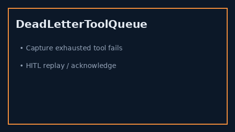

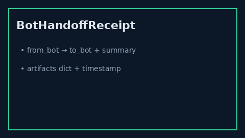

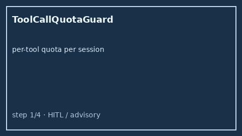
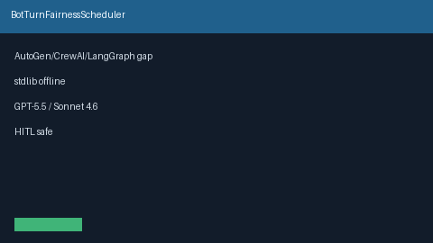
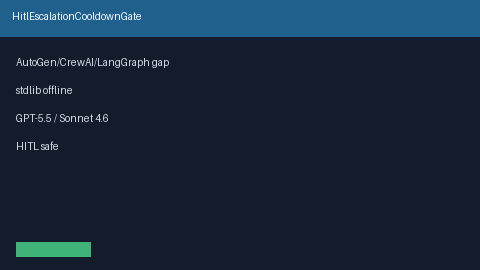
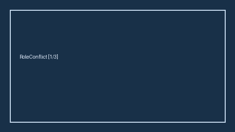

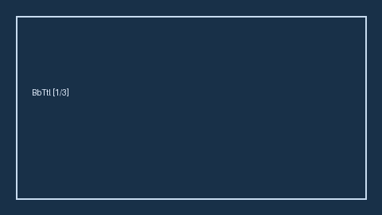

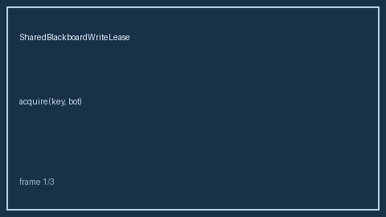

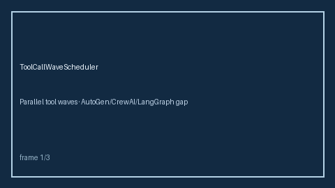
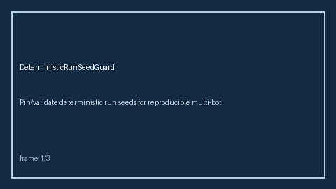
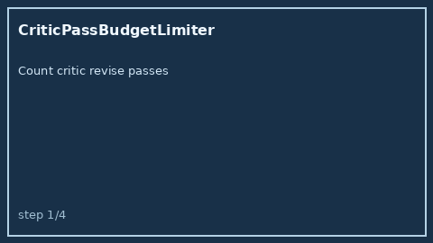
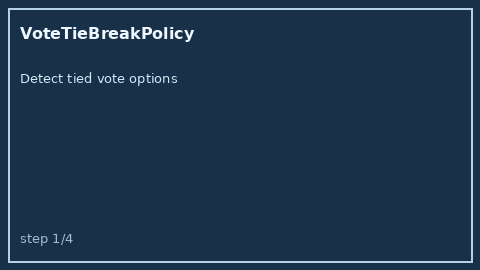
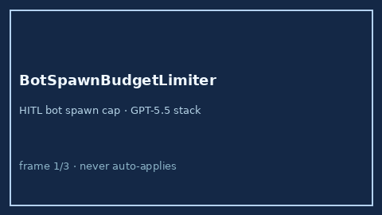
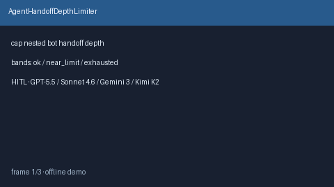
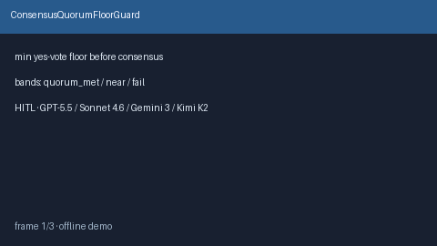
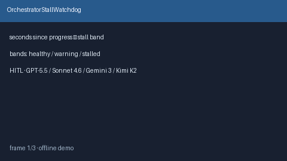
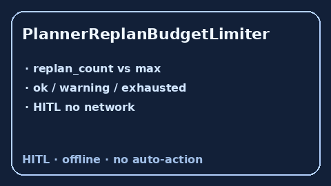
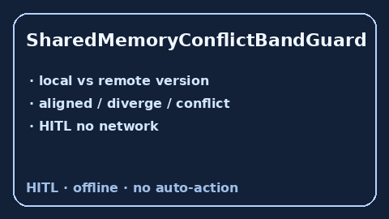
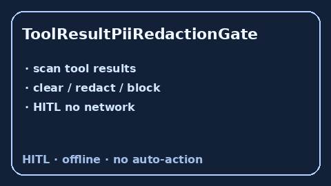
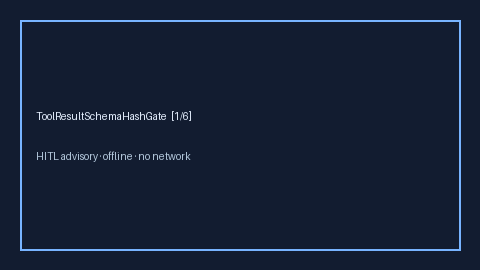

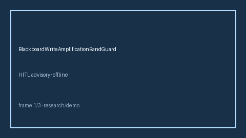
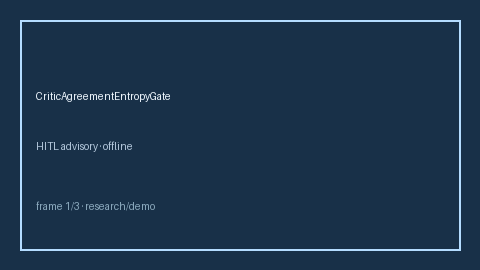
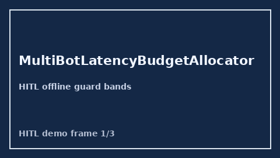
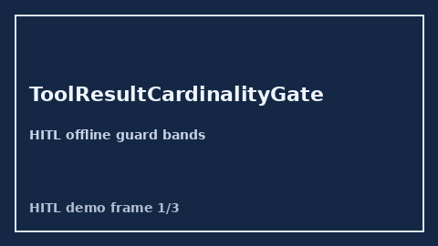

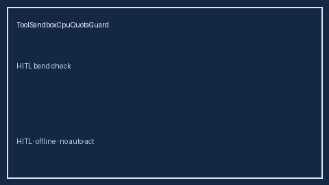
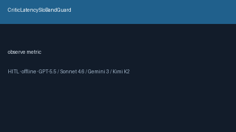
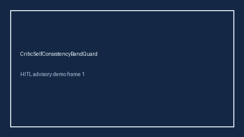
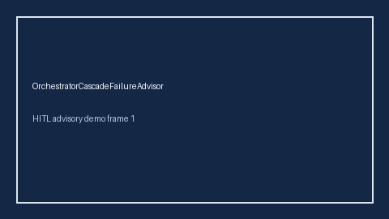
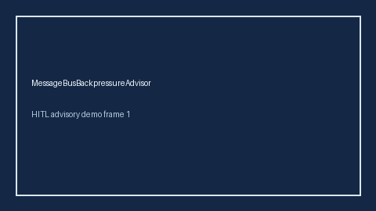

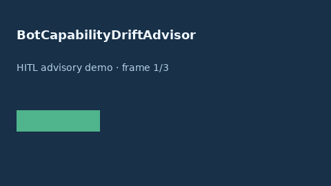
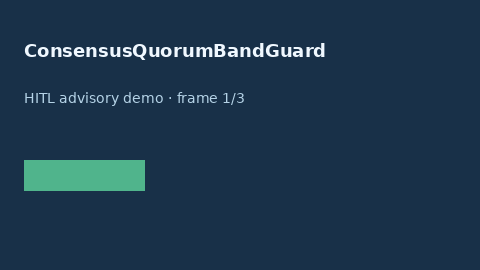
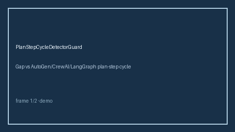
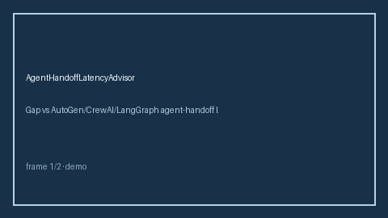
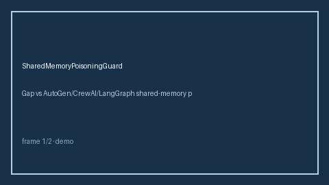
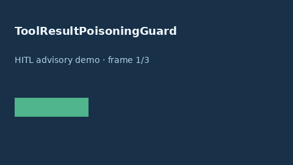
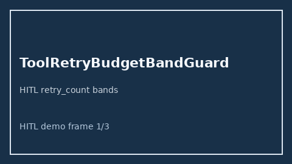
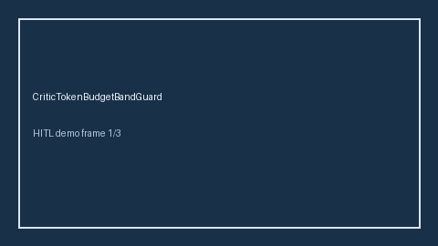
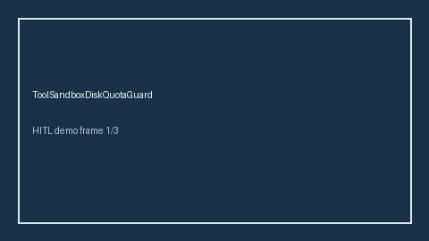
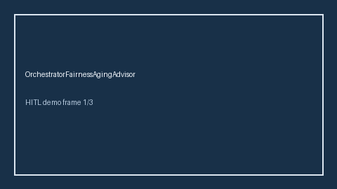
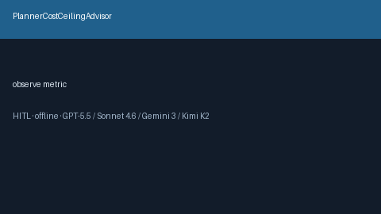
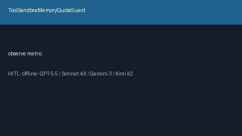
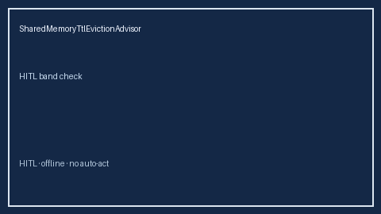
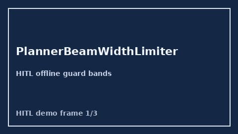
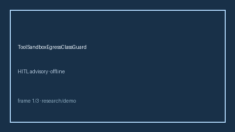
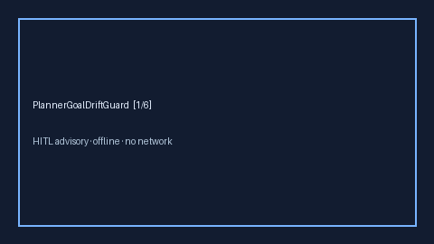
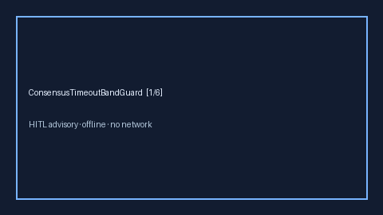

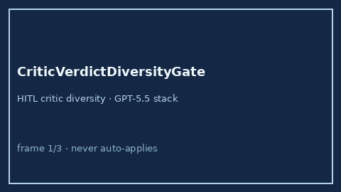
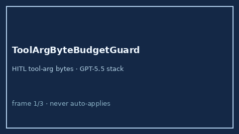
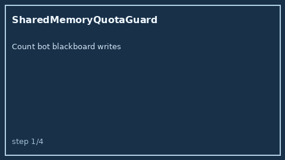

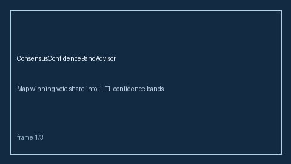

## Entries

### ToolSandboxNetworkExfilGuard

Offline HITL exfil_score bands. Gap vs AutoGen/CrewAI/LangGraph tool-sandbox network-exfil guards. Stack: GPT-5.5 / Claude Sonnet 4.6 / Gemini 3.x / Kimi K2. See `docs/guides/TOOL_SANDBOX_NETWORK_EXFIL_GUARD_GUIDE.md`.
### AgentDeadlockDetectorGuard

Offline HITL deadlock_score bands. Gap vs AutoGen/CrewAI/LangGraph agent-deadlock detectors. Stack: GPT-5.5 / Claude Sonnet 4.6 / Gemini 3.x / Kimi K2. See `docs/guides/AGENT_DEADLOCK_DETECTOR_GUARD_GUIDE.md`.

### PromptLeakBandAdvisor

Offline HITL leak_score bands. Gap vs AutoGen/CrewAI/LangGraph prompt-leak band advisors. Stack: GPT-5.5 / Claude Sonnet 4.6 / Gemini 3.x / Kimi K2. See `docs/guides/PROMPT_LEAK_BAND_ADVISOR_GUIDE.md`.

### ToolArgSchemaDriftGuard

Offline HITL schema_drift_score bands. Gap vs AutoGen/CrewAI/LangGraph tool-argument schema-drift guards. Stack: GPT-5.5 / Claude Sonnet 4.6 / Gemini 3.x / Kimi K2. See `docs/guides/TOOL_ARG_SCHEMA_DRIFT_GUARD_GUIDE.md`.

### PlannerStepBudgetBandAdvisor

Offline HITL steps_used_ratio bands. Gap vs LangGraph/CrewAI/AutoGen planner step-budget monitors. Stack: GPT-5.5 / Claude Sonnet 4.6 / Gemini 3.x / Kimi K2. See `docs/guides/PLANNER_STEP_BUDGET_BAND_ADVISOR_GUIDE.md`.

### ToolSandboxSyscallDenylistGuard

Offline HITL denied_syscall_rate bands. Gap vs AutoGen/CrewAI/LangGraph tool-sandbox syscall denylist guards. Stack: GPT-5.5 / Claude Sonnet 4.6 / Gemini 3.x / Kimi K2. See `docs/guides/TOOL_SANDBOX_SYSCALL_DENYLIST_GUARD_GUIDE.md`.

### BlackboardCasWriteSkewGuard

Offline HITL write_skew_score bands. Gap vs AutoGen/CrewAI/LangGraph shared-blackboard CAS/write-skew guards. Stack: GPT-5.5 / Claude Sonnet 4.6 / Gemini 3.x / Kimi K2. See `docs/guides/BLACKBOARD_CAS_WRITE_SKEW_GUARD_GUIDE.md`.
### PlannerHorizonBandAdvisor

Offline HITL horizon_steps_ratio bands. Gap vs LangGraph/CrewAI/AutoGen planner-horizon monitors. Stack: GPT-5.5 / Claude Sonnet 4.6 / Gemini 3.x / Kimi K2. See `docs/guides/PLANNER_HORIZON_BAND_ADVISOR_GUIDE.md`.

### CriticQuorumHysteresisAdvisor

Offline HITL advisor for `hysteresis_score` bands. Gap vs AutoGen/CrewAI/LangGraph critic-quorum hysteresis monitors. Optional polish via GPT-5.5 / Claude Sonnet 4.6 / Gemini 3.x / Kimi K2.

### OrchestratorFanoutBudgetBandAdvisor

Offline HITL advisor for `fanout_ratio` bands. Gap vs AutoGen/CrewAI/LangGraph orchestrator fan-out budget monitors. Optional polish via GPT-5.5 / Claude Sonnet 4.6 / Gemini 3.x / Kimi K2.

### SubgraphRecursionCapAdvisor

Offline HITL advisor for `recursion_depth_ratio` bands. Gap vs LangGraph/CrewAI subgraph recursion-cap monitors. Optional polish via GPT-5.5 / Claude Sonnet 4.6 / Gemini 3.x / Kimi K2.

### WorkerStarvationBandAdvisor

Offline HITL `starvation_ratio` bands. Gap vs LangGraph/CrewAI/AutoGen worker-starvation band monitors. See `docs/guides/WORKER_STARVATION_BAND_ADVISOR_GUIDE.md`.

### ToolPermissionDriftAdvisor

Offline HITL `drift_ratio` bands. Gap vs LangGraph/CrewAI/AutoGen tool-permission drift monitors. See `docs/guides/TOOL_PERMISSION_DRIFT_ADVISOR_GUIDE.md`.

### BlackboardLeaseThrashAdvisor

Offline HITL `thrash_ratio` bands. Gap vs LangGraph/CrewAI/AutoGen blackboard lease-thrash monitors. See `docs/guides/BLACKBOARD_LEASE_THRASH_ADVISOR_GUIDE.md`.

### SharedKvWriteAmplificationAdvisor

Offline HITL `write_amp_ratio` bands. Gap vs LangGraph/CrewAI/AutoGen shared-KV write-amplification monitors. See `docs/guides/SHARED_KV_WRITE_AMPLIFICATION_ADVISOR_GUIDE.md`.

### HandoffPayloadBloatAdvisor

Offline HITL `payload_bloat_ratio` bands. Gap vs LangGraph/CrewAI/AutoGen handoff payload-bloat monitors. See `docs/guides/HANDOFF_PAYLOAD_BLOAT_ADVISOR_GUIDE.md`.

### SupervisorIdleSkewAdvisor

Offline HITL `idle_skew_ratio` bands. Gap vs LangGraph/CrewAI/AutoGen supervisor idle-skew monitors. See `docs/guides/SUPERVISOR_IDLE_SKEW_ADVISOR_GUIDE.md`.

### BlackboardReadStalenessAdvisor

Offline HITL `staleness_ratio` bands. Gap vs LangGraph/CrewAI/AutoGen blackboard read-staleness monitors. See `docs/guides/BLACKBOARD_READ_STALENESS_ADVISOR_GUIDE.md`.

### ToolSideEffectReplayBandAdvisor

Offline HITL `replay_ratio` bands. Gap vs LangGraph/CrewAI/AutoGen tool side-effect replay monitors. See `docs/guides/TOOL_SIDE_EFFECT_REPLAY_BAND_ADVISOR_GUIDE.md`.

### CriticFanoutSkewAdvisor

Offline HITL `skew_ratio` bands. Gap vs LangGraph/CrewAI/AutoGen critic-fanout skew monitors. See `docs/guides/CRITIC_FANOUT_SKEW_ADVISOR_GUIDE.md`.

### SharedLockContentionBandAdvisor

Offline HITL `contention_ratio` bands. Gap vs LangGraph/CrewAI/AutoGen shared-lock contention monitors. See `docs/guides/SHARED_LOCK_CONTENTION_BAND_ADVISOR_GUIDE.md`.

### ConsensusQuorumStallAdvisor

Offline HITL `stall_ratio` bands. Gap vs LangGraph/CrewAI/AutoGen consensus quorum-stall monitors. See `docs/guides/CONSENSUS_QUORUM_STALL_ADVISOR_GUIDE.md`.

### CriticMajorityCaptureBandAdvisor

Offline HITL `capture_ratio` bands. Gap vs LangGraph/CrewAI/AutoGen critic majority-capture monitors. See `docs/guides/CRITIC_MAJORITY_CAPTURE_BAND_ADVISOR_GUIDE.md`.

### AgentHandoffLoopBandAdvisor

Offline HITL `loop_ratio` bands. Gap vs LangGraph/CrewAI/AutoGen agent handoff-loop monitors. See `docs/guides/AGENT_HANDOFF_LOOP_BAND_ADVISOR_GUIDE.md`.

### WorkerHeartbeatMissBandAdvisor

Offline HITL `miss_ratio` bands. Gap vs LangGraph/CrewAI/AutoGen worker heartbeat-miss monitors. See `docs/guides/WORKER_HEARTBEAT_MISS_BAND_ADVISOR_GUIDE.md`.

### SupervisorRestartThrashAdvisor

Offline HITL `restart_ratio` bands. Gap vs LangGraph/CrewAI/AutoGen supervisor restart-thrash monitors. See `docs/guides/SUPERVISOR_RESTART_THRASH_ADVISOR_GUIDE.md`.

### ToolResultSchemaDriftBandAdvisor

Offline HITL `drift_ratio` bands. Gap vs LangGraph/CrewAI/AutoGen tool-result schema-drift monitors. See `docs/guides/TOOL_RESULT_SCHEMA_DRIFT_BAND_ADVISOR_GUIDE.md`.

### SubgraphCancelLeakAdvisor

Offline HITL `leak_ratio` bands. Gap vs LangGraph/CrewAI/AutoGen subgraph cancel-leak monitors. See `docs/guides/SUBGRAPH_CANCEL_LEAK_ADVISOR_GUIDE.md`.

### PlannerToolMismatchBandAdvisor

Offline HITL `mismatch_ratio` bands. Gap vs LangGraph/CrewAI/AutoGen planner-tool mismatch monitors. See `docs/guides/PLANNER_TOOL_MISMATCH_BAND_ADVISOR_GUIDE.md`.

### OrchestratorHeartbeatGapAdvisor

Offline HITL `heartbeat_gap_ratio` bands. Gap vs LangGraph/CrewAI/AutoGen orchestrator heartbeat monitors. See `docs/guides/ORCHESTRATOR_HEARTBEAT_GAP_ADVISOR_GUIDE.md`.

### FanInBarrierStallAdvisor

Offline HITL `stall_ratio` bands. Gap vs LangGraph/CrewAI/AutoGen fan-in barrier stall monitors. See `docs/guides/FAN_IN_BARRIER_STALL_ADVISOR_GUIDE.md`.

### AgentLoopTokenBleedAdvisor

Offline HITL `token_bleed_ratio` bands. Gap vs LangGraph/CrewAI/AutoGen agent-loop token-bleed monitors. See `docs/guides/AGENT_LOOP_TOKEN_BLEED_ADVISOR_GUIDE.md`.

### PlannerCriticOscillationBandAdvisor

Offline HITL `oscillation_ratio` bands. Gap vs LangGraph/CrewAI/AutoGen planner-critic oscillation monitors. See `docs/guides/PLANNER_CRITIC_OSCILLATION_BAND_ADVISOR_GUIDE.md`.

### ToolTimeoutCascadeBandAdvisor

Offline HITL `cascade_ratio` bands. Gap vs LangGraph/CrewAI/AutoGen tool-timeout cascade monitors. See `docs/guides/TOOL_TIMEOUT_CASCADE_BAND_ADVISOR_GUIDE.md`.

### ActorMailboxOverflowAdvisor

Offline HITL `mailbox_depth_ratio` bands. Gap vs Ray/Akka/Orleans actor-mailbox overflow monitors. See `docs/guides/ACTOR_MAILBOX_OVERFLOW_ADVISOR_GUIDE.md`.
### MemoryNamespaceLeakAdvisor

Offline HITL `leak_ratio` bands. Gap vs LangGraph/CrewAI/AutoGen memory-namespace leak monitors. See `docs/guides/MEMORY_NAMESPACE_LEAK_ADVISOR_GUIDE.md`.

### HandoffTimeoutBandAdvisor

Offline HITL `timeout_ratio` bands. Gap vs LangGraph/CrewAI/AutoGen handoff-timeout band monitors. See `docs/guides/HANDOFF_TIMEOUT_BAND_ADVISOR_GUIDE.md`.

### CriticDisagreementSpreadAdvisor

Offline HITL `disagreement_ratio` bands. Gap vs AutoGen/CrewAI/LangGraph critic disagreement-spread monitors. See `docs/guides/CRITIC_DISAGREEMENT_SPREAD_ADVISOR_GUIDE.md`.

### ToolSideEffectLedgerAdvisor

Offline HITL `side_effect_ratio` bands. Gap vs LangGraph/CrewAI/AutoGen tool side-effect ledger monitors. See `docs/guides/TOOL_SIDE_EFFECT_LEDGER_ADVISOR_GUIDE.md`.

### ToolResultSchemaLagAdvisor

Offline HITL advisor for `lag_ratio` bands. Gap vs LangGraph/CrewAI/AutoGen tool-result schema lag monitors. Optional polish via GPT-5.5 / Claude Sonnet 4.6 / Gemini 3.x / Kimi K2.

### ParallelToolCollisionAdvisor

Offline HITL advisor for `collision_ratio` bands. Gap vs AutoGen/CrewAI/LangGraph parallel tool-collision monitors. Optional polish via GPT-5.5 / Claude Sonnet 4.6 / Gemini 3.x / Kimi K2.

### PlannerReplanThrashAdvisor

Offline HITL advisor for `replan_thrash_ratio` bands. Gap vs LangGraph/CrewAI/AutoGen planner replan-thrash monitors. Optional polish via GPT-5.5 / Claude Sonnet 4.6 / Gemini 3.x / Kimi K2.

### ToolPermissionEscalationBandAdvisor

Offline HITL escalation_score bands. Gap vs AutoGen/CrewAI/LangGraph tool-permission escalation monitors. Stack: GPT-5.5 / Claude Sonnet 4.6 / Gemini 3.x / Kimi K2. See `docs/guides/TOOL_PERMISSION_ESCALATION_BAND_ADVISOR_GUIDE.md`.

### CriticTimeoutCascadeGuard

Offline HITL cascade_score bands. Gap vs AutoGen/CrewAI/LangGraph critic-timeout cascade guards. Stack: GPT-5.5 / Claude Sonnet 4.6 / Gemini 3.x / Kimi K2. See `docs/guides/CRITIC_TIMEOUT_CASCADE_GUARD_GUIDE.md`.

### ConsensusVoteStuffingBandAdvisor

Offline HITL stuffing_score bands. Gap vs AutoGen/CrewAI/LangGraph consensus vote-stuffing band advisors. Stack: GPT-5.5 / Claude Sonnet 4.6 / Gemini 3.x / Kimi K2. See `docs/guides/CONSENSUS_VOTE_STUFFING_ADVISOR_GUIDE.md`.

### AgentCapabilityRevocationBandAdvisor

Offline HITL revocation_score bands. Gap vs AutoGen/CrewAI/LangGraph agent-capability revocation band advisors. Stack: GPT-5.5 / Claude Sonnet 4.6 / Gemini 3.x / Kimi K2. See `docs/guides/AGENT_CAPABILITY_REVOCATION_ADVISOR_GUIDE.md`.

### PlanGoalContradictionBandAdvisor

Offline HITL contradiction_score bands. Gap vs AutoGen/CrewAI/LangGraph plan-goal contradiction band advisors. Stack: GPT-5.5 / Claude Sonnet 4.6 / Gemini 3.x / Kimi K2. See `docs/guides/PLAN_GOAL_CONTRADICTION_BAND_ADVISOR_GUIDE.md`.

### ToolResultSizeBombGuard

Offline HITL result_bytes bands. Gap vs AutoGen/CrewAI/LangGraph tool-result size-bomb guards. Stack: GPT-5.5 / Claude Sonnet 4.6 / Gemini 3.x / Kimi K2. See `docs/guides/TOOL_RESULT_SIZE_BOMB_GUARD_GUIDE.md`.

### MessageBusPoisonPillGuard

Offline HITL poison_score bands. Gap vs AutoGen/CrewAI/LangGraph message-bus poison-pill guards. Stack: GPT-5.5 / Claude Sonnet 4.6 / Gemini 3.x / Kimi K2. See `docs/guides/MESSAGE_BUS_POISON_PILL_GUARD_GUIDE.md`.

### OrphanTaskSweeperGuard

Offline HITL orphan_count bands. Gap vs AutoGen/CrewAI/LangGraph orphan-task sweepers. Stack: GPT-5.5 / Claude Sonnet 4.6 / Gemini 3.x / Kimi K2. See `docs/guides/ORPHAN_TASK_SWEEPER_GUARD_GUIDE.md`.

### ToolSandboxDnsRebindGuard

Offline HITL rebind_score bands. Gap vs AutoGen/CrewAI/LangGraph tool-sandbox DNS-rebinding guards. Stack: GPT-5.5 / Claude Sonnet 4.6 / Gemini 3.x / Kimi K2. See `docs/guides/TOOL_SANDBOX_DNS_REBIND_GUARD_GUIDE.md`.

### CriticCollusionBandAdvisor

Offline HITL collusion_score bands. Gap vs AutoGen/CrewAI/LangGraph critic-collusion band advisors. Stack: GPT-5.5 / Claude Sonnet 4.6 / Gemini 3.x / Kimi K2. See `docs/guides/CRITIC_COLLUSION_BAND_ADVISOR_GUIDE.md`.

### OrchestratorRetryStormBandAdvisor

### ConsensusParticipationSkewAdvisor

### ToolSandboxEscapeAttemptBandAdvisor

Offline HITL `attempt_ratio` bands vs LangGraph/CrewAI/AutoGen tool sandbox-escape attempt monitors. Distinct from `ToolResultSchemaDriftBandAdvisor` / `ToolPermissionEscalationBandAdvisor`. Stack: GPT-5.5 / Claude Sonnet 4.6 / Gemini 3.x / Kimi K2.

### ToolBudgetExhaustionBandAdvisor

Offline HITL `exhaustion_ratio` bands vs LangGraph/CrewAI/AutoGen tool budget-exhaustion monitors. Distinct from `ToolCallQuotaGuard` / `ToolRetryBudgetBandGuard`. Stack: GPT-5.5 / Claude Sonnet 4.6 / Gemini 3.x / Kimi K2.

### OrchestratorFanInStallBandAdvisor

Offline HITL `stall_ratio` bands vs LangGraph/CrewAI/AutoGen orchestrator fan-in stall monitors. Distinct from `AgentHandoffLoopBandAdvisor` / `ConsensusQuorumStallAdvisor`. Stack: GPT-5.5 / Claude Sonnet 4.6 / Gemini 3.x / Kimi K2.

### ToolIdempotencyCollisionBandAdvisor

Offline HITL `collision_ratio` bands vs LangGraph/CrewAI/AutoGen tool idempotency-collision monitors. Distinct from `ToolSideEffectReplayBandAdvisor` / `ToolResultSchemaDriftBandAdvisor`. Stack: GPT-5.5 / Claude Sonnet 4.6 / Gemini 3.x / Kimi K2.

### MessageBusPartitionBandAdvisor

Offline HITL `partition_ratio` bands vs LangGraph/CrewAI/AutoGen message-bus partition monitors. Distinct from `OrchestratorFanInStallBandAdvisor` / `SharedLockContentionBandAdvisor`. Stack: GPT-5.5 / Claude Sonnet 4.6 / Gemini 3.x / Kimi K2.

### SharedMemoryQuotaThrashBandAdvisor

Offline HITL `thrash_ratio` bands vs LangGraph/CrewAI/AutoGen shared-memory quota thrash monitors. Distinct from `SharedKvWriteAmplificationAdvisor` / `BlackboardReadStalenessAdvisor`. Stack: GPT-5.5 / Claude Sonnet 4.6 / Gemini 3.x / Kimi K2.

### CriticLatencySkewBandAdvisor

Gap vs LangGraph/CrewAI/AutoGen critic latency-skew monitors. Distinct from `CriticLatencySloBandGuard` / `CriticTimeoutBandGuard`. Stack: GPT-5.5 / Claude Sonnet 4.6 / Gemini 3.x / Kimi K2. See `docs/guides/CRITIC_LATENCY_SKEW_BAND_ADVISOR_GUIDE.md`.

### SubgraphDeadlockResidualBandAdvisor

Gap vs LangGraph/CrewAI/AutoGen subgraph deadlock-residual monitors. Distinct from `SubgraphCancelLeakAdvisor` / `AgentHandoffLoopBandAdvisor`. Stack: GPT-5.5 / Claude Sonnet 4.6 / Gemini 3.x / Kimi K2. See `docs/guides/SUBGRAPH_DEADLOCK_RESIDUAL_BAND_ADVISOR_GUIDE.md`.

### PlannerContextOverflowBandAdvisor

Gap vs LangGraph/CrewAI/AutoGen planner context-overflow monitors. Distinct from `PlannerStepBudgetBandAdvisor` / `PlannerHorizonBandAdvisor`. Stack: GPT-5.5 / Claude Sonnet 4.6 / Gemini 3.x / Kimi K2. See `docs/guides/PLANNER_CONTEXT_OVERFLOW_BAND_ADVISOR_GUIDE.md`.

### WorkerQueueDepthBandAdvisor

HITL `queue_depth_ratio` band guard. Gap vs LangGraph/CrewAI/AutoGen worker-queue depth monitors. Distinct from `WorkerStarvationBandAdvisor` / `WorkerHeartbeatMissBandAdvisor`. Stack: GPT-5.5 / Claude Sonnet 4.6 / Gemini 3.x / Kimi K2. See `docs/guides/WORKER_QUEUE_DEPTH_BAND_ADVISOR_GUIDE.md`.

### HandoffSchemaDriftBandAdvisor

HITL `drift_ratio` band guard. Gap vs LangGraph/CrewAI/AutoGen handoff-schema drift monitors. Distinct from `ToolResultSchemaDriftBandAdvisor` / `AgentHandoffLoopBandAdvisor`. Stack: GPT-5.5 / Claude Sonnet 4.6 / Gemini 3.x / Kimi K2. See `docs/guides/HANDOFF_SCHEMA_DRIFT_BAND_ADVISOR_GUIDE.md`.

### AgentAffinitySkewBandAdvisor

HITL `skew_ratio` band guard. Gap vs LangGraph/CrewAI/AutoGen agent-affinity skew monitors. Distinct from `FanInSkewBandAdvisor` / `SharedStateWriteSkewBandAdvisor`. Stack: GPT-5.5 / Claude Sonnet 4.6 / Gemini 3.x / Kimi K2. See `docs/guides/AGENT_AFFINITY_SKEW_BAND_ADVISOR_GUIDE.md`.

### CriticCalibrationDriftBandAdvisor

HITL `drift_ratio` band guard. Gap vs LangGraph/CrewAI/AutoGen critic-calibration drift monitors. Distinct from `CriticCollusionBandAdvisor` / `CriticLatencySkewBandAdvisor`. Stack: GPT-5.5 / Claude Sonnet 4.6 / Gemini 3.x / Kimi K2. See `docs/guides/CRITIC_CALIBRATION_DRIFT_BAND_ADVISOR_GUIDE.md`.

### PlannerGoalChurnBandAdvisor

HITL `churn_ratio` band guard. Gap vs LangGraph/CrewAI/AutoGen planner goal-churn monitors. Distinct from `PlannerContextOverflowBandAdvisor` / `PlanGoalContradictionBandAdvisor`. Stack: GPT-5.5 / Claude Sonnet 4.6 / Gemini 3.x / Kimi K2. See `docs/guides/PLANNER_GOAL_CHURN_BAND_ADVISOR_GUIDE.md`.

### SharedKvLeaseExpiryBandAdvisor

HITL `expiry_ratio` band guard. Gap vs LangGraph/CrewAI/AutoGen shared-KV lease-expiry monitors. Distinct from `BlackboardWriteLeaseAdvisor` / `SharedLockContentionBandAdvisor`. Stack: GPT-5.5 / Claude Sonnet 4.6 / Gemini 3.x / Kimi K2. See `docs/guides/SHARED_KV_LEASE_EXPIRY_BAND_ADVISOR_GUIDE.md`.

### ToolSchemaCompatBandAdvisor

HITL `compat_ratio` band guard. Gap vs LangGraph/CrewAI/AutoGen tool-schema compatibility monitors. Distinct from `ToolResultSchemaDriftBandAdvisor` / `ToolBudgetExhaustionBandAdvisor`. Stack: GPT-5.5 / Claude Sonnet 4.6 / Gemini 3.x / Kimi K2. See `docs/guides/TOOL_SCHEMA_COMPAT_BAND_ADVISOR_GUIDE.md`.

### AgentTokenBudgetSkewBandAdvisor

HITL `skew_ratio` band guard. Gap vs LangGraph/CrewAI/AutoGen agent token-budget skew monitors. Distinct from `SessionTokenBudgetLedger` / `CriticTokenBudgetBandGuard`. Stack: GPT-5.5 / Claude Sonnet 4.6 / Gemini 3.x / Kimi K2. See `docs/guides/AGENT_TOKEN_BUDGET_SKEW_BAND_ADVISOR_GUIDE.md`.

### CriticScoreInflationBandAdvisor

HITL `inflation_ratio` band guard. Gap vs LangGraph/CrewAI/AutoGen critic score-inflation monitors. Distinct from `CriticCalibrationDriftBandAdvisor` / `CriticCollusionBandAdvisor`. Stack: GPT-5.5 / Claude Sonnet 4.6 / Gemini 3.x / Kimi K2. See `docs/guides/CRITIC_SCORE_INFLATION_BAND_ADVISOR_GUIDE.md`.

### WorkerMailboxOverflowBandAdvisor

HITL `overflow_ratio` band guard. Gap vs LangGraph/CrewAI/AutoGen worker mailbox overflow monitors. Distinct from `WorkerQueueDepthBandAdvisor` / `WorkerStarvationBandAdvisor`. Stack: GPT-5.5 / Claude Sonnet 4.6 / Gemini 3.x / Kimi K2. See `docs/guides/WORKER_MAILBOX_OVERFLOW_BAND_ADVISOR_GUIDE.md`.

### AgentAffinityDecayBandAdvisor

HITL `decay_ratio` band guard. Gap vs LangGraph/CrewAI/AutoGen agent affinity-decay monitors. Distinct from `AgentAffinitySkewBandAdvisor` / `StickyBotAffinityStore`. Stack: GPT-5.5 / Claude Sonnet 4.6 / Gemini 3.x / Kimi K2. See `docs/guides/AGENT_AFFINITY_DECAY_BAND_ADVISOR_GUIDE.md`.

### HitlTimeoutCascadeBandAdvisor

HITL `cascade_ratio` band guard. Gap vs LangGraph/CrewAI/AutoGen HITL timeout-cascade monitors. Distinct from `HandoffTimeoutBandAdvisor` / `ToolTimeoutCascadeBandAdvisor`. Stack: GPT-5.5 / Claude Sonnet 4.6 / Gemini 3.x / Kimi K2. See `docs/guides/HITL_TIMEOUT_CASCADE_BAND_ADVISOR_GUIDE.md`.

### MemoryCompactionLagBandAdvisor

HITL `lag_ratio` band guard. Gap vs LangGraph/CrewAI/AutoGen memory-compaction lag monitors. Distinct from `SharedMemoryQuotaThrashBandAdvisor` / `SharedKvLeaseExpiryBandAdvisor`. Stack: GPT-5.5 / Claude Sonnet 4.6 / Gemini 3.x / Kimi K2. See `docs/guides/MEMORY_COMPACTION_LAG_BAND_ADVISOR_GUIDE.md`.

### BlackboardWriteContentionBandAdvisor

HITL `contention_ratio` band guard. Gap vs LangGraph/CrewAI/AutoGen blackboard write-contention monitors. Distinct from `SharedBlackboardWriteLease` / `SharedLockContentionBandAdvisor`. Stack: GPT-5.5 / Claude Sonnet 4.6 / Gemini 3.x / Kimi K2. See `docs/guides/BLACKBOARD_WRITE_CONTENTION_BAND_ADVISOR_GUIDE.md`.

### ToolSideEffectOrphanBandAdvisor

HITL `orphan_ratio` band guard. Gap vs LangGraph/CrewAI/AutoGen tool side-effect orphan monitors. Distinct from `ToolSideEffectLedgerAdvisor` / `ToolSideEffectReplayBandAdvisor`. Stack: GPT-5.5 / Claude Sonnet 4.6 / Gemini 3.x / Kimi K2. See `docs/guides/TOOL_SIDE_EFFECT_ORPHAN_BAND_ADVISOR_GUIDE.md`.

### SupervisorFanoutSkewBandAdvisor

HITL supervisor fanout skew_ratio band guard (never auto-acts). Gap vs LangGraph/CrewAI/AutoGen supervisor fanout-skew monitors. Distinct from `OrchestratorFanoutBudgetBandAdvisor` / `CriticFanoutSkewAdvisor`. Stack: GPT-6.1 / Claude Sonnet 5.5 / Gemini 3.x / Kimi K3. Guide: [`SUPERVISOR_FANOUT_SKEW_BAND_ADVISOR_GUIDE.md`](guides/SUPERVISOR_FANOUT_SKEW_BAND_ADVISOR_GUIDE.md).

### HitlApprovalStarvationBandAdvisor

HITL `starvation_ratio` band guard. Gap vs LangGraph/CrewAI/AutoGen HITL approval-starvation monitors. Distinct from `HitlTimeoutCascadeBandAdvisor` / `HitlApprovalGate`. Stack: GPT-5.5 / Claude Sonnet 4.6 / Gemini 3.x / Kimi K2. See `docs/guides/HITL_APPROVAL_STARVATION_BAND_ADVISOR_GUIDE.md`.

### SupervisorHandoffLoopBandAdvisor

HITL `loop_ratio` band guard. Gap vs LangGraph/CrewAI/AutoGen supervisor handoff-loop monitors. Distinct from `AgentHandoffLoopBandAdvisor` / `HandoffSchemaDriftBandAdvisor`. Stack: GPT-5.5 / Claude Sonnet 4.6 / Gemini 3.x / Kimi K2. See `docs/guides/SUPERVISOR_HANDOFF_LOOP_BAND_ADVISOR_GUIDE.md`.

### SubgraphRetryAmplificationBandAdvisor

HITL `amplification_ratio` band guard. Gap vs LangGraph/CrewAI/AutoGen subgraph retry-amplification monitors. Distinct from `ToolRetryBudgetBandGuard` / `ToolTimeoutCascadeBandAdvisor`. Stack: GPT-5.5 / Claude Sonnet 4.6 / Gemini 3.x / Kimi K2. See `docs/guides/SUBGRAPH_RETRY_AMPLIFICATION_BAND_ADVISOR_GUIDE.md`.

### ToolResultTruncationBandAdvisor

Gap vs LangGraph/CrewAI/AutoGen tool-result truncation monitors. Distinct from `ToolResultSchemaDriftBandAdvisor` / `ToolBudgetExhaustionBandAdvisor`. Stack: GPT-5.5 / Claude Sonnet 4.6 / Gemini 3.x / Kimi K2. See `docs/guides/TOOL_RESULT_TRUNCATION_BAND_ADVISOR_GUIDE.md`.

### SharedStateWriteSkewBandAdvisor

Gap vs LangGraph/CrewAI/AutoGen shared-state write-skew monitors. Distinct from `SharedMemoryQuotaThrashBandAdvisor` / `SharedLockContentionBandAdvisor`. Stack: GPT-5.5 / Claude Sonnet 4.6 / Gemini 3.x / Kimi K2. See `docs/guides/SHARED_STATE_WRITE_SKEW_BAND_ADVISOR_GUIDE.md`.

### AgentMemoryPoisonBandAdvisor

Gap vs LangGraph/CrewAI/AutoGen agent-memory poison monitors. Distinct from `SharedMemoryConflictBandAdvisor` / `PromptLeakBandAdvisor`. Stack: GPT-5.5 / Claude Sonnet 4.6 / Gemini 3.x / Kimi K2. See `docs/guides/AGENT_MEMORY_POISON_BAND_ADVISOR_GUIDE.md`.

### OrchestratorPriorityInversionBandAdvisor

Offline HITL `inversion_ratio` bands vs LangGraph/CrewAI/AutoGen orchestrator priority-inversion monitors. Distinct from `OrchestratorFanInStallBandAdvisor` / `OrchestratorRetryStormBandAdvisor`.

### ConsensusVoteLatencySkewBandAdvisor

Offline HITL `skew_ratio` bands vs LangGraph/CrewAI/AutoGen consensus vote latency-skew monitors. Distinct from `ConsensusQuorumStallAdvisor` / `ConsensusConfidenceBandAdvisor`.

### PlannerToolMismatchCascadeBandAdvisor

Offline HITL `mismatch_ratio` bands vs LangGraph/CrewAI/AutoGen planner-tool mismatch cascade monitors. Distinct from `PlannerToolMismatchBandAdvisor` / `PlanGoalContradictionBandAdvisor`.

## Index and gap notes

- **ToolCallQuotaGuard**: Per-tool call quota per session advisory/hard deny — see `docs/guides/TOOL_CALL_QUOTA_GUARD_GUIDE.md`
- **HitlEscalationCooldownGate**: Cooldown after HITL deny/reject to block immediate re-escalation (advisory/hard; never network I/O) — see `docs/guides/HITL_ESCALATION_COOLDOWN_GATE_GUIDE.md`
- **BotRoleConflictDetector**: Exclusive role-tag collision detector (advisory/hard; never network I/O) — see `docs/guides/BOT_ROLE_CONFLICT_DETECTOR_GUIDE.md`
- **PlanStepDependencyResolver**: Topological plan-step ordering with cycle detection — see `docs/guides/PLAN_STEP_DEPENDENCY_RESOLVER_GUIDE.md`
- **BlackboardEntryTtlEvictor**: Per-key TTL eviction for shared blackboard entries — see `docs/guides/BLACKBOARD_ENTRY_TTL_EVICTOR_GUIDE.md`
- **BotHeartbeatLivenessWatchdog**: Per-bot heartbeat liveness (alive/stale/unknown) — see `docs/guides/BOT_HEARTBEAT_LIVENESS_WATCHDOG_GUIDE.md`
- **SharedBlackboardWriteLease**: Exclusive time-bounded blackboard write leases — see `docs/guides/SHARED_BLACKBOARD_WRITE_LEASE_GUIDE.md`
- **CriticPassBudgetLimiter**: Cap critic re-pass loops with HITL exhaust bands — see `docs/guides/CRITIC_PASS_BUDGET_LIMITER_GUIDE.md`
- **VoteTieBreakPolicy**: Deterministic multi-bot vote tie-break with HITL bands — see `docs/guides/VOTE_TIE_BREAK_POLICY_GUIDE.md`
- **BotSpawnBudgetLimiter**: Cap dynamic bot spawns per session with HITL bands — see `docs/guides/BOT_SPAWN_BUDGET_LIMITER_GUIDE.md`
- **AgentHandoffDepthLimiter**: Cap chained bot handoff depth with HITL bands — see `docs/guides/AGENT_HANDOFF_DEPTH_LIMITER_GUIDE.md`
- **ConsensusQuorumFloorGuard**: Require min yes-votes before consensus with HITL bands — see `docs/guides/CONSENSUS_QUORUM_FLOOR_GUARD_GUIDE.md`

- **ToolResultSchemaHashGate**: Flag tool-result schema hash drift with HITL bands — see `docs/guides/TOOL_RESULT_SCHEMA_HASH_GATE_GUIDE.md`
- **CriticTimeoutBandGuard**: Flag critic-pass waits vs timeout with HITL bands — see `docs/guides/CRITIC_TIMEOUT_BAND_GUARD_GUIDE.md`
- **ToolInvocationDeadlineGuard**: Flag per-tool invocation deadline pressure with HITL bands — see `docs/guides/TOOL_INVOCATION_DEADLINE_GUARD_GUIDE.md`
- **MultiBotLatencyBudgetAllocator**: Allocate per-bot latency shares vs a session budget with HITL bands — see `docs/guides/MULTI_BOT_LATENCY_BUDGET_ALLOCATOR_GUIDE.md`
- **ToolResultCardinalityGate**: Gate tool result row/item counts with HITL bands — see `docs/guides/TOOL_RESULT_CARDINALITY_GATE_GUIDE.md`
- **CriticPairwiseKappaGate**: Gate critic pairwise Cohen-kappa with HITL bands (ok/elevated/blocked) — see `docs/guides/CRITIC_PAIRWISE_KAPPA_GATE_GUIDE.md`
- **ToolSandboxCpuQuotaGuard**: Flag tool-sandbox CPU quota with HITL bands (ok/elevated/blocked) — see `docs/guides/TOOL_SANDBOX_CPU_QUOTA_GUARD_GUIDE.md`
- **CriticLatencySloBandGuard**: Flag critic-pass latency vs SLO with HITL bands (ok/elevated/blocked) — see `docs/guides/CRITIC_LATENCY_SLO_BAND_GUARD_GUIDE.md`
- **CriticSelfConsistencyBandGuard**: Flag critic disagreement-rate with HITL bands (ok/elevated/blocked) — see `docs/guides/CRITIC_SELF_CONSISTENCY_BAND_GUARD_GUIDE.md`
- **OrchestratorCascadeFailureAdvisor**: Advise orchestrator cascade-depth with HITL bands (ok/elevated/blocked) — see `docs/guides/ORCHESTRATOR_CASCADE_FAILURE_ADVISOR_GUIDE.md`
- **BlackboardStaleEntryAdvisor**: Flag/advise blackboard stale-entry age with HITL bands (ok/elevated/blocked) — see `docs/guides/BLACKBOARD_STALE_ENTRY_ADVISOR_GUIDE.md`
- **PlannerDepthCapAdvisor**: HITL bands (ok/elevated/blocked) — see `docs/guides/PLANNER_DEPTH_CAP_ADVISOR_GUIDE.md`
- **MessageBusBackpressureAdvisor**: Advise message-bus queue-depth backpressure with HITL bands (ok/elevated/blocked) — see `docs/guides/MESSAGE_BUS_BACKPRESSURE_ADVISOR_GUIDE.md`
- **BotCapabilityDriftAdvisor**: Advise bot capability drift_ratio with HITL bands (ok/elevated/blocked) — see `docs/guides/BOT_CAPABILITY_DRIFT_ADVISOR_GUIDE.md`
- **ConsensusQuorumBandGuard**: Flag consensus shortfall_ratio with HITL bands (ok/elevated/blocked) — see `docs/guides/CONSENSUS_QUORUM_BAND_GUARD_GUIDE.md`
- **PlanStepCycleDetectorGuard**: Flag plan-step cycle score with HITL bands (ok/elevated/blocked) — see `docs/guides/PLAN_STEP_CYCLE_DETECTOR_GUARD_GUIDE.md`
- **AgentHandoffLatencyAdvisor**: Advise agent-handoff latency with HITL bands (ok/elevated/blocked) — see `docs/guides/AGENT_HANDOFF_LATENCY_ADVISOR_GUIDE.md`
- **SharedMemoryPoisoningGuard**: Flag shared-memory poisoning score with HITL bands (ok/elevated/blocked) — see `docs/guides/SHARED_MEMORY_POISONING_GUARD_GUIDE.md`
- **ToolResultPoisoningGuard**: Flag tool-result poisoning score with HITL bands (ok/elevated/blocked) — see `docs/guides/TOOL_RESULT_POISONING_GUARD_GUIDE.md`
- **ToolRetryBudgetBandGuard**: Flag tool retry_count vs soft/hard budgets with HITL bands (ok/elevated/blocked) — see `docs/guides/TOOL_RETRY_BUDGET_BAND_GUARD_GUIDE.md`
- **CriticTokenBudgetBandGuard**: Flag critic token budget with HITL bands (ok/elevated/blocked) — see `docs/guides/CRITIC_TOKEN_BUDGET_BAND_GUARD_GUIDE.md`
- **ToolSandboxDiskQuotaGuard**: Flag tool-sandbox disk quota with HITL bands (ok/elevated/blocked) — see `docs/guides/TOOL_SANDBOX_DISK_QUOTA_GUARD_GUIDE.md`
- **OrchestratorFairnessAgingAdvisor**: Advise orchestrator wait-age fairness with HITL bands (ok/elevated/blocked) — see `docs/guides/ORCHESTRATOR_FAIRNESS_AGING_ADVISOR_GUIDE.md`
- **PlannerCostCeilingAdvisor**: Advise planner USD cost vs ceiling with HITL bands (ok/elevated/blocked) — see `docs/guides/PLANNER_COST_CEILING_ADVISOR_GUIDE.md`
- **ToolSandboxMemoryQuotaGuard**: Flag tool-sandbox memory quota with HITL bands (ok/elevated/blocked) — see `docs/guides/TOOL_SANDBOX_MEMORY_QUOTA_GUARD_GUIDE.md`
- **SharedMemoryTtlEvictionAdvisor**: Advise shared-memory TTL eviction with HITL bands (ok/elevated/blocked) — see `docs/guides/SHARED_MEMORY_TTL_EVICTION_ADVISOR_GUIDE.md`
- **PlannerBeamWidthLimiter**: Cap planner beam width with HITL bands (ok/elevated/blocked) — see `docs/guides/PLANNER_BEAM_WIDTH_LIMITER_GUIDE.md`
- **ToolSandboxEgressClassGuard**: Classify tool sandbox egress risk with HITL bands — see `docs/guides/TOOL_SANDBOX_EGRESS_CLASS_GUARD_GUIDE.md`
- **CriticAgreementEntropyGate**: Gate critic verdict agreement entropy with HITL bands — see `docs/guides/CRITIC_AGREEMENT_ENTROPY_GATE_GUIDE.md`
- **BlackboardWriteAmplificationBandGuard**: Flag blackboard write-amplification (writes/reads) with HITL bands — see `docs/guides/BLACKBOARD_WRITE_AMPLIFICATION_BAND_GUARD_GUIDE.md`
- **FanInSkewBandGuard**: Flag fan-in completion-time skew with HITL bands — see `docs/guides/FAN_IN_SKEW_BAND_GUARD_GUIDE.md`
- **PlannerGoalDriftGuard**: Flag planner goal drift with HITL bands — see `docs/guides/PLANNER_GOAL_DRIFT_GUARD_GUIDE.md`
- **ConsensusTimeoutBandGuard**: Flag consensus waits vs timeout with HITL bands — see `docs/guides/CONSENSUS_TIMEOUT_BAND_GUARD_GUIDE.md`
- **ToolResultPiiRedactionGate**: Gate tool-result PII with HITL bands — see `docs/guides/TOOL_RESULT_PII_REDACTION_GATE_GUIDE.md`
- **SharedMemoryConflictBandGuard**: Flag shared-memory version skew with HITL bands — see `docs/guides/SHARED_MEMORY_CONFLICT_BAND_GUARD_GUIDE.md`
- **PlannerReplanBudgetLimiter**: Cap planner replan attempts with HITL bands — see `docs/guides/PLANNER_REPLAN_BUDGET_LIMITER_GUIDE.md`
- **OrchestratorStallWatchdog**: Flag stalled orchestrator loops with HITL bands — see `docs/guides/ORCHESTRATOR_STALL_WATCHDOG_GUIDE.md`
- **CriticVerdictDiversityGate**: Flag echo-chamber critic verdicts with HITL bands — see `docs/guides/CRITIC_VERDICT_DIVERSITY_GATE_GUIDE.md`
- **ToolArgByteBudgetGuard**: Cap serialized tool-argument bytes with HITL bands — see `docs/guides/TOOL_ARG_BYTE_BUDGET_GUARD_GUIDE.md`
- **SharedMemoryQuotaGuard**: Per-bot shared-blackboard write quota with HITL bands — see `docs/guides/SHARED_MEMORY_QUOTA_GUARD_GUIDE.md`
- **DebateRoundLimiter**: Cap multi-bot debate rounds with HITL exhaust bands — see `docs/guides/DEBATE_ROUND_LIMITER_GUIDE.md`
- **ConsensusConfidenceBandAdvisor**: Map winning vote share into HITL confidence bands — see `docs/guides/CONSENSUS_CONFIDENCE_BAND_ADVISOR_GUIDE.md`
- **DeterministicRunSeedGuard**: Pin/validate deterministic run seeds for reproducible multi-bot runs — see `docs/guides/DETERMINISTIC_RUN_SEED_GUARD_GUIDE.md`
- **ToolCallWaveScheduler**: Dependency-depth parallel tool-call waves — see `docs/guides/TOOL_CALL_WAVE_SCHEDULER_GUIDE.md`
- **FanInBarrierGate**: Fan-in barrier releasing after N distinct bot arrivals — see `docs/guides/FAN_IN_BARRIER_GATE_GUIDE.md`
- **ToolResultFingerprintDeduper**: Fingerprint-hash tool-result dedupe per session to avoid re-injecting identical observations (never network I/O) — see `docs/guides/TOOL_RESULT_FINGERPRINT_DEDUPER_GUIDE.md`
- **BotSkillTagRouter**: Route tasks to bots by skill-tag overlap ranking — see `docs/guides/BOT_SKILL_TAG_ROUTER_GUIDE.md`
- **SessionTokenBudgetLedger**: Soft/hard cumulative token budget per session — see `docs/guides/SESSION_TOKEN_BUDGET_LEDGER_GUIDE.md`
- **BotVoteConsensusAggregator**: Majority/plurality vote across bot answers — see `docs/guides/BOT_VOTE_CONSENSUS_AGGREGATOR_GUIDE.md`
- **SessionTtlExpirer**: Per-session idle TTL with advisory/hard expiry — see `docs/guides/SESSION_TTL_EXPIRER_GUIDE.md`
- **ToolCallLatencyTracker**: Per-tool latency samples with advisory p50/p95 — see `docs/guides/TOOL_CALL_LATENCY_TRACKER_GUIDE.md`
- **CriticBotVerdictGate**: Critic accept/revise/reject verdict gate — see `docs/guides/CRITIC_BOT_VERDICT_GUIDE.md`
- **ConversationTurnBudgetGuard**: Max turns per session advisory/hard gate — see `docs/guides/CONVERSATION_TURN_BUDGET_GUIDE.md`
- **ToolPermissionAllowlist**: Per-bot tool ACL allow/deny gate — see `docs/guides/TOOL_PERMISSION_ALLOWLIST_GUIDE.md`
- **StickyBotAffinityStore**: session→bot sticky affinity for multi-bot continuity — see `docs/guides/STICKY_BOT_AFFINITY_GUIDE.md`
- **RunDeadlineWatchdog**: advisory wall-clock run deadline (remaining/expired) — see `docs/guides/RUN_DEADLINE_WATCHDOG_GUIDE.md`
- **ToolCallIdempotencyCache**: hash-keyed tool result replay for retries — see `docs/guides/TOOL_CALL_IDEMPOTENCY_CACHE_GUIDE.md`
- **ToolResultTruncator**: soft mid-string cap for oversized tool results before LLM context — see `docs/guides/TOOL_RESULT_TRUNCATOR_GUIDE.md`
- **SharedBlackboard**: typed cross-bot scratchpad with revision caps — see `docs/guides/SHARED_BLACKBOARD_GUIDE.md`
- **RateLimitedToolRunner**: per-tool sliding-window call budget — see `docs/guides/RATE_LIMITED_TOOL_RUNNER_GUIDE.md`
- **AdaptiveConcurrencyLimiter**: global in-flight tool cap with adaptive shrink — see `docs/guides/ADAPTIVE_CONCURRENCY_LIMITER_GUIDE.md`
- **ToolCircuitBreaker**: per-tool failure isolation (closed/open/half-open) — see `docs/guides/TOOL_CIRCUIT_BREAKER_GUIDE.md`
- **ObservationRedactor**: PII/token scrub before event logs — see `docs/guides/OBSERVATION_REDACTOR_GUIDE.md`
- **ToolArgumentSanitizer**: scrub secrets from tool args before execute — see `docs/guides/TOOL_ARGUMENT_SANITIZER_GUIDE.md`
- **ConversationSummarizer**: extractive rolling summary (head/tail + keywords) — see `docs/guides/CONVERSATION_SUMMARIZER_GUIDE.md`
- **ToolResultSchemaValidator**: validate ToolResult before observe — see `docs/guides/TOOL_RESULT_SCHEMA_VALIDATOR_GUIDE.md`
- **BudgetedStepPlanner**: token/cost-aware step caps before LLM calls — see `docs/guides/BUDGETED_STEP_PLANNER_GUIDE.md`
- **ToolRetryBackoffPolicy**: jittered exponential tool retries — see `docs/guides/TOOL_RETRY_BACKOFF_GUIDE.md`
- **EventLogCompactor**: bounded head/tail event-log compaction — see `docs/guides/EVENT_LOG_COMPACTOR_GUIDE.md`
- **RunReplayDiff**: run-to-run event-log drift diff (ignores timestamps) — see `docs/guides/RUN_REPLAY_DIFF_GUIDE.md`
- **SpeculativeToolPrefetch**: speculative next-tool ranking (never executes) — see `docs/guides/SPECULATIVE_TOOL_PREFETCH_GUIDE.md`

| Gap filled by `ConsensusConfidenceBandAdvisor` | Missing vote-share confidence bands after consensus | `ConsensusConfidenceBandAdvisor` — see `docs/guides/CONSENSUS_CONFIDENCE_BAND_ADVISOR_GUIDE.md` |
| Gap filled by `DeterministicRunSeedGuard` | Missing explicit run-seed reproducibility guard | `DeterministicRunSeedGuard` — see `docs/guides/DETERMINISTIC_RUN_SEED_GUARD_GUIDE.md` |
| Gap filled by `ToolCallQuotaGuard` | Missing per-session per-tool call quota | `ToolCallQuotaGuard` — see `docs/guides/TOOL_CALL_QUOTA_GUARD_GUIDE.md` |
| Gap filled by `BotTurnFairnessScheduler` | Missing turn fairness across bots | `BotTurnFairnessScheduler` — see `docs/guides/BOT_TURN_FAIRNESS_SCHEDULER_GUIDE.md` |
| Gap filled by `BotRoleConflictDetector` | Missing exclusive role-collision detection | `BotRoleConflictDetector` — see `docs/guides/BOT_ROLE_CONFLICT_DETECTOR_GUIDE.md` |
| Gap filled by `PlanStepDependencyResolver` | Missing explicit plan-step dependency resolver | `PlanStepDependencyResolver` — see `docs/guides/PLAN_STEP_DEPENDENCY_RESOLVER_GUIDE.md` |
| Gap filled by `BlackboardEntryTtlEvictor` | Missing per-entry blackboard TTL eviction | `BlackboardEntryTtlEvictor` — see `docs/guides/BLACKBOARD_ENTRY_TTL_EVICTOR_GUIDE.md` |
| Gap filled by `BotHeartbeatLivenessWatchdog` | Missing per-bot heartbeat liveness | `BotHeartbeatLivenessWatchdog` — see `docs/guides/BOT_HEARTBEAT_LIVENESS_WATCHDOG_GUIDE.md` |
| Gap filled by `SharedBlackboardWriteLease` | Missing exclusive blackboard write leases | `SharedBlackboardWriteLease` — see `docs/guides/SHARED_BLACKBOARD_WRITE_LEASE_GUIDE.md` |
| Gap filled by `ToolCallWaveScheduler` | Missing explicit dependency-depth tool waves | `ToolCallWaveScheduler` — see `docs/guides/TOOL_CALL_WAVE_SCHEDULER_GUIDE.md` |
| Gap filled by `FanInBarrierGate` | Missing explicit fan-in barrier gate | `FanInBarrierGate` — see `docs/guides/FAN_IN_BARRIER_GATE_GUIDE.md` |
| Gap filled by `ToolResultFingerprintDeduper` | Missing tool-result fingerprint dedupe | `ToolResultFingerprintDeduper` — see `docs/guides/TOOL_RESULT_FINGERPRINT_DEDUPER_GUIDE.md` |
| Gap filled by `HitlEscalationCooldownGate` | Missing HitlEscalationCooldownGate capability | `HitlEscalationCooldownGate` — see `docs/guides/HITL_ESCALATION_COOLDOWN_GATE_GUIDE.md` |
| Gap filled by `BotSkillTagRouter` | Missing skill-tag overlap bot router | `BotSkillTagRouter` — see `docs/guides/BOT_SKILL_TAG_ROUTER_GUIDE.md` |
| Gap filled by `SessionTokenBudgetLedger` | Missing per-session soft/hard cumulative token ledger | `SessionTokenBudgetLedger` — see `docs/guides/SESSION_TOKEN_BUDGET_LEDGER_GUIDE.md` |
| Gap filled by `BotVoteConsensusAggregator` | Missing majority/plurality bot consensus | `BotVoteConsensusAggregator` — see `docs/guides/BOT_VOTE_CONSENSUS_AGGREGATOR_GUIDE.md` |
| Gap filled by `SessionTtlExpirer` | Missing per-session idle TTL | `SessionTtlExpirer` — see `docs/guides/SESSION_TTL_EXPIRER_GUIDE.md` |
| Gap filled by `ToolCallLatencyTracker` | Missing local per-tool p50/p95 latency | `ToolCallLatencyTracker` — see `docs/guides/TOOL_CALL_LATENCY_TRACKER_GUIDE.md` |
| Gap filled by `CriticBotVerdictGate` | Missing critic accept/revise/reject gate | `CriticBotVerdictGate` — see `docs/guides/CRITIC_BOT_VERDICT_GUIDE.md` |
| Gap filled by `ConversationTurnBudgetGuard` | Missing per-session turn budget | `ConversationTurnBudgetGuard` — see `docs/guides/CONVERSATION_TURN_BUDGET_GUIDE.md` |
| Gap filled by `ToolPermissionAllowlist` | Missing per-bot tool ACL | `ToolPermissionAllowlist` — see `docs/guides/TOOL_PERMISSION_ALLOWLIST_GUIDE.md` |
| Gap filled by `StickyBotAffinityStore` | Missing sticky session→bot pin | `StickyBotAffinityStore` — see `docs/guides/STICKY_BOT_AFFINITY_GUIDE.md` |
| Gap filled by `RunDeadlineWatchdog` | Missing wall-clock advisory deadline | `RunDeadlineWatchdog` — see `docs/guides/RUN_DEADLINE_WATCHDOG_GUIDE.md` |
| Gap filled by `ToolCallIdempotencyCache` | Missing local tool idempotency | `ToolCallIdempotencyCache` — see `docs/guides/TOOL_CALL_IDEMPOTENCY_CACHE_GUIDE.md` |
| Gap vs popular stacks for `DeadLetterToolQueue` | Missing local HITL control | `DeadLetterToolQueue` adds offline HITL-safe behavior for GPT-5.5 / Claude Sonnet 4.6 / Gemini 3.x / Kimi K2 |
| Gap filled by `BotHandoffReceiptStore` | Missing structured bot handoff audit | `BotHandoffReceiptStore` — see `docs/guides/BOT_HANDOFF_RECEIPT_GUIDE.md` |
