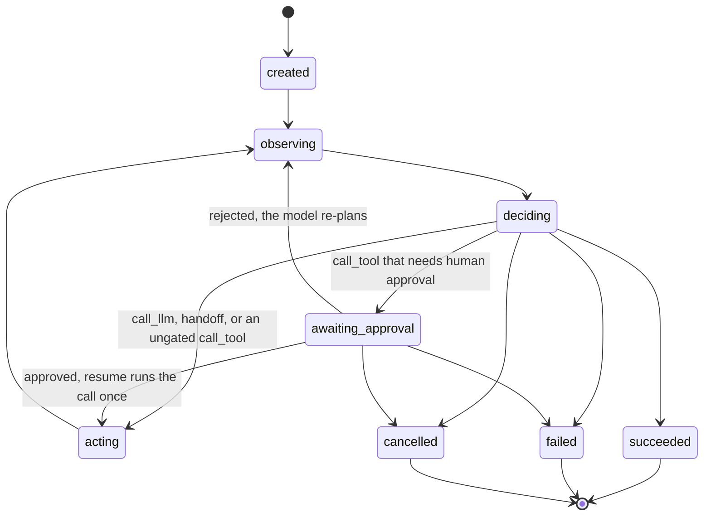

# Architecture

The runtime is a deterministic control plane around LLM and tool adapters. The LLM can propose text such as `TOOL:echo:<payload>` or `DONE:<answer>`, but it never directly executes tools.

## Runtime Loop

The core loop lives in `AgentRunner.run()`:

```text
Observe -> Decide -> Act -> Observe -> ...
```

## Observe

The runner gathers observations from the initial goal, provider outputs, and tool results. Observations are durable events.

Observation examples:

- user goal
- normalized provider output
- tool result
- cancellation signal

## Decide

The deterministic decision engine evaluates observations and safety policy. It emits a `Decision` with a `RationaleTrace` that records why an action was chosen and which alternatives were rejected.

Current deterministic rules:

- `safety.cancel-file`: cancel if the configured cancellation file exists.
- `observe.no-model-output`: call the selected provider first.
- `observe.new-user-goal`: call the provider when the user set a new goal after its latest output (a fork's
  `--goal`), so an earlier `TOOL:` or `DONE:` directive is not acted on first.
- `model.requested-tool`: call an allowlisted tool for `TOOL:<name>:<payload>`. If the tool matches the
  approval policy (`--require-approval`), the run pauses in `awaiting_approval` before the call instead.
- `tool.result-needs-synthesis`: send tool results back to the provider.
- `approval.rejected-needs-replan`: after a human rejected a tool call, ask the provider to re-plan with the
  rejection reason (an `approval:<tool>` observation) instead of running it.
- `model.done-or-budget`: finish on `DONE:<answer>` or final budget step.
- `model.needs-followup`: call the provider again for non-final text.

## Act

Actions are limited to provider calls, allowlisted tools, finish, fail, or cancel. The LLM never directly invokes tools.

## Durable Event Log

The sqlite event log stores every lifecycle transition, observation, decision, action request, action result, human-approval interrupt and decision, and failure with a per-run sequence number. A run can be replayed without calling a provider. Its `run_leases` table holds the lease of the process currently continuing each run (see [Human-In-The-Loop Interrupts](#human-in-the-loop-interrupts)); it is operational state, not part of the replayed history.

`run` creates the log file and its directory when they are missing. Commands that read a log (`replay`, `report`, `resume`, `history`, `trace`, and `fork`) never create one: a missing `--event-log` fails with `error: event log not found: <path>` and exit code 2, so a mistyped path is not mistaken for a run that recorded nothing.

## Provider Adapters

All providers implement one interface:

```text
ModelRequest -> ModelOutput
```

Adapters normalize GPT/OpenAI, Claude Code CLI, Gemini, Kimi/Moonshot, and the deterministic fake provider.

Adapters send only parameters the current models accept. The OpenAI adapter (also used for Kimi) calls Chat
Completions with `model`, `messages`, and `max_completion_tokens`, and sends no sampling parameters, reasoning effort,
or native `tools`. The tool catalog is part of the prompt and comes back as a `TOOL:` directive, so GPT-6.2, which
rejects reasoning effort `none` and calls native tools only through the Responses API, works without a Responses
client. The Gemini adapter sends only `contents`, so every Gemini 4 model, Neon included, keeps its default thinking
level. See [Provider Parameter Rules](CONFIGURATION.md#provider-parameter-rules).

## State Machine



Every non-terminal state can also move to `failed` or `cancelled`. `awaiting_approval` is the only state a run
rests in between processes: the run records an `interrupt` event and a checkpoint, exits, and a later `resume`
continues from that state after a human decided. Invalid transitions raise `InvalidTransitionError` and are covered
by tests.

## Replay

Replay reads sqlite events and prints them in sequence. Replay never calls providers or tools, so it is safe to run in CI and postmortems.

## Trace Export

`multi_bot_agentic.tracing` turns one run's events into an OpenTelemetry trace without calling providers or
tools:

```text
EventRecord[] -> parse_run() -> RunTimeline -> build_trace() -> Trace -> render_otlp_json() / push_otlp_json()
                                            \-> render_mermaid() -> Mermaid sequenceDiagram
```

- `timeline.py` pairs each decision with its `action_requested`/`action_result` events and tracks the active bot,
  handoffs, approvals, checkpoints, resumes, fork points, and the outcome.
- `spans.py` builds the GenAI span tree: a root `invoke_agent` span, `invoke_agent {bot}` spans per bot,
  `chat`/`generate_content` spans for provider calls, and `execute_tool` spans for built-in and MCP tools. Each
  carries its decision's rule id, explanation, and rejected actions. Ids are SHA-256 digests of the run id and
  event sequence numbers, so exports are deterministic. A fork's root span links to its parent run's root span.
- `otlp.py` encodes OTLP/JSON and POSTs it with stdlib `urllib` (no redirects, header values never printed).
- `mermaid.py` draws the orchestrator, bots, tools, MCP servers, and human approver as a sequence diagram.
- `privacy.py` keeps content (goal, model inputs and outputs, tool arguments and results) opt-in and redacts
  everything exported with `ObservationRedactor` and `ToolArgumentSanitizer`.

The CLI entry point is `trace`. See [OpenTelemetry Trace Export Guide](guides/OTEL_TRACE_EXPORT_GUIDE.md).

## Bot Handoff

Optional `BotSpec` registries let the decision engine accept `HANDOFF:bot_id:summary`. The runner swaps `active_bot_id` and `SafetyPolicy.allowed_tools` for the rest of that run without changing the ODA loop shape. Every `run()` starts again from the constructor's `active_bot_id`, and `resume()` restores the bot recorded in the checkpoint.

## MCP Tool Bridge

`multi_bot_agentic.mcp` lets bots use tools from any Model Context Protocol server without new dependencies:

- `StdioMcpClient` launches a server in its own process group and speaks newline-delimited JSON-RPC over stdio.
  It is dual-era: a `server/discover` probe selects the stateless MCP 2026-07-28 protocol (per-request `_meta`,
  `-32022` version retry), and any other answer or a probe timeout falls back to the legacy
  `initialize` + `notifications/initialized` handshake. The era is cached per server process.
- `McpToolset` starts every server in a Claude-Desktop-style `mcpServers` config, follows `tools/list`
  pagination, applies `allowedTools`/`deniedTools`, and wraps each tool as `McpToolAdapter` named
  `mcp__<server>__<tool>`.
- The CLI (`run`/`resume --mcp-config`) merges these adapters into the tool registry, adds them to
  `SafetyPolicy.allowed_tools`, and passes their `ToolSpec` catalog to the runner. The runner advertises only
  the currently allowed specs in `ModelRequest.tools`, and provider prompts render them as an
  `Available tools` section.

Execution still flows through the unchanged decision engine (`TOOL:<name>:<payload>`) and event log, so MCP
calls get rationale traces, replay, and resume like any other tool. See
[MCP Tool Bridge Guide](guides/MCP_TOOLS_GUIDE.md).

## Human-In-The-Loop Interrupts

`SafetyPolicy.require_approval` (CLI `--require-approval`, env `MULTIBOT_REQUIRE_APPROVAL`) names tools whose calls
need a human decision:

```text
decision call_tool X (X gated) -> deciding -> awaiting_approval + interrupt event + checkpoint(interrupt_id) -> exit 3
                                  (one transaction: a crash leaves the whole pause or none of it)
approve / reject           -> approval_decision event (atomic: first decision wins)
resume, approved           -> awaiting_approval -> acting, action_requested (atomic claim) -> tool once -> checkpoint -> loop
resume, rejected           -> checkpoint + approval:<tool> observation -> observing -> approval.rejected-needs-replan
```

- The interrupt records the tool, bot, paused step, a redacted argument preview, and the decision's rationale.
  Decisions record who, when, the decision, the reason, and edited arguments (same keys and types as the call).
- `SQLiteEventLog.append_guarded` runs a check and its appends in one `BEGIN IMMEDIATE` transaction, so double
  decisions are refused and a resume never runs an approved call a second time.
- Single owner: `run`, `resume`, and `fork` hold the run's lease (`run_leases` table, `acquire_lease` /
  `release_lease`, also one `BEGIN IMMEDIATE` transaction) while they continue a run. Another process gets
  `RunBusyError` (CLI exit 75) before it reads or writes anything; recovery from a recorded result therefore only
  happens after the earlier resume has ended. A lease whose holder died on this host (pid gone) is taken over.
- The policy is stored in `run_created` and checkpoints, restored by `resume`, and inherited by forks. A resume that
  adds entries restates its starting checkpoint with the merged policy before it advances, so a crash cannot drop
  them. `history` shows a paused step as `approval pending` (not forkable), and `trace` exports approvals as span
  events and Mermaid arrows to a human participant, with the arguments an approved call actually ran with.

See `docs/guides/HITL_INTERRUPTS_GUIDE.md`.

## HITL Approval Gate

`HitlApprovalGate` is the lower-level, caller-driven alternative: file-backed JSON approvals
(`pending`/`approved`/`rejected`) your own code polls. `record_approval` appends a request or decision to the run's
event log as an `action_result` with `kind: approval`, so `replay` and `trace` show it.

## Parallel Fan-Out

`ParallelFanOut` optionally fans capped tasks across a thread pool with caller-supplied workers. Results preserve input order; worker exceptions map to `ok=False` without a graph runtime.

## Checkpoint resume

Durable checkpoint resume for ODA runs is available via `resume`. Only interrupted runs (no
`run_completed`/`run_failed`/`run_cancelled` event) continue; a finished run returns its recorded
outcome without executing anything. See `docs/guides/CHECKPOINT_RESUME_GUIDE.md`.

## Time-Travel Forks

`AgentRunner.fork()` (CLI `fork`) branches any recorded run after step N into a new run. `history` lists the
forkable steps. `multi_bot_agentic.fork` only reads the log:

```text
EventRecord[] -> build_history() -> RunHistory (steps, forkable steps, lineage)
              -> plan_fork() -> ForkPlan (rebuilt state + overrides + checks + first decision)  [fork --dry-run]
AgentRunner.fork(): append run_forked + copies of the source's events up to step N
                    + [bot-switch handoff] + starting checkpoint, then the normal ODA loop from step N
```

- The state after step N is the latest checkpoint recorded for step N, parsed like `resume` does
  (`snapshot_from_event`). Step 0 is the goal.
- The new run starts with a `run_forked` lineage event: parent run, fork step, SHA-256 of the fork-point event,
  number and digest of the copied (inherited) events, and the overrides. The copies make the fork's `replay`,
  `report`, and `trace` self-contained.
- Checks run before anything is written. The step must have a recorded state, and the new run id must be
  unused. Bots come from the runner's registry, never from the log, and may not widen the policy allowlist.
  The budget must leave a step. A bot switch is recorded as a handoff, so the next decision is a model call under
  the new scope. A new goal is answered first (`observe.new-user-goal`).
- `report` shows parents (with a digest check) and children. `trace` adds a span link to the parent's root
  span, `multi_bot_agentic.fork.*` attributes, and a `run.forked` event, and marks inherited spans.

See `docs/guides/RUN_FORK_GUIDE.md`.

## SharedBlackboard

In-process typed scratchpad for multi-bot coordination with revision counters and size caps. See `docs/guides/SHARED_BLACKBOARD_GUIDE.md`.
