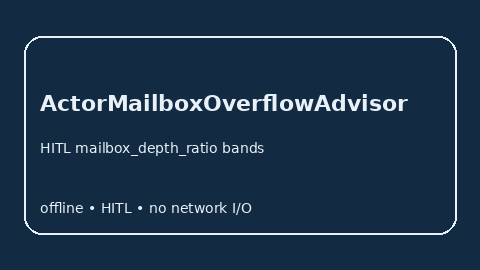

# ActorMailboxOverflowAdvisor Guide



Offline HITL `mailbox_depth_ratio` bands. Gap vs Ray/Akka/Orleans actor-mailbox overflow monitors. Distinct from `WorkerStarvationBandAdvisor` / `OrchestratorRetryStormBandAdvisor`.

Optional polish via **GPT-6 Astra / Claude Opus 5.5 / Gemini 4 Argon / Kimi K3.1 Pro**.

## Usage

```python
from multi_bot_agentic.actor_mailbox_overflow import ActorMailboxOverflowAdvisor

status = ActorMailboxOverflowAdvisor().advise("s1", mailbox_depth_ratio=0.3)
assert status.requires_human_review is True
print(status.band)
```

## Safety

Advisory only. No network I/O. Humans decide.
