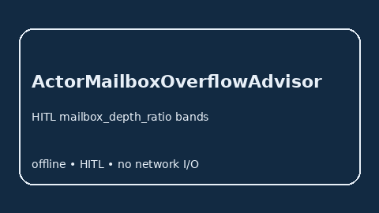

# ActorMailboxOverflowAdvisor Guide



Offline HITL `mailbox_depth_ratio` bands. Gap vs Ray/Akka/Orleans actor-mailbox overflow monitors. Distinct from `WorkerStarvationBandAdvisor` / `OrchestratorRetryStormBandAdvisor`.

Optional polish via **GPT-5.5 / Claude Sonnet 4.6 / Gemini 3.x / Kimi K2**.

## Usage

```python
from multi_bot_agentic.actor_mailbox_overflow import ActorMailboxOverflowAdvisor

status = ActorMailboxOverflowAdvisor().advise("s1", mailbox_depth_ratio=0.3)
assert status.requires_human_review is True
print(status.band)
```

## Safety

Advisory only. No network I/O. Humans decide.
