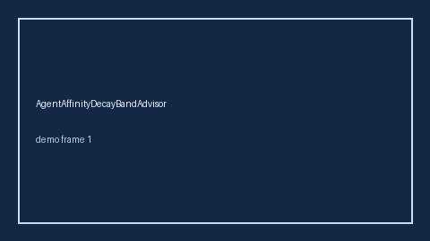

# AgentAffinityDecayBandAdvisor Guide



Offline helper.
Gap vs LangGraph/CrewAI/AutoGen agent affinity-decay monitors. Distinct from `AgentAffinitySkewBandAdvisor` / `StickyBotAffinityStore`.

Stack: **GPT-5.5 / Claude Sonnet 4.6 / Gemini 3.x / Kimi K2**.

## Usage

```python
from multi_bot_agentic.agent_affinity_decay_band import AgentAffinityDecayBandAdvisor

status = AgentAffinityDecayBandAdvisor().advise("session-1", decay_ratio=0.35)
assert status.requires_human_review is True
print(status.band)
```

## Safety

Advisory only. No network I/O. Never auto-acts. Humans decide.
