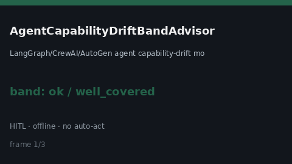

# AgentCapabilityDriftBandAdvisor Guide



HITL `drift_ratio` band guard.
Gap vs LangGraph/CrewAI/AutoGen agent capability-drift monitors. Distinct from `BotCapabilityDriftAdvisor` / `ToolSchemaCompatBandAdvisor`.

Stack: **GPT-6.1 / Claude Sonnet 5.5 / Gemini 3.x / Kimi K3**.

## Usage

```python
from multi_bot_agentic.agent_capability_drift_band import AgentCapabilityDriftBandAdvisor

status = AgentCapabilityDriftBandAdvisor(soft_limit=0.2, hard_limit=0.5).advise(
    "sess-1",
    drift_ratio=0.35,
)
print(status.band, status.requires_human_review)
```

## Safety

Advisory only. No network I/O. Never auto-acts. Humans decide.
