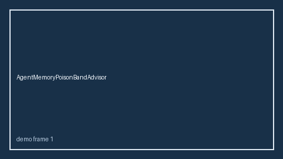

# AgentMemoryPoisonBandAdvisor Guide



HITL band advisor for `poison_ratio`.
Gap vs LangGraph/CrewAI/AutoGen agent-memory poison monitors. Distinct from `SharedMemoryConflictBandAdvisor` / `PromptLeakBandAdvisor`.

Stack: **GPT-6 Astra / Claude Opus 5.5 / Gemini 4 Argon / Kimi K3.1 Pro**.

## Usage

```python
from multi_bot_agentic.agent_memory_poison_band import AgentMemoryPoisonBandAdvisor

status = AgentMemoryPoisonBandAdvisor().advise("session-1", poison_ratio=0.3)
assert status.requires_human_review is True
print(status.band)
```

## Safety

Advisory only. No network I/O. Humans decide.
