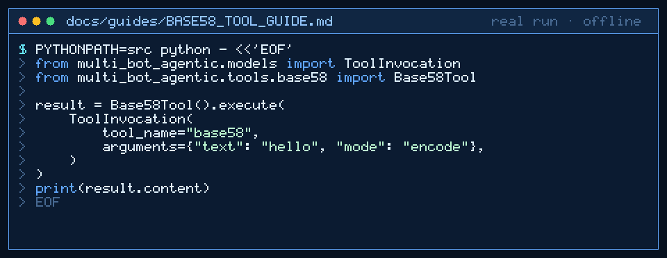

# base58 Tool Guide



Encode or decode UTF-8 text with Bitcoin-alphabet Base58 before the next
GPT-6 Astra / Claude Opus 5.5 / Gemini 4 Argon / Kimi K3.1 Pro turn.

## Why

Agent pipelines often need an opaque encoding that avoids lookalike characters
(`0`/`O`/`I`/`l`). Models invent alphabet mistakes. `base58` uses the Bitcoin
Base58 alphabet only, with no network access.

## Usage

```python
from multi_bot_agentic.models import ToolInvocation
from multi_bot_agentic.tools.base58 import Base58Tool

result = Base58Tool().execute(
    ToolInvocation(
        tool_name="base58",
        arguments={"text": "hello", "mode": "encode"},
    )
)
print(result.content)
```

Decode with `mode=decode`. The `data` argument is accepted as an alias for
`text`. Whitespace in Base58 input is ignored.

## Bounds & Safety

- Max text 20_000 chars
- Modes: `encode` (default) or `decode`
- Alphabet: Bitcoin Base58
- Never executes code or makes network requests
