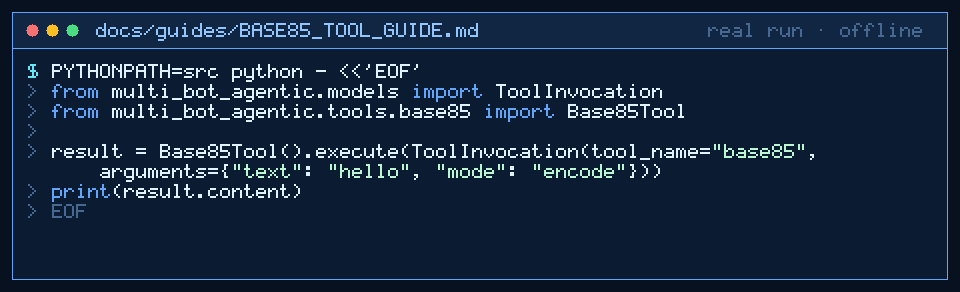

# base85 Tool Guide



Denser-than-Base64 opaque handoffs before the next GPT-6 Astra / Claude Opus 5.5 / Gemini 4 Argon / Kimi K3.1 Pro turn.

## Why

Denser-than-Base64 opaque handoffs. Complements existing base32/base58/base64 tools (parity with encoding suites in popular agent runtimes).

## Usage

```python
tool.execute(ToolInvocation(tool_name="base85", arguments={"text": "hello", "mode": "encode"}))
```

## Bounds & Safety

- Max text 20_000 chars
- Modes: `encode` (default) or `decode`
- Alphabet: Adobe ASCII85 via stdlib base64.a85
- Never executes code or makes network requests
