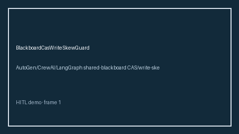

# BlackboardCasWriteSkewGuard Guide



Offline HITL guard. Never network I/O. Closes gaps vs AutoGen/CrewAI/LangGraph shared-blackboard CAS/write-skew guards.

Optional polish via **GPT-5.5 / Claude Sonnet 4.6 / Gemini 3.x / Kimi K2**.

Distinct from `SharedBlackboardWriteLease` / `BlackboardWriteAmplificationGuard`.

## Usage

```python
from multi_bot_agentic.blackboard_cas_write_skew import BlackboardCasWriteSkewGuard

status = BlackboardCasWriteSkewGuard().advise("s1", write_skew_score=0.3000)
assert status.requires_human_review is True
print(status.band)
```

## Safety

Always `requires_human_review=True`. No HTTP. Humans decide.
