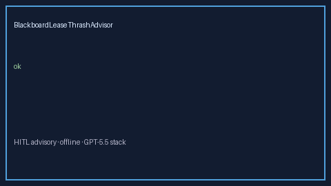

# BlackboardLeaseThrashAdvisor Guide



Offline HITL advisor for `thrash_ratio` bands.
Gap vs LangGraph/CrewAI/AutoGen blackboard lease-thrash monitors. Distinct from `BlackboardWriteLease` / `BlackboardStaleEntryAdvisor`.

Optional polish via **GPT-5.5 / Claude Sonnet 4.6 / Gemini 3.x / Kimi K2**.

## Usage

```python
from multi_bot_agentic.blackboard_lease_thrash import BlackboardLeaseThrashAdvisor

status = BlackboardLeaseThrashAdvisor().advise("s1", thrash_ratio=0.3)
assert status.requires_human_review is True
print(status.band)
```

## Safety

Advisory only. No network I/O. Humans decide.
