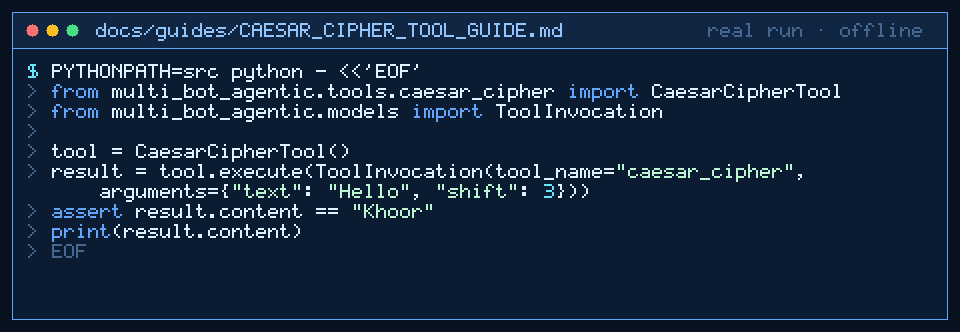

# Caesar Cipher Tool Guide



Deterministic Caesar cipher for GPT-6 Astra / Claude Opus 5.5 / Gemini 4 Argon / Kimi K3.1 Pro workers.

## Why

Models miscalculate letter wrapping. This tool shifts alphabetic characters by a configurable amount with no network.

## Usage

```python
from multi_bot_agentic.tools.caesar_cipher import CaesarCipherTool
from multi_bot_agentic.models import ToolInvocation

tool = CaesarCipherTool()
result = tool.execute(ToolInvocation(tool_name="caesar_cipher", arguments={"text": "Hello", "shift": 3}))
assert result.content == "Khoor"
print(result.content)
```

## Bounds

- Max 20000 characters
- Default shift: 13 (ROT13-equivalent)
- Preserves upper/lower case
- Non-alpha characters pass through

## Safety

Allowlisted; no network; no file access.
