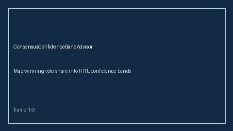

# ConsensusConfidenceBandAdvisor Guide



Map winning vote share into HITL confidence bands. Never performs network I/O. Optional polish via **GPT-6 Astra / Claude Opus 5.5 / Gemini 4 Argon / Kimi K3.1 Pro**.

## Usage

```python
from multi_bot_agentic.consensus_confidence_band import ConsensusConfidenceBandAdvisor
# see unit tests for examples
```
