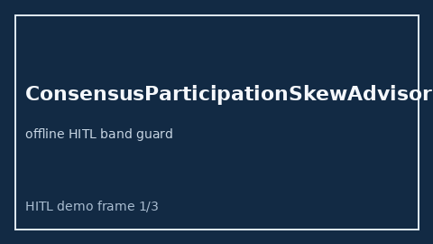

# ConsensusParticipationSkewAdvisor Guide



Offline HITL advisor for `skew_ratio` bands.
Gap vs LangGraph/CrewAI/AutoGen consensus participation-skew monitors. Distinct from `CriticDisagreementSpreadAdvisor` / `WorkerStarvationBandAdvisor`.

Optional polish via **GPT-5.5 / Claude Sonnet 4.6 / Gemini 3.x / Kimi K2**.

## Usage

```python
from multi_bot_agentic.consensus_participation_skew import ConsensusParticipationSkewAdvisor

status = ConsensusParticipationSkewAdvisor().advise("s1", skew_ratio=0.3)
print(status.band)
```

## Safety

Advisory only. No network I/O. Humans decide.
