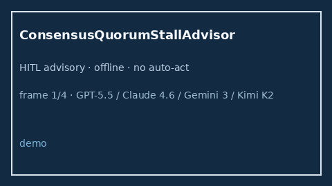

# ConsensusQuorumStallAdvisor Guide



Offline HITL `stall_ratio` bands.
Gap vs LangGraph/CrewAI/AutoGen consensus quorum-stall monitors. Distinct from `ConsensusQuorumBandGuard` / `ConsensusTimeoutBandGuard`.

Stack: **GPT-5.5 / Claude Sonnet 4.6 / Gemini 3.x / Kimi K2**.

## Usage

```python
from multi_bot_agentic.consensus_quorum_stall import ConsensusQuorumStallAdvisor

status = ConsensusQuorumStallAdvisor().advise("session-1", stall_ratio=0.4)
assert status.requires_human_review is True
print(status.band)
```

## Safety

Advisory only. No network I/O. Never auto-acts.
