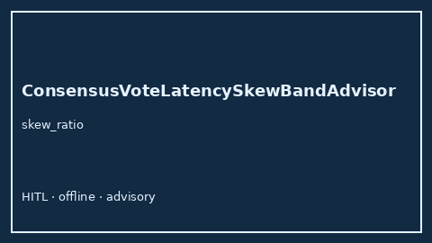

# ConsensusVoteLatencySkewBandAdvisor Guide



Offline HITL `skew_ratio` band advisor.
Gap vs LangGraph/CrewAI/AutoGen consensus vote latency-skew monitors. Distinct from `ConsensusQuorumStallAdvisor` / `ConsensusConfidenceBandAdvisor`.

Stack: **GPT-5.5 / Claude Sonnet 4.6 / Gemini 3.x / Kimi K2**.

## Usage

```python
from multi_bot_agentic.consensus_vote_latency_skew_band import ConsensusVoteLatencySkewBandAdvisor

status = ConsensusVoteLatencySkewBandAdvisor().advise("session-1", skew_ratio=0.85)
assert status.requires_human_review is True
print(status.band)
```

## Safety

Advisory only. No network I/O. Humans decide.
