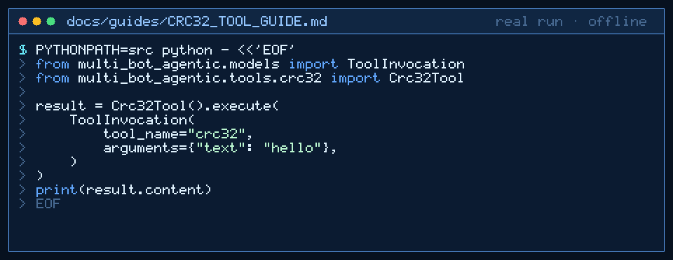

# crc32 Tool Guide



Compute deterministic CRC32 checksums for content-integrity checks before the
next GPT-6 Astra / Claude Opus 5.5 / Gemini 4 Argon / Kimi K3.1 Pro turn.

## Why

Agent pipelines need a stable CRC32 fingerprint when comparing handoff blobs
or cache keys. Models invent digests; `crc32` uses stdlib `zlib` with no
network access (inspired by content-integrity tooling in agent pipelines).

## Usage

```python
from multi_bot_agentic.models import ToolInvocation
from multi_bot_agentic.tools.crc32 import Crc32Tool

result = Crc32Tool().execute(
    ToolInvocation(
        tool_name="crc32",
        arguments={"text": "hello"},
    )
)
print(result.content)
```

## Bounds & Safety

- Required: `text` (max 100_000 chars)
- Content is the unsigned hexadecimal CRC32 digest; metadata includes `crc32`
- Never executes code or makes network requests
