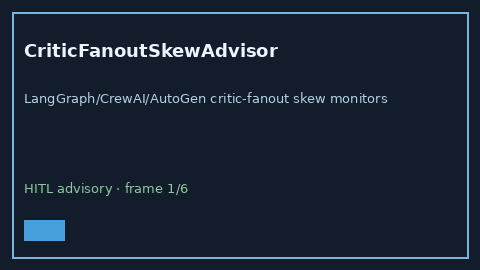

# CriticFanoutSkewAdvisor Guide



Offline HITL `skew_ratio` bands.
Gap vs LangGraph/CrewAI/AutoGen critic-fanout skew monitors. Distinct from `PlannerCriticOscillationBandAdvisor` / `PlannerToolMismatchBandAdvisor`.

Stack: **GPT-5.5 / Claude Sonnet 4.6 / Gemini 3.x / Kimi K2**.

## Usage

```python
from multi_bot_agentic.critic_fanout_skew import CriticFanoutSkewAdvisor

status = CriticFanoutSkewAdvisor().advise("session-1", skew_ratio=0.4)
assert status.requires_human_review is True
print(status.band)
```

## Safety

Advisory only. No network I/O. Never auto-acts. Humans decide.
