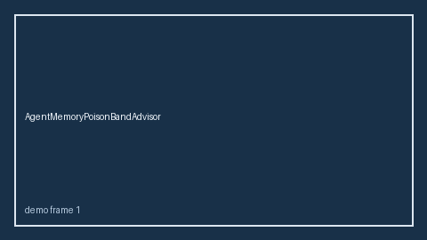

# CriticLatencySkewBandAdvisor Guide



Offline HITL `skew_ratio` bands.
Gap vs LangGraph/CrewAI/AutoGen critic latency-skew monitors. Distinct from `CriticLatencySloBandGuard` / `CriticTimeoutBandGuard`.

Stack: **GPT-6 Astra / Claude Opus 5.5 / Gemini 4 Argon / Kimi K3.1 Pro**.

## Usage

```python
from multi_bot_agentic.critic_latency_skew_band import CriticLatencySkewBandAdvisor

status = CriticLatencySkewBandAdvisor().advise("session-1", skew_ratio=0.3)
assert status.requires_human_review is True
print(status.band)
```

## Safety

Advisory only. No network I/O. Never auto-acts.
