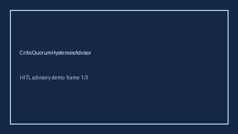

# CriticQuorumHysteresisAdvisor Guide



Offline HITL guard. Never network I/O. Closes gaps vs AutoGen/CrewAI/LangGraph critic-quorum hysteresis monitors.

Optional polish via **GPT-5.5 / Claude Sonnet 4.6 / Gemini 3.x / Kimi K2**.

Distinct from `ConsensusQuorumBandGuard` / `CriticSelfConsistencyBandGuard`.

## Usage

```python
from multi_bot_agentic.critic_quorum_hysteresis import CriticQuorumHysteresisAdvisor

status = CriticQuorumHysteresisAdvisor().advise("s1", hysteresis_score=0.3000)
assert status.requires_human_review is True
print(status.band)
```

## Safety

Always `requires_human_review=True`. No HTTP. Humans decide.
