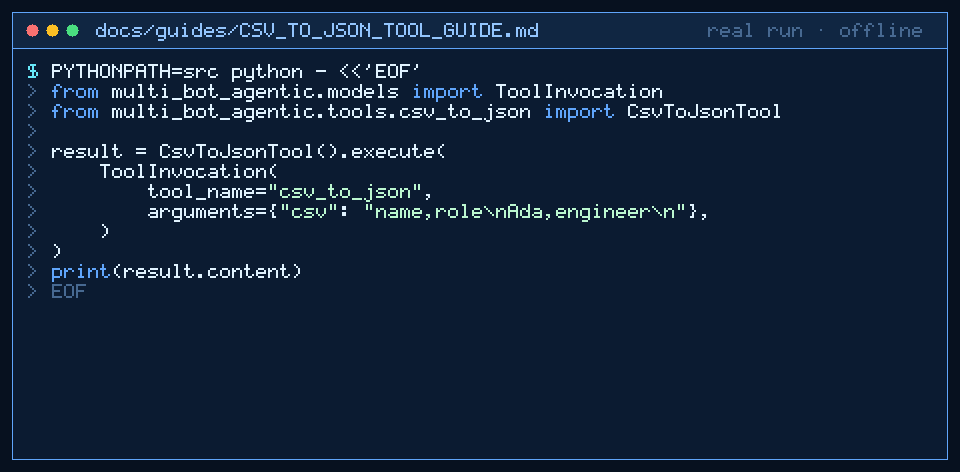

# csv_to_json Tool Guide



Parse CSV text into a JSON array of objects before the next GPT-6 Astra /
Claude Opus 5.5 / Gemini 4 Argon / Kimi K3.1 Pro turn.

## Why

Agent pipelines need stable header-keyed records from small CSV exports.
Models invent keys and shift columns; `csv_to_json` uses stdlib `csv` with a
required header row and hard caps on size, rows, and columns. No network
access.

## Usage

```python
from multi_bot_agentic.models import ToolInvocation
from multi_bot_agentic.tools.csv_to_json import CsvToJsonTool

result = CsvToJsonTool().execute(
    ToolInvocation(
        tool_name="csv_to_json",
        arguments={"csv": "name,role\nAda,engineer\n"},
    )
)
print(result.content)
```

Optional `delimiter` overrides `,`. The `text` argument is accepted as an
alias for `csv`.

## Bounds & Safety

- Required: `csv` (max 20_000 chars); non-blank unique header row
- Caps: 500 body rows, 64 columns
- Content is pretty JSON (array of objects); metadata includes `rows`,
  `columns`, `header`
- Never executes code or makes network requests
