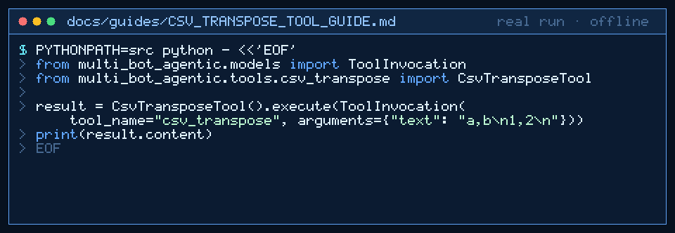

# csv_transpose Tool Guide



Transpose CSV tables before GPT-6 Astra / Claude Opus 5.5 / Gemini 4 Argon / Kimi K3.1 Pro
turns. Inspired by spreadsheet transpose helpers in popular agent toolkits.

## Usage

```python
from multi_bot_agentic.models import ToolInvocation
from multi_bot_agentic.tools.csv_transpose import CsvTransposeTool

result = CsvTransposeTool().execute(ToolInvocation(tool_name="csv_transpose", arguments={"text": "a,b\n1,2\n"}))
print(result.content)
```

## Bounds & Safety

- Max 20_000 chars, 500 rows, 64 columns
- Short rows are padded; malformed CSV is rejected
- Never executes code or makes network requests
