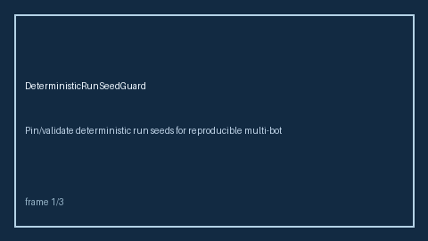

# DeterministicRunSeedGuard Guide



Pin/validate deterministic run seeds for reproducible multi-bot runs. Never performs network I/O. Optional polish via **GPT-6 Astra / Claude Opus 5.5 / Gemini 4 Argon / Kimi K3.1 Pro**.

## Usage

```python
from multi_bot_agentic.deterministic_run_seed import DeterministicRunSeedGuard
# see unit tests for examples
```
