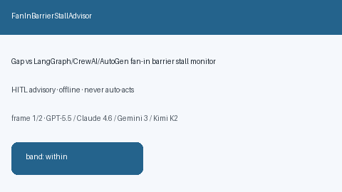

# FanInBarrierStallAdvisor Guide



Offline HITL `stall_ratio` bands.
Gap vs LangGraph/CrewAI/AutoGen fan-in barrier stall monitors. Distinct from `SupervisorIdleSkewAdvisor` / `WorkerStarvationBandAdvisor`.

Stack: **GPT-6 Astra / Claude Opus 5.5 / Gemini 4 Argon / Kimi K3.1 Pro**.

## Usage

```python
from multi_bot_agentic.fan_in_barrier_stall import FanInBarrierStallAdvisor

status = FanInBarrierStallAdvisor().advise("s1", stall_ratio=0.4)
assert status.requires_human_review is True
print(status.band)
```

## Safety

Advisory only. No network I/O. Never auto-acts.
