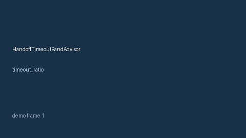

# HandoffTimeoutBandAdvisor Guide



Offline HITL advisor for `timeout_ratio` bands. Gap vs LangGraph/CrewAI/AutoGen handoff-timeout band monitors. Distinct from `AgentHandoffLatencyTracker` / `CriticTimeoutBandGuard`.

Optional polish via **GPT-5.5 / Claude Sonnet 4.6 / Gemini 3.x / Kimi K2**.

## Usage

```python
from multi_bot_agentic.handoff_timeout_band import HandoffTimeoutBandAdvisor

status = HandoffTimeoutBandAdvisor().advise("s1", timeout_ratio=0.3)
assert status.requires_human_review is True
print(status.band)
```

## Safety

Advisory only. No network I/O. Humans decide.
