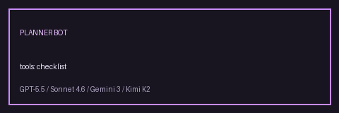

# HITL Approval Gate Guide



File-backed human-in-the-loop approvals for GPT-6 Astra / Claude Opus 5.5 / Gemini 4 Argon / Kimi K3.1 Pro tool calls.

## Why

Some tools (deploy, shell, payments) should not execute until an operator says
yes. LangGraph offers interrupt/resume; CrewAI/AutoGen expose human-input nodes.
This module adds a thin, durable JSON gate you can poll without rewriting the
ODA runner for v1.

## What This Adds

- `ApprovalDecision` (`pending` / `approved` / `rejected`)
- `ApprovalRequest` dataclass
- `HitlApprovalGate.requires_approval` / `request` / `resolve` / `poll`
- One JSON file per request under `approval_dir`

## Gap vs CrewAI / AutoGen / LangGraph

| Capability | multi-bot-agentic | CrewAI / AutoGen / LangGraph |
| --- | --- | --- |
| Pause signal | Explicit gate API | Human-input / interrupt nodes |
| Persistence | JSON files on disk | Framework checkpoints |
| Runner coupling | Optional (caller-driven) | Built into graph/crew runtime |
| Audit | Request JSON + status | Framework traces |

## Usage

```python
from pathlib import Path
from multi_bot_agentic.approval import ApprovalDecision, HitlApprovalGate

gate = HitlApprovalGate(
    approval_dir=Path("/tmp/approvals"),
    tools_requiring_approval=frozenset({"deploy", "shell"}),
)

if gate.requires_approval("deploy"):
    req = gate.request(run_id="run-1", tool_name="deploy", payload="canary")
    # operator / UI later:
    gate.resolve(req.request_id, ApprovalDecision.APPROVED)
    assert gate.poll(req.request_id) is ApprovalDecision.APPROVED
```

## Safety

- Only tools listed in `tools_requiring_approval` can create requests.
- `resolve(..., PENDING)` is rejected; already-resolved requests cannot flip.
- Request ids are plain filenames; path traversal characters are rejected.
- v1 does not auto-wire `AgentRunner`; integrate at the call site when ready.

## Recording Approvals In The Event Log

`record_approval` appends a request or a decision to the run's durable event log as an `action_result` with
`kind: "approval"`. It records the request id, tool, and status, never the payload text. `replay` lists the
event, and `trace` exports it as a `multi_bot_agentic.approval` span event and a human-approver arrow in the
Mermaid diagram:

```python
from multi_bot_agentic.approval import record_approval

request = gate.request(run_id="run-1", tool_name="deploy", payload="canary")
record_approval(event_log, request)  # pending
record_approval(event_log, gate.resolve(request.request_id, ApprovalDecision.APPROVED))
```

See [OpenTelemetry Trace Export Guide](OTEL_TRACE_EXPORT_GUIDE.md).
