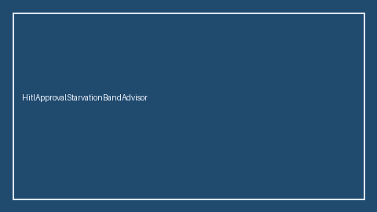

# HitlApprovalStarvationBandAdvisor Guide



HITL `starvation_ratio` band guard.
Gap vs LangGraph/CrewAI/AutoGen HITL approval-starvation monitors. Distinct from `HitlTimeoutCascadeBandAdvisor` / `HitlApprovalGate`.

Stack: **GPT-6 Astra / Claude Opus 5.5 / Gemini 4 Argon / Kimi K3.1 Pro**.

## Usage

```python
from multi_bot_agentic.hitl_approval_starvation_band import HitlApprovalStarvationBandAdvisor

status = HitlApprovalStarvationBandAdvisor(soft_limit=0.2, hard_limit=0.5).advise(
    "sess-1",
    starvation_ratio=0.35,
)
print(status.band, status.requires_human_review)
```

## Safety

Advisory only. No network I/O. Never auto-acts. Humans decide.
