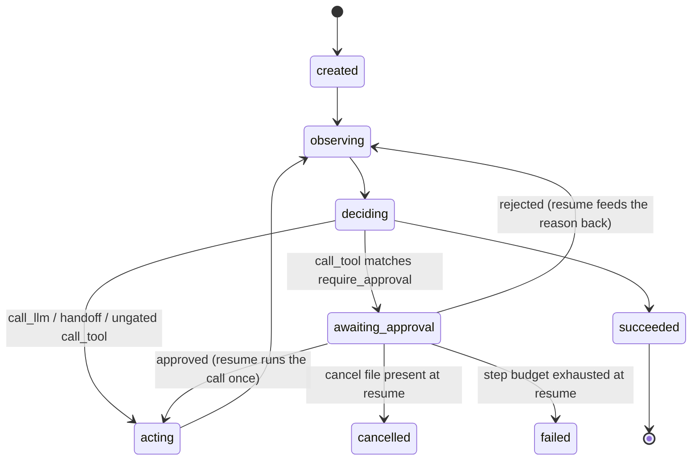

# Human-in-the-Loop Interrupts Guide


A run can now **pause durably before a sensitive tool call**, wait for a human to **approve, edit, or reject** the
call from the CLI, and then **resume exactly where it stopped**:

- `run --require-approval checklist` stops the run when the decision engine selects `checklist`. Nothing is
  executed. The run moves to the new `awaiting_approval` state, appends an `interrupt` event and a checkpoint, and
  exits with code **3**.
- `approvals list` / `approvals show` display what the run is waiting for: tool, bot, step, a redacted argument
  preview, and the rationale of the decision.
- `approve` (optionally with `--args` to edit the call) or `reject --reason` records the decision in the durable
  event log: who decided, when, why, and whether the arguments were edited.
- `resume` continues the run. An approved call runs **exactly once**, with the edited arguments if any. A rejected
  call never runs; the rejection is fed back to the model as an observation, and the model re-plans.

Everything is an event in the run's SQLite log, so `replay`, `report`, `history`, and `trace` show the interrupt
and the decision, and a paused run survives process exits, restarts, and machines. Works the same with the
offline fake provider, GPT-6.2 Sol, Claude Opus 5.5, Gemini 4 Neon, Kimi K3.1 Pro, and MCP tools.

## Contents

- [Why](#why)
- [Prerequisites](#prerequisites)
- [Quickstart](#quickstart)
- [How It Works](#how-it-works)
- [CLI Reference](#cli-reference)
- [Python API](#python-api)
- [Worked Examples](#worked-examples)
- [Configuration](#configuration)
- [Interaction With Other Features](#interaction-with-other-features)
- [Event Reference](#event-reference)
- [Safety](#safety)
- [Limitations And Roadmap](#limitations-and-roadmap)
- [Troubleshooting](#troubleshooting)
- [FAQ](#faq)
- [How This Demo Was Recorded](#how-this-demo-was-recorded)

## Why

Agents that call tools with side effects (deploys, payments, emails, file writes, MCP tools of other systems) need
a human checkpoint before the call, not a log entry after it. The popular agent frameworks all ship this as a
first-class, *durable* pause/resume flow. Before this feature, multi-bot-agentic only had the caller-driven
[`HitlApprovalGate`](HITL_APPROVAL_GATE_GUIDE.md): a JSON file per request that your own code had to poll. The
runner never paused, the run state machine had no waiting state, and the CLI had no way to decide.

| Capability | [LangGraph interrupts](https://docs.langchain.com/oss/python/langgraph/interrupts) | [OpenAI Agents SDK HITL](https://openai.github.io/openai-agents-python/human_in_the_loop/) | [Pydantic AI deferred tools](https://pydantic.dev/docs/ai/tools-toolsets/deferred-tools/) | multi-bot-agentic before | multi-bot-agentic now |
| --- | --- | --- | --- | --- | --- |
| Mark calls that need a human | `interrupt()` inside a node | `needs_approval=True` or a callable; MCP `require_approval` | `requires_approval=True`, `ApprovalRequired` | `HitlApprovalGate(tools_requiring_approval=...)`, not wired to the runner | `--require-approval TOOL[,TOOL]` / `MULTIBOT_REQUIRE_APPROVAL`, names or `fnmatch` patterns such as `mcp__*` |
| Durable pause | checkpointer + `thread_id` | `RunState.to_json()` / `from_json()` | `DeferredToolRequests` output + message history | none | `interrupt` event + checkpoint + `awaiting_approval` state, exit code 3 |
| Inspect pending calls | `__interrupt__` / `stream.interrupts` | `result.interruptions` (`ToolApprovalItem`) | `DeferredToolRequests.approvals` | read the JSON files | `approvals list`, `approvals show` |
| Approve / edit / reject | `Command(resume=...)` | `state.approve()` / `state.reject()` | `DeferredToolResults` with `ToolApproved(override_args=...)` / `ToolDenied(message)` | rewrite the JSON file | `approve [--args JSON]`, `reject --reason` |
| Rejection feedback to the model | value passed to `Command(resume=...)` | rejection message as the tool output | `ToolDenied` message | none | `approval:<tool>` observation + `approval.rejected-needs-replan` rule |
| Continue where it stopped | re-invoke the graph | `Runner.run(agent, state)` | follow-up run with the history | none | `resume --run-id` (exactly-once execution of the approved call) |
| Audit trail | checkpoint history | traces | message history | request files | `interrupt` and `approval_decision` events in `replay`, `report`, `history`, `trace` |

What this repository adds on top: the pause is a state of the **explicit run state machine**, the decision is an
**append-only audit event** (never an overwrite), double decisions and concurrent resumes are refused
**atomically**, a typo in the policy is refused instead of silently disabling a gate, and the rationale trace of
the paused decision is shown to the approver. What it leaves out (see
[Limitations And Roadmap](#limitations-and-roadmap)): sticky "always approve" decisions, approval timeouts, a
web inbox, and per-call approval callbacks.

## Prerequisites

- Python 3.10, 3.11, or 3.12 and `python -m pip install -e ".[dev]"` (no new dependencies).
- Any provider. The examples use the deterministic `fake` provider, which asks for the `checklist` tool on its
  first turn, so they run offline and need no API key.
- `jq` is used only to shorten JSON in the examples.

## Quickstart

```bash
# 1. Start a run that must not call `checklist` without a human decision. It pauses and exits with code 3.
multi-bot-agentic run --goal "Create a launch checklist" --provider fake \
  --event-log data/runs.sqlite --run-id demo --require-approval checklist
echo "exit code: $?"

# 2. See what it is waiting for.
multi-bot-agentic approvals list --event-log data/runs.sqlite
multi-bot-agentic approvals show <interrupt-id> --event-log data/runs.sqlite

# 3a. Approve it, optionally editing the call's arguments ...
multi-bot-agentic approve --run-id demo --event-log data/runs.sqlite --by alice \
  --args '{"text": "Create a launch checklist with a rollback plan"}'
# 3b. ... or reject it with a reason the model will see:
#     multi-bot-agentic reject --run-id demo --event-log data/runs.sqlite --reason "use the release template"

# 4. Continue exactly where the run stopped.
multi-bot-agentic resume --run-id demo --event-log data/runs.sqlite

# 5. Audit it.
multi-bot-agentic replay --event-log data/runs.sqlite --run-id demo --format text
multi-bot-agentic report --event-log data/runs.sqlite --run-id demo
multi-bot-agentic history --event-log data/runs.sqlite --run-id demo
multi-bot-agentic trace --event-log data/runs.sqlite --run-id demo --format mermaid
```

`approve` and `reject` take either the interrupt id (`int-` + 12 hex digits, printed by `run` and
`approvals list`) or `--run-id` to decide the interrupt that run is paused at.

## How It Works



1. **Pause.** After the decision engine picks `call_tool` for a tool that matches the approval policy, the runner
   first checks that the tool is allowlisted and registered (a human is never asked to approve a call that could
   not run). It then transitions `deciding -> awaiting_approval`, appends an `interrupt` event, writes a checkpoint
   that carries the interrupt id, and returns. The tool is not executed and the provider is not called.
2. **Decide.** `approve` / `reject` appends one `approval_decision` event. The check ("is the run still paused at
   this interrupt, and undecided?") and the append run in a single SQLite `BEGIN IMMEDIATE` transaction, so the
   first decision wins even when two people decide at the same moment.
3. **Resume.** `resume` sees that the latest checkpoint is an interrupt checkpoint and acts on its decision
   instead of re-running the step:
   - **approved**: `awaiting_approval -> acting`, `action_requested` (tagged with the interrupt id; this append is
     an atomic *claim*, so two concurrent resumes can never both run the call), the tool runs with the effective
     arguments (edited or original), `action_result` (tagged), a checkpoint, then the normal loop continues;
   - **rejected**: the run appends a checkpoint whose observations end with an `approval:<tool>` observation
     (`REJECTED:<tool>: a human reviewer rejected this tool call, so it did not run. Reason: ...`), then
     `awaiting_approval -> observing`. The engine's `approval.rejected-needs-replan` rule asks the model to re-plan.
     The fake provider re-plans by finishing without the tool; a real model sees the reason in its prompt.
4. **Before acting**, `resume` checks the cancellation file (cancels the run, nothing runs) and the step budget
   (the paused step counts; a smaller `--max-steps` fails the run without running the call).

A crashed resume never causes a second execution: if an earlier resume already claimed the interrupt and recorded
the tool result, the next `resume` continues from the **recorded** result; if it claimed it but recorded no result,
`resume` refuses (fork an earlier step to retry deliberately).

## CLI Reference

### Exit codes

| Command | 0 | 2 | 3 |
| --- | --- | --- | --- |
| `run`, `fork`, `resume` | the run succeeded | failed, cancelled, or a usage error | **the run is paused awaiting approval** (or `resume` was refused because nobody decided yet) |
| `approve`, `reject` | decision recorded | refused; nothing was written | - |
| `approvals list`, `approvals show` | printed | missing/unreadable log, unknown run or interrupt | - |

### `--require-approval TOOL[,TOOL]` (on `run`, `fork`, `resume`)

Tool names or `fnmatch` patterns (`*`, `?`, `[abc]`), comma-separated, repeatable. Matching is case-sensitive.
Examples: `--require-approval checklist`, `--require-approval 'mcp__*'`, `--require-approval json_format,regex*`.

- On `run`, it replaces `MULTIBOT_REQUIRE_APPROVAL`. Every entry must match at least one registered tool (built-in,
  or MCP with `--mcp-config`), otherwise the command exits 2 before writing anything, so a typo can never disable a
  gate. An empty value (`--require-approval ""`) is refused too.
- The policy is recorded in the run (`run_created` and every checkpoint). `resume` always keeps the recorded
  policy; `--require-approval` on `resume` can only add tools.
- `fork` inherits the source run's policy at the fork point; `--require-approval` adds to it. `fork --dry-run`
  prints the resulting `require_approval` and whether the fork's first decision `needs_approval`.

### `approvals list`

```text
multi-bot-agentic approvals list --event-log PATH [--run-id RUN] [--all] [--format text|json]
```

Lists **pending** interrupts (all runs, or one run). `--all` also lists decided and expired ones. Read-only; never
creates a missing log. Statuses: `pending` (the run is paused, undecided), `approved`, `rejected`, `expired` (the
run moved on without a decision, for example it was cancelled while paused). The text table shows the effective
argument preview, marked `(edited)` when the approver changed it.

### `approvals show`

```text
multi-bot-agentic approvals show INTERRUPT_ID --event-log PATH [--run-id RUN] [--format text|json]
```

Shows one interrupt: run, step, bot, tool, the call's arguments (redacted, not truncated), when it was requested,
the rule and rationale that selected the call, and the decision (who, when, reason, edited arguments) and progress
(`waiting for resume`, `resumed`, `executed`). `--run-id` is needed only if the same id is paused in two runs, which
cannot happen through the CLI (forks copy only decided interrupts).

### `approve`

```text
multi-bot-agentic approve [INTERRUPT_ID] --event-log PATH [--run-id RUN] [--by NAME] [--reason TEXT] [--args JSON]
```

| Option | Default | Meaning |
| --- | --- | --- |
| `INTERRUPT_ID` | the interrupt `--run-id` is paused at | which call to approve |
| `--by` | the OS user (`getpass.getuser()`) | who decides, recorded verbatim |
| `--reason` | none | why, recorded (at most 1,000 characters) |
| `--args` | keep the model's arguments | replacement arguments: a JSON object with **exactly the same keys, each with the same JSON type** as the requested call (`TOOL:` directives always produce `{"text": "..."}`), at most 65,536 characters of JSON; identical arguments are not recorded as an edit |

### `reject`

```text
multi-bot-agentic reject [INTERRUPT_ID] --event-log PATH [--run-id RUN] [--by NAME] --reason TEXT
```

`--reason` is required (at most 1,000 characters): it is recorded and shown to the model so it can re-plan.

### Errors (no tracebacks; nothing is written)

| Situation | Message (abridged) | Exit |
| --- | --- | --- |
| Second decision on one interrupt | `interrupt int-... was already approved by alice at ...; a decision cannot be changed` | 2 |
| Unknown interrupt | `interrupt int-... not found in event log ...; list them with 'approvals list --all'` | 2 |
| Run not paused / finished / cancelled while paused | `run demo is not paused at an interrupt (state succeeded)` or `interrupt int-... expired: run ... is no longer paused at it` | 2 |
| `resume` before a decision | `run demo is awaiting approval of interrupt int-... (checklist in step 2); nothing was resumed` | 3 |
| `resume` of a finished run | `note: run demo already finished (succeeded); nothing to resume` (the recorded outcome is printed, as before) | 0/2 |
| Two resumes race for one approved call | `interrupt int-... of run demo was resumed by another process; nothing was executed here` | 2 |
| Approved tool missing in this resume (for example no `--mcp-config`) | `cannot run approved interrupt int-...: tool is not registered: ...; resume with the same tools as the run` | 2 |
| Bad `--args` | `--args is not valid JSON: ...`, `--args must be a JSON object, got array`, `--args must have exactly the keys of the requested call (text), got query`, `--args key 'text' must be a string, got number` | 2 |
| Policy typo | `require-approval matches no registered tool: chekclist (...)` | 2 |
| `reject` without `--reason` | argparse usage error | 2 |

## Python API

```python
from pathlib import Path

from multi_bot_agentic.approval import ApprovalDecision, decide_interrupt
from multi_bot_agentic.event_log import SQLiteEventLog
from multi_bot_agentic.llm.fake import FakeLLMAdapter
from multi_bot_agentic.models import RunState
from multi_bot_agentic.runner import AgentRunner, build_default_tools
from multi_bot_agentic.safety import SafetyPolicy

log = SQLiteEventLog(Path("data/runs.sqlite"))
runner = AgentRunner(
    provider=FakeLLMAdapter(),
    event_log=log,
    tools=build_default_tools(Path.cwd()),
    safety_policy=SafetyPolicy(require_approval=frozenset({"checklist"})),
)
paused = runner.run("Create a launch checklist", run_id="lib-demo")
assert paused.state is RunState.AWAITING_APPROVAL and paused.interrupt is not None
print(paused.interrupt.tool, paused.interrupt.step, paused.interrupt.arguments_preview)

decide_interrupt(
    log,
    paused.interrupt.interrupt_id,
    ApprovalDecision.APPROVED,
    decided_by="alice",
    arguments={"text": "Create a launch checklist with a rollback plan"},
)
print(runner.resume("lib-demo").answer)
log.close()
```

| Name (`multi_bot_agentic.*`) | Purpose |
| --- | --- |
| `safety.SafetyPolicy.require_approval`, `.requires_approval(tool)` | the policy (names or patterns) and its matcher |
| `safety.parse_approval_patterns(values)` | parse `TOOL[,TOOL]` values |
| `runner.RunResult.interrupt` | the `InterruptRecord` a paused run stopped at (state `awaiting_approval`) |
| `approval.decide_interrupt(log, interrupt_id or None, decision, decided_by=, reason=, arguments=, run_id=)` | record a decision atomically; raises `ApprovalError` |
| `approval.collect_interrupts(events)`, `paused_interrupt(events)`, `find_interrupt(log, id)`, `find_paused_interrupt(log, run_id)` | read interrupts back from events |
| `approval.InterruptRecord` (`status`, `paused`, `executed`, `effective_arguments`, `to_dict()`), `InterruptDecision` | typed views |
| `approval.validate_edited_arguments(original, edited)`, `argument_preview(arguments)` | edit validation and redacted previews |
| `approval.ApprovalError`, `AwaitingApprovalError` | refusals (`AgentRunner.resume` raises `AwaitingApprovalError` for an undecided interrupt) |
| `event_log.SQLiteEventLog.append_guarded(run_id, entries, guard)` | check-and-append in one write transaction |
| `approval.HitlApprovalGate`, `record_approval` | the unchanged file-backed gate ([guide](HITL_APPROVAL_GATE_GUIDE.md)) |

## Worked Examples

All outputs below are real, from the session in the GIF (`demo-output/hitl.sqlite`, fake provider).

**Pause.** The run stops before `checklist`, prints how to decide, and exits 3:

```text
$ multi-bot-agentic run --goal "Create a launch checklist" --provider fake --event-log demo-output/hitl.sqlite --run-id demo --require-approval checklist | jq -c "{state, steps, interrupt: .interrupt | {interrupt_id, tool, step}}"; echo "exit code: ${PIPESTATUS[0]}"
note: run demo paused in step 2: checklist needs approval (interrupt int-ec8ce00f1f5b)
note: decide: approve|reject int-ec8ce00f1f5b --event-log demo-output/hitl.sqlite; then: resume --run-id demo --event-log demo-output/hitl.sqlite
{"state":"awaiting_approval","steps":1,"interrupt":{"interrupt_id":"int-ec8ce00f1f5b","tool":"checklist","step":2}}
exit code: 3
```

`steps` counts completed steps; the interrupt's `step` is the paused step, numbered like `history`.

**Resume before a decision is refused** (exit 3, nothing written), **approve with an edit**, and **resume**:

```text
$ multi-bot-agentic resume --run-id demo --event-log demo-output/hitl.sqlite; echo "exit code: $?"
error: run demo is awaiting approval of interrupt int-ec8ce00f1f5b (checklist in step 2); nothing was resumed
note: run demo paused in step 2: checklist needs approval (interrupt int-ec8ce00f1f5b)
note: decide: approve|reject int-ec8ce00f1f5b --event-log demo-output/hitl.sqlite; then: resume --run-id demo --event-log demo-output/hitl.sqlite
exit code: 3
$ multi-bot-agentic approve --run-id demo --event-log demo-output/hitl.sqlite --by alice --args '{"text": "Create a launch checklist with a rollback plan"}' | jq -c "{status, decision: .decision | {decided_by, args_edited}}"
note: approved interrupt int-ec8ce00f1f5b; continue the run with 'resume --run-id demo --event-log demo-output/hitl.sqlite'
{"status":"approved","decision":{"decided_by":"alice","args_edited":true}}
$ multi-bot-agentic resume --run-id demo --event-log demo-output/hitl.sqlite | jq -c "{state, answer, steps}"
{"state":"succeeded","answer":"synthesized plan from 3 observations","steps":4}
$ multi-bot-agentic replay --event-log demo-output/hitl.sqlite --run-id demo --event-type action_requested | jq -c "select(.payload.interrupt_id) | .payload.payload"
{"text":"Create a launch checklist with a rollback plan"}
```

**The audit trail** (`replay --format text`, events 14 to 21):

```text
014 deciding   decision action=call_tool rule=model.requested-tool
015 awaiting_approval state_transition
016 awaiting_approval interrupt id=int-ec8ce00f1f5b tool=checklist step=2
017 awaiting_approval checkpoint
018 awaiting_approval approval_decision id=int-ec8ce00f1f5b decision=approved by=alice args_edited=true
019 acting     state_transition
020 acting     action_requested
021 acting     action_result kind=tool target=checklist
```

**One decision per interrupt:**

```text
$ multi-bot-agentic reject int-ec8ce00f1f5b --event-log demo-output/hitl.sqlite --reason "too late"
error: interrupt int-ec8ce00f1f5b was already approved by alice at 2026-11-25T04:33:37.669142+00:00; a decision cannot be changed
```

**`approvals show` and `approvals list --all`** after both runs:

```text
interrupt int-ec8ce00f1f5b: approved
  run:        demo (step 2)
  tool:       checklist
  arguments:  {"text": "Create a launch checklist"}
  requested:  2026-11-25T04:33:37.479877+00:00
  why:        model.requested-tool: The latest model output requested an allowlisted tool action.
  decision:   approved by alice at 2026-11-25T04:33:37.669142+00:00
  edited to:  {"text": "Create a launch checklist with a rollback plan"}
  progress:   executed

interrupt         run   step  tool       bot  status    decided by  arguments
int-ec8ce00f1f5b  demo     2  checklist  -    approved  alice       (edited) {"text": "Create a launch checklist ...
int-9b047616bf54  rej      2  checklist  -    rejected  bob         {"text": "Create a launch checklist"}
```

**Reject and re-plan.** The rejected call never runs; the model gets the reason and finishes without it:

```text
$ multi-bot-agentic reject --run-id rej --event-log demo-output/hitl.sqlite --by bob --reason "use the release template" | jq -c "{status, reason: .decision.reason}"
note: rejected interrupt int-9b047616bf54; continue the run with 'resume --run-id rej --event-log demo-output/hitl.sqlite'
{"status":"rejected","reason":"use the release template"}
$ multi-bot-agentic resume --run-id rej --event-log demo-output/hitl.sqlite | jq -c "{state, answer}"
{"state":"succeeded","answer":"re-planned without checklist after a human rejected it (use the release template)"}
$ multi-bot-agentic history --event-log demo-output/hitl.sqlite --run-id rej
run rej: succeeded after 4 steps (provider fake)
goal: Create a launch checklist
step  bot  action     target     rule                            outcome            fork
   0  -    start      -          -                               -                  yes
   1  -    call_llm   fake       observe.no-model-output         TOOL checklist     yes
   2  -    call_tool  checklist  model.requested-tool            rejected by human  yes
   3  -    call_llm   fake       approval.rejected-needs-replan  DONE               yes
   4  -    finish     -          model.done-or-budget            succeeded          no
forkable steps: 0, 1, 2, 3
```

**`report`** lists each run's interrupts with their decisions (`report --run-id rej | jq '.runs[0].interrupts'`):

```json
[
  {
    "interrupt_id": "int-9b047616bf54",
    "run_id": "rej",
    "step": 2,
    "tool": "checklist",
    "bot": null,
    "status": "rejected",
    "requested_at": "2026-11-25T04:33:38.065635+00:00",
    "arguments_preview": "{\"text\": \"Create a launch checklist\"}",
    "rule_id": "model.requested-tool",
    "policy": ["checklist"],
    "decision": {
      "decision": "rejected",
      "decided_by": "bob",
      "decided_at": "2026-11-25T04:33:38.130243+00:00",
      "reason": "use the release template",
      "args_edited": false,
      "arguments_preview": null
    },
    "resumed": true,
    "executed": false
  }
]
```

**`trace`.** Mermaid draws the question to a *Human approver* participant and the answer; OTLP/JSON adds
`multi_bot_agentic.approval` span events (`approval.tool`, `approval.status` = `pending` then `approved` /
`rejected`, `approval.request_id` = the interrupt id) and a `multi_bot_agentic.run.resumed` event. A paused run's
root span has `multi_bot_agentic.run.state = awaiting_approval`, and its diagram ends with
`Note over O: paused: awaiting human approval`.

```text
    O->>A1: call_llm (observe.no-model-output)
    A1-->>O: TOOL
    O->>H: approve checklist?
    H--xO: rejected
    Note over O: resumed from checkpoint
    O->>A1: call_llm (approval.rejected-needs-replan)
    A1-->>O: DONE
```

## Configuration

| Setting | Default | Meaning |
| --- | --- | --- |
| `--require-approval TOOL[,TOOL]` (`run`, `fork`, `resume`) | none | tools whose calls pause for a human; see [CLI Reference](#cli-reference) |
| `MULTIBOT_REQUIRE_APPROVAL` | empty | the same list for every `run`/`fork`/`resume` without the flag, for example `MULTIBOT_REQUIRE_APPROVAL='mcp__*,checklist'` |
| `MULTIBOT_CANCEL_FILE` | unset | if this file exists when a paused run is resumed, the run is cancelled and nothing runs |
| `MULTIBOT_MAX_STEPS` / `--max-steps` | 6 | the paused step counts toward the budget; checked again at resume |

There is no approval timeout: a paused run waits in the log until someone decides (or cancels it).

## Interaction With Other Features

- **Checkpoint resume.** An interrupt checkpoint is a normal `checkpoint` event with `state: awaiting_approval`,
  `interrupt_id`, and the paused step's observations. Runs without interrupts resume exactly as before.
- **Forks.** A fork inherits the approval policy at its fork point and can add to it. The paused step itself is not
  forkable (`history` shows `approval pending` and `fork: no`); earlier steps are. Forking a step after a decided
  interrupt copies the interrupt and its decision (they show up as decided in the fork).
- **Bots and handoffs.** The interrupt records the active bot, and resume restores that bot's tool scope from the
  checkpoint. The policy applies to whichever bot is active.
- **MCP tools.** Gate them by name or with `--require-approval 'mcp__*'`; resume with the same `--mcp-config`
  (otherwise resume refuses without writing, so you can retry).
- **Cancellation and budgets.** Checked at resume before anything runs.
- **Evaluation.** `eval` runs without a policy, so golden paths are unchanged.
- **`HitlApprovalGate`.** Still available, unchanged, for callers that drive their own polling loop. The new
  interrupts reuse its `ApprovalDecision` enum.

## Event Reference

| Event | State | Payload |
| --- | --- | --- |
| `run_created` | `created` | adds `require_approval` (sorted list) when a policy is set |
| `state_transition` | `awaiting_approval` | `{"from": "deciding", "to": "awaiting_approval"}` |
| `interrupt` | `awaiting_approval` | `interrupt_id`, `kind: "tool_approval"`, `tool`, `bot`, `step` (paused step, `history` numbering), `arguments` (the requested call), `arguments_preview` (redacted, at most 240 characters), `rationale` (rule, observations used, rejected actions, explanation), `policy` (matching entries) |
| `checkpoint` | `awaiting_approval` | the usual checkpoint fields (`step` = paused zero-based step) plus `interrupt_id` and `require_approval` |
| `approval_decision` | `awaiting_approval` | `interrupt_id`, `decision` (`approved`/`rejected`), `tool`, `step`, `decided_by`, `decided_at`, `reason`, `args_edited`, and when edited `arguments` + `arguments_preview` |
| `action_requested` / `action_result` | `acting` | as usual, plus `interrupt_id` for the approved call |
| `observation` | `observing` | a rejection: `source: "approval:<tool>"`, metadata `interrupt_id`, `decision`, `tool`, `reason` |

## Safety

- **Fail closed.** A gated call never runs without an `approved` decision. A typo in the policy is refused, an
  undecided resume is refused, and a missing or disallowed tool at resume is refused without writing.
- **Exactly once.** The approved call's `action_requested` append is an atomic claim, so concurrent resumes cannot
  both run it, and a resume after a crash continues from the recorded result instead of running the call again.
- **Decisions are immutable.** The first `approval_decision` wins (atomic check-and-append); later ones are refused.
  Nothing is overwritten, so the log is a complete audit trail of who decided what and when.
- **Edits keep the call's shape.** `--args` may change values, not keys or types, and is size-limited. The tool still
  validates its input, and the safety allowlist and bot scope are checked again at resume.
- **Redaction.** Argument previews (`interrupt` events, `approvals list`, `report`) and `approvals show` pass through
  the same scrubbers as `trace` (sensitive keys such as `api_key`/`password`/`token`, emails, phone numbers,
  `Bearer`/`sk-` tokens). The full arguments stay in the event log, like every `decision` event before this
  feature, so protect the log file like any audit log.
- **The model sees only what you write in `--reason`.** A rejection reason becomes part of the model's prompt; do not
  put secrets in it. `decided_by` is recorded in the log and `report` but never sent to a provider or exported by
  `trace`.
- **Not an access-control system.** Anyone who can write the event log can record a decision. Restrict who can run
  `approve`/`reject` (file permissions, a wrapper service) if approvals must be authenticated.

## Limitations And Roadmap

- No sticky decisions (OpenAI's `always_approve`), approval timeouts/expiry, or escalation; a paused run waits until
  someone decides or cancels it.
- One decision per interrupt; approving and resuming are separate commands (an `approve --resume` shortcut is a
  possible follow-up).
- Policies are per run (CLI/env); per-bot policies in the bot registry and per-call approval callbacks are not
  implemented yet.
- Decisions are not authenticated; `--by` is self-declared.
- A tool that crashes mid-call during an approved resume leaves the run refusing to resume (by design, never
  re-executed); fork an earlier step to retry deliberately.
- No web UI. `approvals list --format json` is the integration point for a review inbox or chat bot.

## Troubleshooting

| Symptom | Cause and fix |
| --- | --- |
| `run` exits 3 in CI | The run is paused by design. Treat exit 3 as "needs a human": decide with `approve`/`reject`, then `resume` |
| `error: require-approval matches no registered tool: ...` | Typo, or an MCP tool without `--mcp-config`. List tools in [docs/TOOLS.md](../TOOLS.md) or with `mcp-tools` |
| `error: run demo is awaiting approval of interrupt ...` | Decide first, then `resume` |
| `error: interrupt ... was already approved by ...` | Decisions are final. To try another decision, fork a step before the interrupt |
| `error: interrupt ... expired` | The run moved on without a decision (for example it was cancelled while paused) |
| `error: cannot run approved interrupt ...: tool is not registered` | Resume with the same tools as the run, for example the same `--mcp-config` |
| `error: --args must have exactly the keys of the requested call (text), got ...` | Keep the call's keys: `--args '{"text": "..."}'` for `TOOL:` directives |
| The run paused again after `resume` | The model asked for another gated call; each call needs its own decision |
| `approvals list` prints `no pending interrupts` | Nothing is waiting. Use `--all` for decided ones |

## FAQ

**Does the paused run hold a process, thread, or lock?** No. The run is just events in SQLite; `run` exits with
code 3 and any process can decide or resume later, even on another machine with a copy of the log.

**Is the provider called again on resume?** Not for the paused step. The approved call runs directly; after a
rejection the next step asks the model to re-plan, which is one provider call.

**Can I approve from code or a chat bot?** Yes: `approval.decide_interrupt(...)` or the CLI. Read pending items with
`approvals list --format json`.

**What do real models see after a rejection?** An observation such as
`approval:checklist: REJECTED:checklist: a human reviewer rejected this tool call, so it did not run. Reason: ...`
in the next prompt, with the rule `approval.rejected-needs-replan`.

**How is this different from the `HitlApprovalGate` guide?** The gate is a caller-driven JSON-file API with no
runner wiring. Interrupts are built into the runner, state machine, event log, and CLI.

## How This Demo Was Recorded

The GIF at the top was rendered from a **real** terminal transcript, committed as
[`assets/demo/hitl-interrupts.txt`](../../assets/demo/hitl-interrupts.txt). It was recorded on 2026-11-24 on macOS
with Python 3.12, from the repository root, with no `MULTIBOT_*` variables set and `demo-output/hitl.sqlite` deleted
first. Each command ran for real, and its stdout and stderr were appended verbatim after a `$ <command>` line (the
reject of the approved interrupt used the id the session printed):

```bash
multi-bot-agentic run --goal "Create a launch checklist" --provider fake --event-log demo-output/hitl.sqlite --run-id demo --require-approval checklist | jq -c "{state, steps, interrupt: .interrupt | {interrupt_id, tool, step}}"; echo "exit code: ${PIPESTATUS[0]}"
multi-bot-agentic approvals list --event-log demo-output/hitl.sqlite
multi-bot-agentic resume --run-id demo --event-log demo-output/hitl.sqlite; echo "exit code: $?"
multi-bot-agentic approve --run-id demo --event-log demo-output/hitl.sqlite --by alice --args '{"text": "Create a launch checklist with a rollback plan"}' | jq -c "{status, decision: .decision | {decided_by, args_edited}}"
multi-bot-agentic resume --run-id demo --event-log demo-output/hitl.sqlite | jq -c "{state, answer, steps}"
multi-bot-agentic replay --event-log demo-output/hitl.sqlite --run-id demo --format text | sed -n "14,21p"
multi-bot-agentic replay --event-log demo-output/hitl.sqlite --run-id demo --event-type action_requested | jq -c "select(.payload.interrupt_id) | .payload.payload"
multi-bot-agentic reject <interrupt-id-of-demo> --event-log demo-output/hitl.sqlite --reason "too late"
multi-bot-agentic run --goal "Create a launch checklist" --provider fake --event-log demo-output/hitl.sqlite --run-id rej --require-approval checklist > /dev/null
multi-bot-agentic reject --run-id rej --event-log demo-output/hitl.sqlite --by bob --reason "use the release template" | jq -c "{status, reason: .decision.reason}"
multi-bot-agentic resume --run-id rej --event-log demo-output/hitl.sqlite | jq -c "{state, answer}"
multi-bot-agentic history --event-log demo-output/hitl.sqlite --run-id rej
multi-bot-agentic trace --event-log demo-output/hitl.sqlite --run-id rej --format mermaid | sed -n "6,13p"
```

The transcript was rendered with [`scripts/render_terminal_gif.py`](../../scripts/render_terminal_gif.py) (stdlib
pixel frames stitched by `ffmpeg`, the repository palette, and the public-domain X11 8x13 font). Lines starting with
`$ ` are typed; all other lines are printed as captured:

```bash
python scripts/render_terminal_gif.py assets/demo/hitl-interrupts.txt assets/demo/hitl-interrupts.gif \
  --rows 32 --title "multi-bot-agentic: human-in-the-loop interrupts (approve / edit / reject, then resume)"
```

The `approvals show`, `approvals list --all`, and `report` outputs in [Worked Examples](#worked-examples) were
captured from the same `demo-output/hitl.sqlite` right after the recording.

## Related

- [HITL Approval Gate Guide](HITL_APPROVAL_GATE_GUIDE.md): the file-backed, caller-driven gate (unchanged).
- [Checkpoint Resume Guide](CHECKPOINT_RESUME_GUIDE.md): how `resume` continues interrupted runs.
- [Run Fork Guide](RUN_FORK_GUIDE.md): branch a step before an interrupt to try another decision.
- [OpenTelemetry Trace Export Guide](OTEL_TRACE_EXPORT_GUIDE.md): approval span events and Mermaid participants.
- [MCP Tool Bridge Guide](MCP_TOOLS_GUIDE.md): gate MCP tools with `--require-approval 'mcp__*'`.
- [Safety](../SAFETY.md) and [Configuration](../CONFIGURATION.md).
