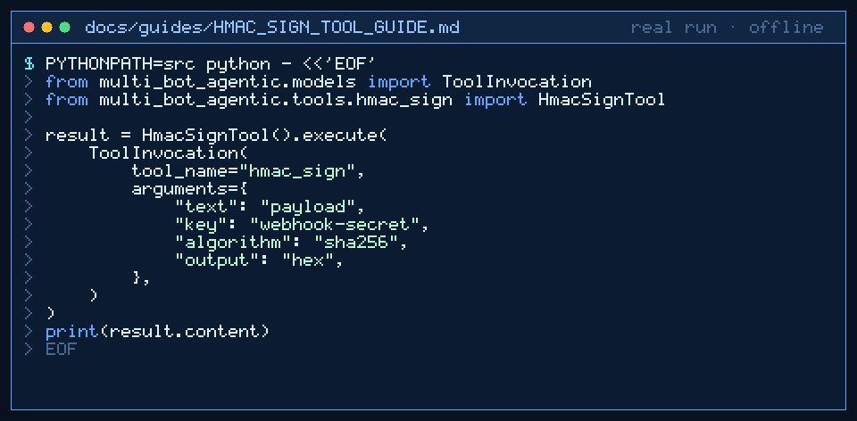

# hmac_sign Tool Guide



Sign a UTF-8 payload with HMAC before the next GPT-6 Astra / Claude Opus 5.5 /
Gemini 4 Argon / Kimi K3.1 Pro turn.

## Why

Webhook signing utilities in LangChain / n8n agent stacks need a deterministic
HMAC digest. Models cannot reliably compute keyed digests. `hmac_sign` uses
stdlib `hmac` + `hashlib` only and never logs the secret key.

## Usage

```python
from multi_bot_agentic.models import ToolInvocation
from multi_bot_agentic.tools.hmac_sign import HmacSignTool

result = HmacSignTool().execute(
    ToolInvocation(
        tool_name="hmac_sign",
        arguments={
            "text": "payload",
            "key": "webhook-secret",
            "algorithm": "sha256",
            "output": "hex",
        },
    )
)
print(result.content)
```

## Bounds & Safety

- Max text 20_000 chars; max key 1_024 chars
- Algorithms: `sha256` (default), `sha1`, `sha512`
- Output: `hex` (default) or `base64`
- Secret never appears in result content or metadata
- Never executes code or makes network requests
