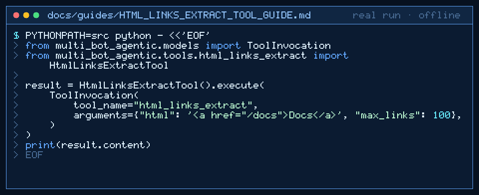

# html_links_extract Tool Guide



Extract anchor `href` + text pairs as JSON before the next GPT-6 Astra /
Claude Opus 5.5 / Gemini 4 Argon / Kimi K3.1 Pro research turn.

## Why

Browser-use / Scrapy-style agent pipelines need link inventories without
fetching pages or running JS. This tool is stdlib-only and bounded.

## Usage

```python
from multi_bot_agentic.models import ToolInvocation
from multi_bot_agentic.tools.html_links_extract import HtmlLinksExtractTool

result = HtmlLinksExtractTool().execute(
    ToolInvocation(
        tool_name="html_links_extract",
        arguments={"html": '<a href="/docs">Docs</a>', "max_links": 100},
    )
)
print(result.content)
```

## Bounds & Safety

- Max 20_000 input/output chars
- `max_links` in 1..500 (default 100)
- Rejects documents containing `script`/`style`
- Never executes code or makes network requests
