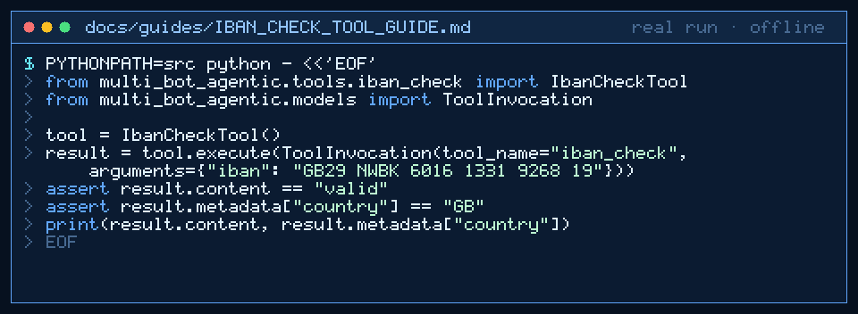

# IBAN Check Tool Guide



Deterministic IBAN validation for GPT-6 Astra / Claude Opus 5.5 / Gemini 4 Argon / Kimi K3.1 Pro workers.

## Why

Models miscalculate mod-97 arithmetic. This tool validates IBAN strings using the ISO 13616 algorithm with no network.

## Usage

```python
from multi_bot_agentic.tools.iban_check import IbanCheckTool
from multi_bot_agentic.models import ToolInvocation

tool = IbanCheckTool()
result = tool.execute(ToolInvocation(tool_name="iban_check", arguments={"iban": "GB29 NWBK 6016 1331 9268 19"}))
assert result.content == "valid"
assert result.metadata["country"] == "GB"
```

## Bounds

- Max 2000 characters input
- IBAN length 15–34 after stripping spaces/dashes
- Accepts `iban` or `text` argument
- Returns `valid`/`invalid` plus country code in metadata

## Safety

Allowlisted; no network; no file access; does not store or transmit account data.
