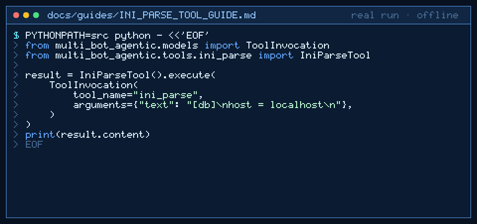

# ini_parse Tool Guide



Parse INI/CFG text into pretty JSON sections→keys before the next GPT-6 Astra /
Claude Opus 5.5 / Gemini 4 Argon / Kimi K3.1 Pro turn.

## Why

Ops agents ingest legacy `.ini` snippets. Models drop sections or invent keys;
`ini_parse` uses stdlib `configparser` only (inspired by Ansible/ConfigParser
tooling patterns).

## Usage

```python
tool.execute(
    ToolInvocation(
        tool_name="ini_parse",
        arguments={"text": "[db]\nhost = localhost\n"},
    )
)
```

## Bounds & Safety

- Required: `text` (max 20_000 chars, ≤200 sections, ≤2000 keys)
- Rejects empty input and ConfigParser errors
- Never executes code or makes network requests
