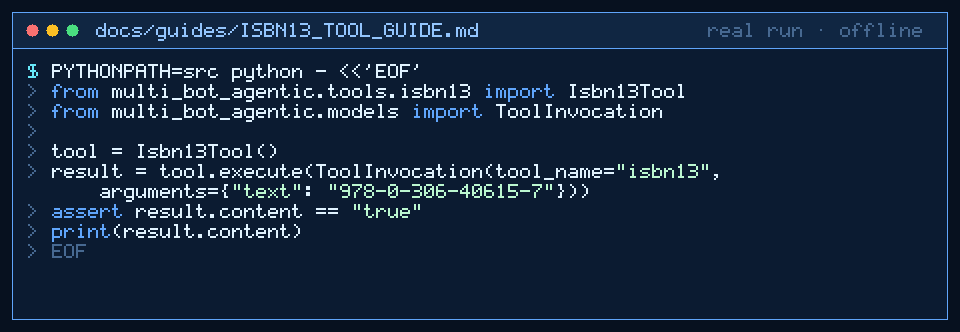

# ISBN-13 Tool Guide



Deterministic ISBN-13 (EAN-13) for GPT-6 Astra / Claude Opus 5.5 / Gemini 4 Argon / Kimi K3.1 Pro workers.

## Why

Models invent weighting rules. This tool validates or completes ISBN-13 digit strings with no network. Inspired by barcode/ISBN helpers in LangChain community toolkits and retail agent stacks.

## Usage

```python
from multi_bot_agentic.tools.isbn13 import Isbn13Tool
from multi_bot_agentic.models import ToolInvocation

tool = Isbn13Tool()
result = tool.execute(ToolInvocation(tool_name="isbn13", arguments={"text": "978-0-306-40615-7"}))
assert result.content == "true"
print(result.content)
```

## Bounds

- Max 2000 characters
- Digits, spaces, and dashes only
- Modes: `validate` (default, requires 13 digits), `check_digit` (requires 12 payload digits)

## Safety

Allowlisted; no network; does not store or transmit catalog data.
