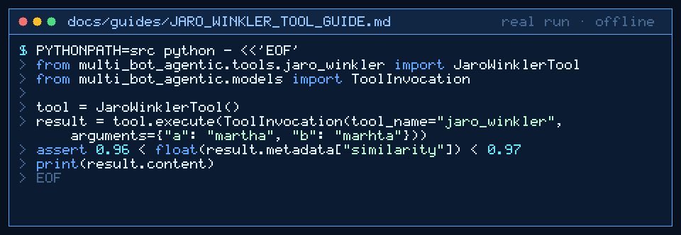

# Jaro-Winkler Tool Guide



Deterministic Jaro-Winkler string similarity for GPT-6 Astra / Claude Opus 5.5 / Gemini 4 Argon / Kimi K3.1 Pro workers.

## Why

Models guess fuzzy similarity poorly. Levenshtein gives edit distance; this companion returns a classic Jaro-Winkler score in `[0, 1]` with no network. Inspired by text utilities in popular agent/tool runtimes (CrewAI/LangChain community utilities).

## Usage

```python
from multi_bot_agentic.tools.jaro_winkler import JaroWinklerTool
from multi_bot_agentic.models import ToolInvocation

tool = JaroWinklerTool()
result = tool.execute(ToolInvocation(tool_name="jaro_winkler", arguments={"a": "martha", "b": "marhta"}))
assert 0.96 < float(result.metadata["similarity"]) < 0.97
```

## Bounds

- Max 2000 characters per argument
- Required args: `a`, `b`
- Score range: `0..1`

## Safety

Allowlisted; no network; pure local similarity math.
