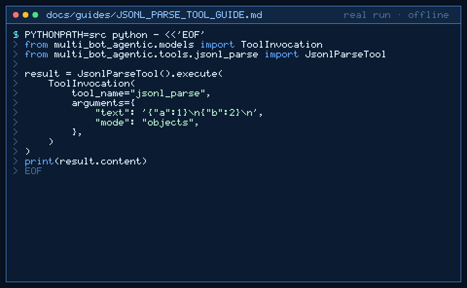

# jsonl_parse Tool Guide



Parse JSON Lines into a pretty JSON array before the next GPT-6 Astra /
Claude Opus 5.5 / Gemini 4 Argon / Kimi K3.1 Pro turn.

## Why

LLM dataset agents (HuggingFace datasets-style workflows) often receive JSONL
blobs. Asking a model to reformat multi-line JSONL is fragile. `jsonl_parse`
validates each line with stdlib `json` and returns a sorted-keys indented array.

## Usage

```python
tool.execute(
    ToolInvocation(
        tool_name="jsonl_parse",
        arguments={
            "text": '{"a":1}\n{"b":2}\n',
            "mode": "objects",
        },
    )
)
```

`mode=objects` (default) rejects non-object lines. `mode=any` accepts any JSON
value per line.

## Bounds & Safety

- Max 20_000 chars; max 500 lines
- Blank lines and invalid JSON fail with a line number
- Rejects non-finite JSON numbers (`NaN` / `Infinity`)
- Never executes code or makes network requests
