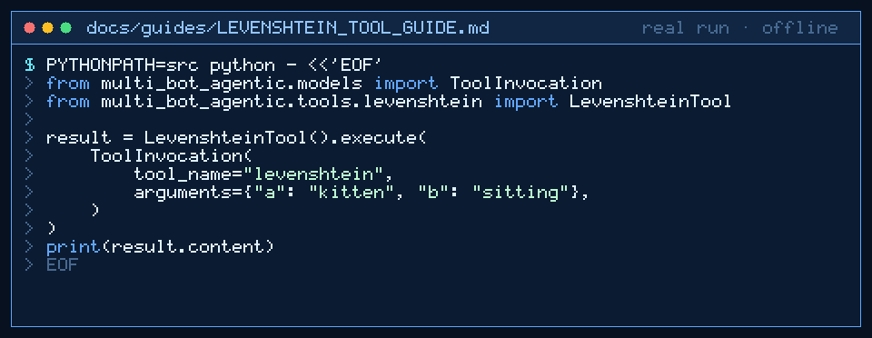

# levenshtein Tool Guide



Compute deterministic Levenshtein edit distance for fuzzy matching before the
next GPT-6 Astra / Claude Opus 5.5 / Gemini 4 Argon / Kimi K3.1 Pro turn.

## Why

CrewAI / LangGraph-style agents need a stable similarity signal for typos and
near-duplicate labels. Models invent distances; `levenshtein` uses classic
unit-cost DP with no network access (inspired by fuzzywuzzy / rapidfuzz agent
tooling, implemented with stdlib only).

## Usage

```python
from multi_bot_agentic.models import ToolInvocation
from multi_bot_agentic.tools.levenshtein import LevenshteinTool

result = LevenshteinTool().execute(
    ToolInvocation(
        tool_name="levenshtein",
        arguments={"a": "kitten", "b": "sitting"},
    )
)
print(result.content)
```

## Bounds & Safety

- Required: `a`, `b` (max 2000 chars each)
- Content is the decimal distance string; metadata includes `distance`
- Never executes code or makes network requests
