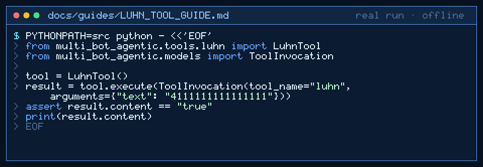

# Luhn Tool Guide



Deterministic Luhn (mod-10) for GPT-6 Astra / Claude Opus 5.5 / Gemini 4 Argon / Kimi K3.1 Pro workers.

## Why

Models invent parity rules. This tool validates or completes digit strings with no network.

## Usage

```python
from multi_bot_agentic.tools.luhn import LuhnTool
from multi_bot_agentic.models import ToolInvocation

tool = LuhnTool()
result = tool.execute(ToolInvocation(tool_name="luhn", arguments={"text": "4111111111111111"}))
assert result.content == "true"
```

## Bounds

- Max 2000 characters
- Digits, spaces, and dashes only
- Modes: `validate` (default), `check_digit`

## Safety

Allowlisted; no network; does not store or transmit card data.
