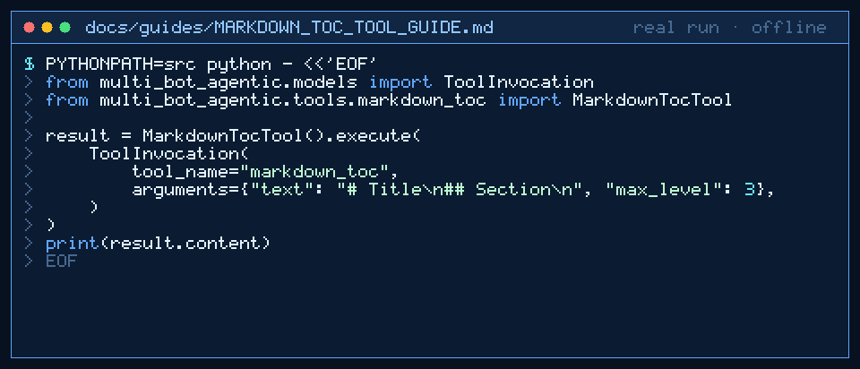

# markdown_toc Tool Guide



Build a nested Markdown table of contents from ATX headings for GPT-6 Astra /
Claude Opus 5.5 / Gemini 4 Argon / Kimi K3.1 Pro documentation agents.

## Why

LlamaIndex / MkDocs-style doc pipelines routinely need a TOC without an LLM
call. This tool is deterministic and bounded.

## Usage

```python
from multi_bot_agentic.models import ToolInvocation
from multi_bot_agentic.tools.markdown_toc import MarkdownTocTool

result = MarkdownTocTool().execute(
    ToolInvocation(
        tool_name="markdown_toc",
        arguments={"text": "# Title\n## Section\n", "max_level": 3},
    )
)
print(result.content)
```

Sentinel form: `markdown<<<MARKDOWN_TOC>>>2`

## Bounds & Safety

- Max 20_000 input/output chars
- `max_level` in 1..6 (default 3)
- Never executes code or makes network requests
