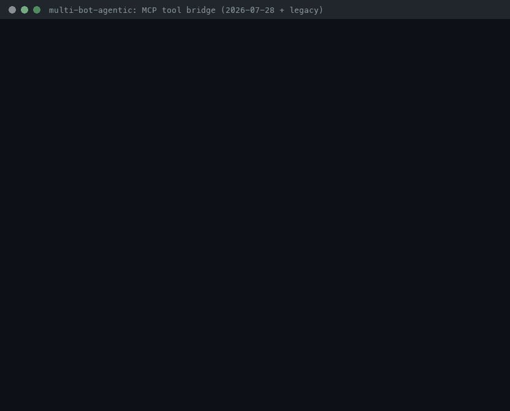

# MCP Tool Bridge Guide



Let multi-bot-agentic bots call tools from **any [Model Context Protocol](https://modelcontextprotocol.io) (MCP)
server**: the official reference servers, servers you already configured for Claude Desktop or Cursor, or
your own. The client speaks the current **MCP 2026-07-28** revision and still works with older
`initialize`-handshake servers (2025-11-25 and earlier). It has **zero dependencies** (stdlib `subprocess` and
newline-delimited JSON-RPC over stdio).

## Why

Popular agent frameworks all consume MCP servers. Before this feature, multi-bot-agentic could only call
its built-in tools:

| Framework | MCP entry point | What multi-bot-agentic now matches |
| --- | --- | --- |
| OpenAI Agents SDK | `MCPServerStdio` | Launch a stdio server and expose its tools to agents |
| smolagents | `ToolCollection.from_mcp` | Turn every server tool into a framework tool |
| PydanticAI | `MCPServerStdio` | Namespaced tools with per-server config |
| CrewAI | `MCPServerAdapter` | Use MCP tools from multi-agent crews |
| LangGraph | `langchain-mcp-adapters` | Load tools from several servers at once |

**The gap this closes:** bots can now use MCP tools with the same guarantees as built-in tools. Every MCP call:

- goes through the deterministic decision engine (`model.requested-tool` rationale trace),
- must pass the `SafetyPolicy` allowlist and any per-bot `BotSpec` scope,
- is written to the durable SQLite event log (decision, `action_requested`, and `action_result` with MCP metadata),
- shows up in `replay` and `report`, and is restored by `resume`.

Each MCP tool is wrapped as an ordinary `ToolAdapter`, so the runner, rate limiting, redaction, truncation, and
permission helpers work on it without changes.

## Quickstart (60 seconds)

The repo ships a small modern-era demo server (`examples/mcp/notes_server.py`) and a config for it:

```bash
# 1. Start the configured servers and list the tools they expose
multi-bot-agentic mcp-tools --mcp-config examples/mcp/mcp.json

# 2. Run a bot that calls an MCP tool (the fake provider requests the tool named in MULTIBOT_FAKE_TOOL)
MULTIBOT_FAKE_TOOL=mcp__notes__search_notes multi-bot-agentic run --provider fake \
  --mcp-config examples/mcp/mcp.json --goal "release checklist" \
  --event-log demo-output/mcp-demo.sqlite --run-id mcp-demo

# 3. Replay the durable timeline, including the MCP call
multi-bot-agentic replay --event-log demo-output/mcp-demo.sqlite --run-id mcp-demo --format text
```

With a real provider (`--provider openai|gemini|kimi|claude_code`) you don't need `MULTIBOT_FAKE_TOOL`. The
model's prompt lists the MCP tools, and the model decides when to call them.

## How It Works

```text
--mcp-config mcp.json
   |
   v
McpToolset.start()            one StdioMcpClient per enabled server (own process group, least-privilege env)
   |  server/discover probe   -> modern 2026-07-28 | -32022 retry | fallback: initialize (legacy)
   |  tools/list (paginated)  -> allowedTools / deniedTools -> McpToolAdapter "mcp__<server>__<tool>"
   v
AgentRunner(tools=builtin + MCP, allowed_tools += MCP names, tool_specs=catalog)
   |
   |  Observe -> Decide -> Act
   |  model:  TOOL:mcp__notes__search_notes:{"query": "release"}
   |  engine: decision call_tool (rule model.requested-tool, allowlist checked)
   |  act:    McpToolAdapter.execute -> tools/call (timeout, cancellation) -> ToolResult
   v
event log: decision, action_requested, action_result {tool, ok, content, metadata.mcp_*}
```

**Arguments.** The decision engine passes the text after `TOOL:<name>:` to the adapter, which maps it to the
tool's `inputSchema` like this:

| Payload | Sent as `arguments` |
| --- | --- |
| A JSON object, e.g. `{"query": "release", "limit": 2}` | The object as-is |
| Plain text, and the tool has exactly one required property (or exactly one property) | `{"<that property>": "<text>"}` (JSON scalars such as `5` are decoded for non-string properties) |
| Anything, and the tool declares no properties | `{}` |
| Plain text, and the tool has several properties | Not sent. The tool returns `ok=false`, and the message lists the expected signature so the model can retry with JSON |

**Tool catalog.** Real providers get an `Available tools` section in their prompt. Each entry shows the
namespaced name, the description, and an argument signature such as `query: string (required), limit: integer`.
Only tools that are registered **and** currently allowed (including bot scope) are listed. Without
`--mcp-config`, prompts are byte-for-byte unchanged.

## Configuration

The file uses the `mcpServers` format from Claude Desktop, Claude Code, and Cursor. You can paste an existing
entry and add the optional multi-bot-agentic safety keys. Other clients ignore those keys, so one file can serve
all of them.

```json
{
  "mcpServers": {
    "notes": {
      "command": "python3",
      "args": ["notes_server.py"],
      "cwd": ".",
      "env": {"NOTES_TOKEN": "${NOTES_TOKEN}"},
      "allowedTools": ["search_*", "word_count"],
      "deniedTools": ["search_private"],
      "callTimeoutSeconds": 10,
      "startupTimeoutSeconds": 15,
      "maxResultBytes": 4096,
      "redactResults": true
    }
  }
}
```

| Key | Default | Meaning |
| --- | --- | --- |
| `command`, `args` | required, `[]` | Executable and arguments (stdio transport) |
| `env` | `{}` | Extra environment variables for the server (see *least-privilege environment* below) |
| `cwd` | inherit | Working directory. A relative path is resolved against the config file's directory |
| `allowedTools` | all | Glob patterns (`fnmatch`) of server tool names to expose |
| `deniedTools` | none | Glob patterns to hide. Deny wins over allow |
| `callTimeoutSeconds` | `30` | Per `tools/call` (and `tools/list` page) timeout |
| `startupTimeoutSeconds` | `30` | Budget for launch plus protocol-era detection (raise it for first-run `npx`/`uvx` downloads) |
| `maxResultBytes` | `16384` | UTF-8 byte cap on each result's text |
| `redactResults` | `false` | Scrub emails, phone numbers, SSNs, and API tokens (`ObservationRedactor`) before results reach the model or the event log |
| `disabled` | `false` | Keep the entry but don't start it |

- `${VAR}` and `${VAR:-default}` are expanded in `command`, `args`, `env` values, and `cwd`, so secrets stay out
  of the file. If a referenced variable is unset and has no default, loading fails with an error.
- Server names must be letters and digits separated by single `-` or `_` (max 64 chars). This keeps
  `mcp__<server>__<tool>` collision-free.
- Remote entries (`url`, `type: "http"`/`"sse"`) are skipped with a warning. Only stdio servers are supported.
- Unknown keys produce a warning, so a typo such as `allowedTool` can't silently disable a safety control.
- VS Code's `{"servers": {...}}` top-level key is accepted as an alias.

## Safety Controls

| Control | What it does |
| --- | --- |
| Opt-in | MCP servers start only when you pass `--mcp-config` (or build an `McpToolset` yourself) |
| Least-privilege environment | Servers inherit only `HOME`, `LOGNAME`, `PATH`, `SHELL`, `TERM`, `USER` (the Windows equivalents on Windows), like the official MCP Python SDK. Provider keys such as `OPENAI_API_KEY` never reach a server unless you pass them through `env` |
| Allow/deny lists | Hidden tools are never wrapped, so the model can't call them. `mcp-tools` reports how many tools are hidden |
| Namespacing | `mcp__<server>__<tool>` can't collide across servers or with built-in tools. Tool names outside `[A-Za-z0-9_.-]{1,128}` are skipped and reported |
| Policy + bot scope | MCP tools are added to `SafetyPolicy.allowed_tools`. `BotSpec.allowed_tools` can narrow them per bot. The prompt catalog follows the live allowlist |
| Timeouts | Each call has a timeout and is cancelled with `notifications/cancelled` when it expires. Startup and era detection have their own budgets. A hung server can't hang a run |
| Process cleanup | Each server runs in its own process group. Shutdown closes stdin, then sends SIGTERM, then SIGKILL to the whole group (covers `npx`→`node` children). A finalizer also cleans up at interpreter exit |
| Crash handling | A server that dies is restarted once, and the era is re-detected for the new process. After that, calls fail fast |
| Bounded results | Results are capped by `maxResultBytes` without splitting UTF-8 characters. Image, audio, and binary resources are summarized instead of inlined. Messages larger than 16 MiB are rejected |
| Redaction | Optional per server (`redactResults`) |
| Minimal capabilities | The client declares no sampling, roots, or elicitation capabilities. `input_required` results are reported as tool failures |

**Failure semantics.** MCP tools follow the repository's tool-failure contract: they return `ok=false` and the
run continues, so the model can recover.

| Situation | `ok` | `metadata.error_kind` |
| --- | --- | --- |
| `isError: true` tool result | `false` | `tool_error` |
| JSON-RPC error (unknown tool, invalid params, etc.) | `false` | `protocol_error` (+ `error_code`) |
| No answer within `callTimeoutSeconds` | `false` | `timeout` |
| Server exited or broke framing (restart budget exhausted) | `false` | `transport_error` |
| Payload can't be mapped to the input schema | `false` | `invalid_arguments` (the server is not called) |

**Trust.** Tool descriptions, annotations, and `serverInfo` are self-reported by the server and are untrusted.
A malicious description is a prompt-injection vector ("tool poisoning"). Prefer read-only servers and narrow
allowlists. For sensitive MCP tools, combine the bridge with `HitlApprovalGate` (gate on the namespaced name)
and `RateLimitedToolRunner`. Both work with any `ToolAdapter`.

## CLI Usage

```bash
multi-bot-agentic mcp-tools --mcp-config mcp.json                 # human-readable listing
multi-bot-agentic mcp-tools --mcp-config mcp.json --format json   # servers + tools with input schemas
multi-bot-agentic run    --goal "..." --mcp-config mcp.json        # MCP tools available to the run
multi-bot-agentic resume --run-id R --event-log runs.sqlite --mcp-config mcp.json
```

- `mcp-tools` exits `0` when every server started, `1` if any server failed (the failure is listed in the
  output), and `2` for an invalid config.
- `run`/`resume` fail fast with exit code `2` and an `error: MCP server startup failed: ...` message if a
  configured server can't start. On success, they print one `mcp: <server> <era> <version> (<n> tools)` line
  per server to stderr. The JSON result on stdout is unchanged.
- Without `--mcp-config`, every command behaves exactly as before.

Python API:

```python
from pathlib import Path

from multi_bot_agentic.cli import build_runtime_tools
from multi_bot_agentic.mcp import McpToolset, load_mcp_config
from multi_bot_agentic.runner import AgentRunner
from multi_bot_agentic.safety import SafetyPolicy

with McpToolset(load_mcp_config(Path("examples/mcp/mcp.json"))) as toolset:
    toolset.start()  # inspect toolset.failed / toolset.statuses
    tools, policy, specs = build_runtime_tools(SafetyPolicy(max_steps=6), toolset)
    runner = AgentRunner(provider=..., event_log=..., tools=tools, safety_policy=policy, tool_specs=specs)
    result = runner.run("find the release checklist")
```

## Event Log And Replay

The MCP call is a normal tool action, so `replay --format text` shows it next to the decision that selected it.
MCP rows also show `ok`, the server and tool, and the era:

```text
014 deciding   decision action=call_tool rule=model.requested-tool
017 acting     action_result kind=tool target=mcp__notes__search_notes ok=true mcp=notes/search_notes era=modern
```

The `action_result` payload (from `replay --format json`) contains the full audit record. This one is from the
demo run:

```json
{
  "kind": "tool",
  "tool": "mcp__notes__search_notes",
  "ok": true,
  "content": "release-checklist: Release checklist: freeze main, run the eval suite, tag the build, update the CHANGELOG.",
  "metadata": {
    "mcp_server": "notes",
    "mcp_tool": "search_notes",
    "mcp_arguments": {"query": "release checklist"},
    "mcp_era": "modern",
    "mcp_protocol_version": "2026-07-28",
    "duration_ms": 0,
    "content_types": ["text"],
    "result_bytes": 107,
    "truncated": false
  }
}
```

`report` lists the call under `tool_calls` like any other tool, and `resume --mcp-config` re-attaches the
servers so a checkpointed `TOOL:mcp__...` request can run after a crash.

## Protocol Era Compatibility

MCP 2026-07-28 ("modern") is stateless: there is no `initialize` handshake, and every request carries `_meta`
with `io.modelcontextprotocol/protocolVersion`, `clientCapabilities`, and `clientInfo`. Older ("legacy")
revisions require `initialize` followed by `notifications/initialized`. The client is **dual-era** and follows
the stdio backward-compatibility rules:

| Server | `server/discover` probe result | Client behavior | Verified with |
| --- | --- | --- | --- |
| Modern (2026-07-28) | `DiscoverResult` | Modern: per-request `_meta`, no handshake | `tests/fixtures/mcp/modern_server.py`, `examples/mcp/notes_server.py`, `uvx mcp-server-time` |
| Modern, but the preferred version is unsupported | `-32022` with `data.supported` | Retry with a mutually supported version. Error if there is none (no fallback to `initialize`) | fixture test |
| Dual-era (e.g. `@modelcontextprotocol/server-filesystem@2.2.0`) | `DiscoverResult` | Modern | real server (demo above) |
| Legacy (2025-11-25, 2025-06-18, 2025-03-26, 2024-11-05) | Any other error, e.g. `-32601` | `initialize` + `notifications/initialized`, then the negotiated version | `tests/fixtures/mcp/legacy_server.py`, `@modelcontextprotocol/server-filesystem@2025.12.18` |
| Legacy server that ignores unknown requests sent before `initialize` | No answer within the 5 s probe timeout | `initialize` | legacy fixture `--silent-probe` |
| Slow-starting modern server (first-run `npx`/`uvx`) | Answered after the probe timeout, and `initialize` is rejected | The late `DiscoverResult` switches the client back to modern | modern fixture `--slow-start` |

The detected era is cached for the lifetime of each server process and re-detected only after a restart.
Legacy `ping` requests from the server are answered. In modern mode the client never writes JSON-RPC responses,
as the stdio transport requires. Results without `resultType` (legacy) are treated as `complete`.

## Using Real MCP Servers (Optional)

`examples/mcp/mcp.official.json` launches the official filesystem server twice: the current dual-era release
and a pinned legacy-only release. Use it to see both eras side by side. It requires Node.js; the first run
downloads the packages.

```bash
multi-bot-agentic mcp-tools --mcp-config examples/mcp/mcp.official.json
MULTIBOT_FAKE_TOOL=mcp__fs-legacy__read_text_file multi-bot-agentic run --provider fake \
  --mcp-config examples/mcp/mcp.official.json --goal "LICENSE" --event-log demo-output/fs.sqlite
```

`MCP_FS_ROOT` (default `.`) sets the only directory the filesystem server may read. Only the read-only
`read_text_file` and `list_directory` tools are allowlisted.

Python reference servers work the same way through `uvx`. For example, the official time server is detected as
modern 2026-07-28:

```json
{"mcpServers": {"time": {"command": "uvx", "args": ["mcp-server-time", "--local-timezone", "America/Los_Angeles"],
                         "startupTimeoutSeconds": 120}}}
```

```bash
MULTIBOT_FAKE_TOOL=mcp__time__get_current_time multi-bot-agentic run --provider fake \
  --mcp-config time.json --goal '{"timezone": "Asia/Tokyo"}'
```

To reuse servers from Claude Desktop, copy entries from `claude_desktop_config.json` and add `allowedTools`
before giving them to a bot.

## Troubleshooting

| Symptom | Fix |
| --- | --- |
| `cannot start MCP server 'x' (cmd): [Errno 2] ...` | The command isn't on the server's `PATH`. Use an absolute path or check that `PATH` contains it |
| `answered neither server/discover nor initialize within Ns` | The server is slow (often a first `npx`/`uvx` download) or hung. Raise `startupTimeoutSeconds` and run the command by hand to see its stderr |
| `MCP server 'x': server closed its stdout (exit code N); stderr: ...` | The server crashed. The last stderr lines are included in the message |
| The server needs an API token | Add it to `env` with a placeholder: `"env": {"TOKEN": "${TOKEN}"}`. It isn't inherited automatically |
| A tool is missing from `mcp-tools` | It's hidden by `allowedTools`/`deniedTools` (counted in the listing) or skipped for an invalid name (listed) |
| `pass a JSON object of arguments; expected ...` | The tool has several parameters. The model must send `TOOL:<name>:{"key": "value"}` |
| A result ends with `…[truncated: kept N of M bytes; raise maxResultBytes]` | Raise `maxResultBytes` for that server |
| `server asked for additional client input (input_required)` | The tool needs elicitation or sampling, which this client doesn't provide |
| `warning: ... only stdio servers are supported` | Remote HTTP/SSE servers aren't supported yet. Run a stdio proxy or a local build |
| A real model never calls MCP tools | Check that the tool appears in `mcp-tools` and isn't excluded by bot scope. Naming the tool in the goal also helps |

## How This Demo Was Recorded

The GIF at the top was rendered from a **real** terminal transcript, committed as
[`assets/demo/mcp-tools.txt`](../../assets/demo/mcp-tools.txt). It was recorded on 2026-11-06 on macOS with
Python 3.12 and Node.js 26, using the official `@modelcontextprotocol/server-filesystem` packages from npm.
Each command was executed for real from the repo root, and its stdout and stderr were appended verbatim after a
`$ <command>` line:

```bash
multi-bot-agentic mcp-tools --mcp-config examples/mcp/mcp.official.json
MULTIBOT_FAKE_TOOL=mcp__notes__search_notes multi-bot-agentic run --provider fake --mcp-config examples/mcp/mcp.json --goal "release checklist" --event-log demo-output/mcp-demo.sqlite --run-id mcp-demo
multi-bot-agentic replay --event-log demo-output/mcp-demo.sqlite --run-id mcp-demo --format text | grep -E "call_tool|kind=tool"
multi-bot-agentic replay --event-log demo-output/mcp-demo.sqlite --run-id mcp-demo --event-type action_result | jq -c 'select(.payload.kind == "tool") | .payload | {ok, content, era: .metadata.mcp_era}'
```

The transcript was rendered with a Pillow terminal renderer: lines starting with `$ ` are typed, all other
lines are printed. The settings were 100 columns, 32 rows, and font size 13. The frames were then re-quantized
to one shared 16-color palette so unchanged pixels compress across frames, keeping the GIF under 400 KB. This
re-quantization doesn't change the content:

```python
from PIL import Image, ImageSequence

gif = Image.open("mcp-tools-raw.gif")
frames = [frame.convert("RGB") for frame in ImageSequence.Iterator(gif)]
durations = [frame.info.get("duration", 100) for frame in ImageSequence.Iterator(Image.open("mcp-tools-raw.gif"))]
palette = frames[-1].quantize(colors=16, method=Image.Quantize.MEDIANCUT)
out = [frame.quantize(palette=palette, dither=Image.Dither.NONE) for frame in frames]
out[0].save(
    "assets/demo/mcp-tools.gif",
    save_all=True,
    append_images=out[1:],
    duration=durations,
    loop=0,
    optimize=True,
    disposal=1,
)
```
