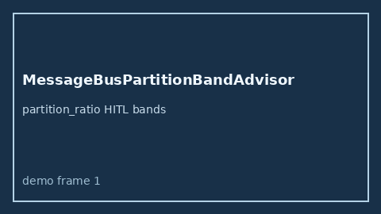

# MessageBusPartitionBandAdvisor Guide



Offline HITL `partition_ratio` bands.
Gap vs LangGraph/CrewAI/AutoGen message-bus partition monitors. Distinct from `OrchestratorFanInStallBandAdvisor` / `SharedLockContentionBandAdvisor`.

Stack: **GPT-5.5 / Claude Sonnet 4.6 / Gemini 3.x / Kimi K2**.

## Usage

```python
from multi_bot_agentic.message_bus_partition_band import MessageBusPartitionBandAdvisor

status = MessageBusPartitionBandAdvisor().advise("s1", partition_ratio=0.8)
assert status.requires_human_review is True
print(status.band)
```

## Safety

Advisory only. No network I/O. Never auto-acts.
