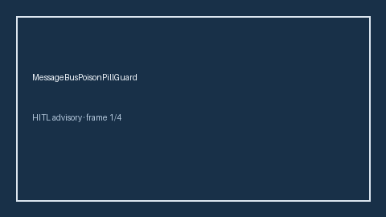

# MessageBusPoisonPillGuard Guide



Offline HITL guard. Never network I/O. Closes gaps vs AutoGen/CrewAI/LangGraph message-bus poison-pill guards.

Optional polish via **GPT-5.5 / Claude Sonnet 4.6 / Gemini 3.x / Kimi K2**.

Distinct from `MessageBusBackpressureAdvisor` / `SharedMemoryPoisoningGuard`.

## Usage

```python
from multi_bot_agentic.message_bus_poison_pill import MessageBusPoisonPillGuard

status = MessageBusPoisonPillGuard().check("s1", poison_score=0.1)
assert status.requires_human_review is True
print(status.band)
```

## Safety

Always `requires_human_review=True`. No HTTP. Humans decide.
