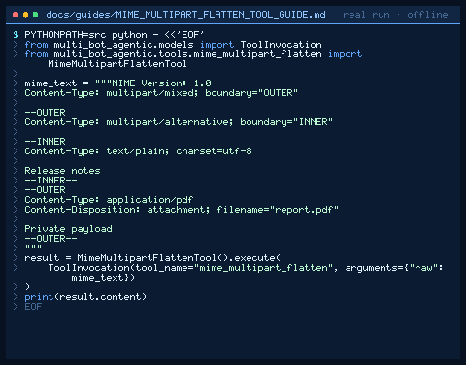

# mime_multipart_flatten Tool Guide



Recursively flatten nested multipart MIME into leaf metadata for GPT-6 Astra /
Claude Opus 5.5 / Gemini 4 Argon / Kimi K3.1 Pro workers. Inspired by email agent
pipelines in popular frameworks.

## Usage

```python
from multi_bot_agentic.models import ToolInvocation
from multi_bot_agentic.tools.mime_multipart_flatten import MimeMultipartFlattenTool

mime_text = """MIME-Version: 1.0
Content-Type: multipart/mixed; boundary="OUTER"

--OUTER
Content-Type: multipart/alternative; boundary="INNER"

--INNER
Content-Type: text/plain; charset=utf-8

Release notes
--INNER--
--OUTER
Content-Type: application/pdf
Content-Disposition: attachment; filename="report.pdf"

Private payload
--OUTER--
"""
result = MimeMultipartFlattenTool().execute(
    ToolInvocation(tool_name="mime_multipart_flatten", arguments={"raw": mime_text})
)
print(result.content)
```

## Bounds & Safety

- Max 20_000 chars, 200 leaf parts
- Returns content_type/filename/content_id/size/depth only — no payloads
- Never executes code or makes network requests
