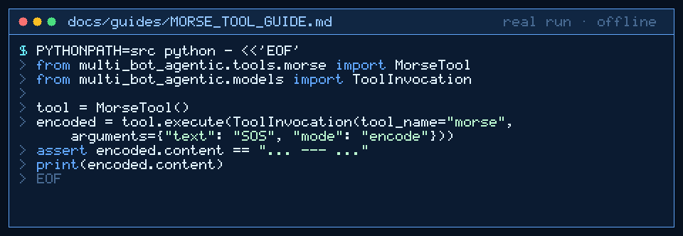

# Morse Tool Guide



Deterministic International Morse for GPT-6 Astra / Claude Opus 5.5 / Gemini 4 Argon / Kimi K3.1 Pro workers.

## Why

Models invent dot-dash tables. This tool uses an explicit map with no network.

## Usage

```python
from multi_bot_agentic.tools.morse import MorseTool
from multi_bot_agentic.models import ToolInvocation

tool = MorseTool()
encoded = tool.execute(ToolInvocation(tool_name="morse", arguments={"text": "SOS", "mode": "encode"}))
assert encoded.content == "... --- ..."
print(encoded.content)
```

## Bounds

- Max 20_000 characters
- Letter gap: single space; word gap: ` / `
- Unsupported characters/codes fail closed

## Safety

Allowlisted; no code execution; no network.
