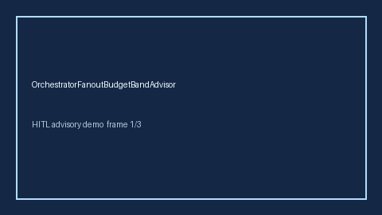

# OrchestratorFanoutBudgetBandAdvisor Guide



Offline HITL guard. Never network I/O. Closes gaps vs AutoGen/CrewAI/LangGraph orchestrator fan-out budget monitors.

Optional polish via **GPT-5.5 / Claude Sonnet 4.6 / Gemini 3.x / Kimi K2**.

Distinct from `OrchestratorCascadeFailureAdvisor` / `OrchestratorFairnessAgingAdvisor`.

## Usage

```python
from multi_bot_agentic.orchestrator_fanout_budget import OrchestratorFanoutBudgetBandAdvisor

status = OrchestratorFanoutBudgetBandAdvisor().advise("s1", fanout_ratio=0.3000)
assert status.requires_human_review is True
print(status.band)
```

## Safety

Always `requires_human_review=True`. No HTTP. Humans decide.
