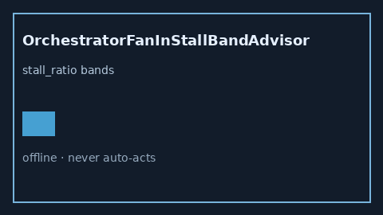

# OrchestratorFanInStallBandAdvisor Guide



Offline HITL helper for `stall_ratio` bands.
Gap vs LangGraph/CrewAI/AutoGen orchestrator fan-in stall monitors. Distinct from `AgentHandoffLoopBandAdvisor` / `ConsensusQuorumStallAdvisor`.

Stack: **GPT-5.5 / Claude Sonnet 4.6 / Gemini 3.x / Kimi K2**.

## Usage

```python
from multi_bot_agentic.orchestrator_fan_in_stall_band import OrchestratorFanInStallBandAdvisor

status = OrchestratorFanInStallBandAdvisor().advise("s1", stall_ratio=0.4)
assert status.requires_human_review is True
print(status.band)
```

## Safety

Advisory only. No network I/O. Never auto-acts. Humans decide.
