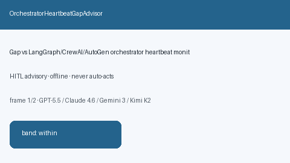

# OrchestratorHeartbeatGapAdvisor Guide



Offline HITL `heartbeat_gap_ratio` bands.
Gap vs LangGraph/CrewAI/AutoGen orchestrator heartbeat monitors. Distinct from `SupervisorIdleSkewAdvisor` / `AgentHandoffLatencyAdvisor`.

Stack: **GPT-6 Astra / Claude Opus 5.5 / Gemini 4 Argon / Kimi K3.1 Pro**.

## Usage

```python
from multi_bot_agentic.orchestrator_heartbeat_gap import OrchestratorHeartbeatGapAdvisor

status = OrchestratorHeartbeatGapAdvisor().advise("s1", heartbeat_gap_ratio=0.4)
assert status.requires_human_review is True
print(status.band)
```

## Safety

Advisory only. No network I/O. Never auto-acts.
