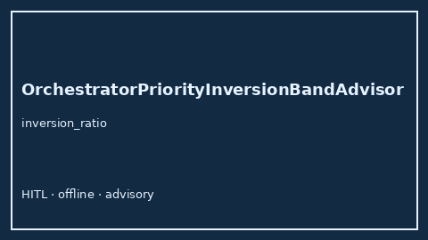

# OrchestratorPriorityInversionBandAdvisor Guide



Offline HITL `inversion_ratio` band advisor.
Gap vs LangGraph/CrewAI/AutoGen orchestrator priority-inversion monitors. Distinct from `OrchestratorFanInStallBandAdvisor` / `OrchestratorRetryStormBandAdvisor`.

Stack: **GPT-5.5 / Claude Sonnet 4.6 / Gemini 3.x / Kimi K2**.

## Usage

```python
from multi_bot_agentic.orchestrator_priority_inversion_band import OrchestratorPriorityInversionBandAdvisor

status = OrchestratorPriorityInversionBandAdvisor().advise("session-1", inversion_ratio=0.85)
assert status.requires_human_review is True
print(status.band)
```

## Safety

Advisory only. No network I/O. Humans decide.
