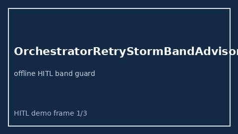

# OrchestratorRetryStormBandAdvisor Guide



Offline HITL advisor for `retry_storm_ratio` bands.
Gap vs LangGraph/CrewAI/AutoGen orchestrator retry-storm band monitors. Distinct from `HandoffTimeoutBandAdvisor` / `CriticDisagreementSpreadAdvisor`.

Optional polish via **GPT-5.5 / Claude Sonnet 4.6 / Gemini 3.x / Kimi K2**.

## Usage

```python
from multi_bot_agentic.orchestrator_retry_storm_band import OrchestratorRetryStormBandAdvisor

status = OrchestratorRetryStormBandAdvisor().advise("s1", retry_storm_ratio=0.3)
print(status.band)
```

## Safety

Advisory only. No network I/O. Humans decide.
