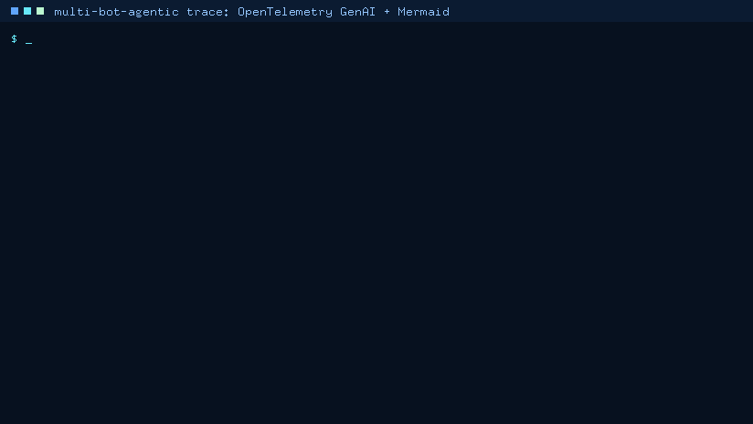
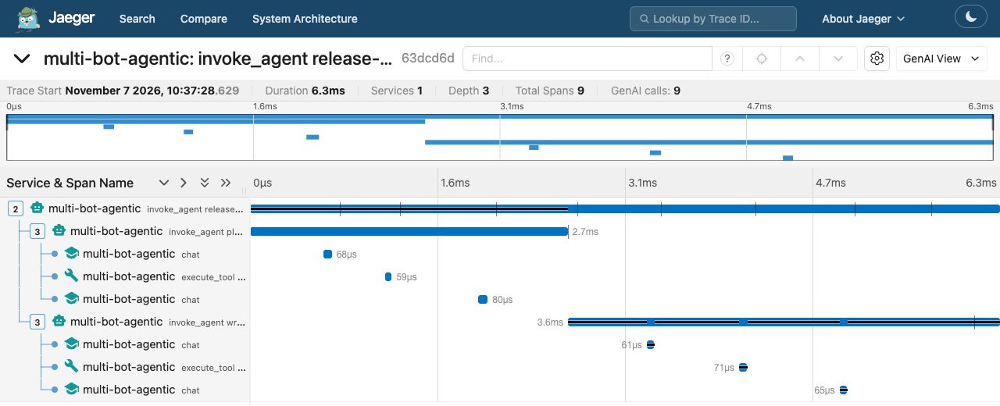
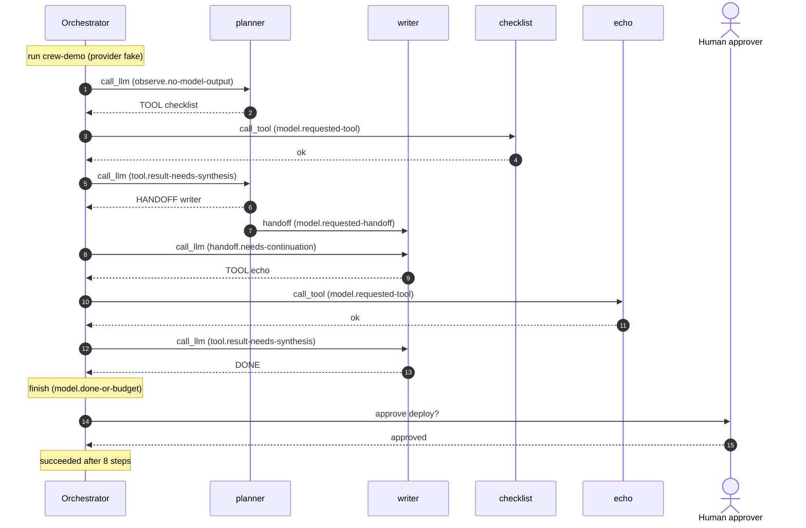

# OpenTelemetry Trace Export Guide



`multi-bot-agentic trace` turns any run in the durable event log into:

- an **OpenTelemetry trace** (OTLP/JSON `ExportTraceServiceRequest`) that follows the
  [OpenTelemetry GenAI semantic conventions](https://github.com/open-telemetry/semantic-conventions-genai):
  one `invoke_agent` span for the run, `invoke_agent {bot}` spans for each bot, `chat {model}` spans for model
  calls, and `execute_tool {tool}` spans for built-in and MCP tools. It can print the trace, write it to a file,
  or push it to any OTLP/HTTP endpoint, such as Jaeger, Grafana Tempo, or Langfuse;
- a **Mermaid `sequenceDiagram`** of who called whom (orchestrator, bots, tools, MCP servers, and the human
  approver), which GitHub renders inline.

Like `replay` and `report`, `trace` only reads the event log. It never calls a provider, a tool, or an MCP
server, so you can export last week's run or a CI run's log long after the process is gone.

## Why

Teams already watch their agents in an observability stack, and every major agent framework feeds one:

| Framework or backend | How runs get into an observability stack |
| --- | --- |
| [OpenAI Agents SDK](https://openai.github.io/openai-agents-python/tracing/) | Built-in tracing (agent, generation, function, guardrail, handoff spans) sent to the OpenAI Traces dashboard, plus custom trace processors for other backends |
| LangChain / LangGraph | LangSmith tracing, with [OpenTelemetry export](https://docs.langchain.com/langsmith/trace-with-opentelemetry) (`LANGSMITH_OTEL_ENABLED=true`) |
| CrewAI, AutoGen, and others | OpenTelemetry instrumentation from [OpenLLMetry](https://github.com/traceloop/openllmetry) or OpenInference |
| Jaeger, Grafana Tempo, Langfuse, Arize Phoenix, Datadog | Ingest OTLP and read the `gen_ai.*` attributes |

Before this feature, multi-bot-agentic recorded everything in its event log but could only print it. There
was no way to see a run in the tracing backend a team already uses, and no picture of which bot handed off
to whom. `trace` closes both gaps. Because it works from the durable log, it adds two things that live tracers
can't offer:

- **Post-hoc and repeatable.** Any recorded run can be exported later, as many times as you like, and the same
  run always produces byte-identical output with the same trace and span ids.
- **Explained.** Every span carries the deterministic decision behind it: the rule id, the rule's explanation,
  and the actions the engine rejected.

## Quickstart

```bash
# 1. Record a run offline with the deterministic fake provider
multi-bot-agentic run --goal "Create a launch checklist" --provider fake \
  --event-log demo-output/trace-demo.sqlite --run-id trace-demo

# 2. Draw it (GitHub renders the output inside a mermaid code block)
multi-bot-agentic trace --event-log demo-output/trace-demo.sqlite --format mermaid

# 3. Export it as OTLP/JSON (stdout, or a file with --output)
multi-bot-agentic trace --event-log demo-output/trace-demo.sqlite --output demo-output/trace-demo.json

# 4. Start Jaeger (OTLP/HTTP on 4318, UI on 16686) and push the trace to it
docker run --rm --name jaeger -p 16686:16686 -p 4318:4318 cr.jaegertracing.io/jaegertracing/jaeger:2.23.0
multi-bot-agentic trace --event-log demo-output/trace-demo.sqlite --run-id trace-demo \
  --otlp-endpoint http://localhost:4318/v1/traces
# exported 4 spans of run trace-demo (trace 7c101eacd14518dfc8a2675d49345ff2) to http://localhost:4318/v1/traces: HTTP 200
```

Then open `http://localhost:16686/trace/7c101eacd14518dfc8a2675d49345ff2`. The trace id is derived from the run
id, so `trace-demo` always maps to the same trace. Without `--run-id`, `trace` picks the most recently active run
and says so on stderr.

## CLI Reference

```text
multi-bot-agentic trace --event-log PATH [--run-id ID] [--format otlp-json|mermaid] [--output FILE]
                        [--include-content] [--agent-name NAME]
                        [--otlp-endpoint URL] [--otlp-header KEY=VALUE ...] [--otlp-timeout SECONDS]
```

`python -m multi_bot_agentic.cli trace ...` works the same way.

| Option | Default | Meaning |
| --- | --- | --- |
| `--event-log` | required | SQLite event log to read. It is never created if missing |
| `--run-id` | most recently active run | Run to export (the run whose latest event is newest) |
| `--format` | `otlp-json` | `otlp-json` or `mermaid`. With only `--otlp-endpoint`, nothing is printed unless you pass `--format` or `--output` |
| `--output` | stdout | Write the rendered output to a file (parent directories are created) |
| `--include-content` | off | Also export the goal, model inputs and outputs, tool arguments and results, and handoff summaries, all redacted. See [Privacy](#privacy) |
| `--agent-name` | none | `gen_ai.agent.name` for the root span, which is then named `invoke_agent {name}` |
| `--otlp-endpoint` | none | Also POST the OTLP/JSON to this `http://` or `https://` URL, for example `http://localhost:4318/v1/traces` |
| `--otlp-header` | none | Extra request header, repeatable. `${VAR}` and `${VAR:-default}` expand from the environment. Values are never printed |
| `--otlp-timeout` | `10` | Request timeout in seconds |

Exit codes follow the other commands. `0` means success. `2` means invalid arguments, a missing or unreadable
log, a log with no runs, or an unknown run id, and comes with an `error:` line on stderr. `1` means the OTLP
push failed: a non-2xx answer, a redirect, a timeout, or a connection error.

Keep tokens out of shell history and process listings by single-quoting a placeholder. `trace` expands it
itself:

```bash
export OTLP_TOKEN=...
multi-bot-agentic trace --event-log runs.sqlite --otlp-endpoint https://otlp.example.com/v1/traces \
  --otlp-header 'Authorization=Bearer ${OTLP_TOKEN}'
```

## View Runs In Your Tracing Backend

The push sends `Content-Type: application/json`, the OTLP/HTTP JSON encoding. It does not follow redirects, so
headers such as `Authorization` only ever go to the URL you gave. An OTLP partial-success answer is reported as
a warning.

### Jaeger (verified)

```bash
docker run --rm --name jaeger -p 16686:16686 -p 4318:4318 cr.jaegertracing.io/jaegertracing/jaeger:2.23.0
multi-bot-agentic trace --event-log runs.sqlite --run-id <id> --otlp-endpoint http://localhost:4318/v1/traces
```

Jaeger v2's image runs the all-in-one configuration (collector, query, and in-memory storage) and replaces the
v1 `jaegertracing/all-in-one` image. The **GenAI View** in its trace page recognizes the spans by their
`gen_ai.operation.name`:



Verified on 2026-11-07 with the Jaeger 2.23.0 release binary (`jaeger-2.23.0-darwin-arm64`, the same release as
the image above, run with its default all-in-one configuration). Pushed traces came back from
`GET /api/traces/<trace id>` with the span hierarchy, span kinds, span events (as logs), and, for failed runs,
`error=true` with `otel.status_code=ERROR` and the redacted status description.

### Grafana Tempo (should work, not tested here)

Tempo's distributor accepts OTLP/HTTP, including JSON, on port 4318 when the `otlp` receiver is enabled. Point
`--otlp-endpoint` at `http://<tempo>:4318/v1/traces`. For a multi-tenant Tempo, add
`--otlp-header X-Scope-OrgID=<tenant>`.

### Langfuse (should work, not tested here)

Langfuse's OpenTelemetry endpoint
[accepts OTLP over HTTP with JSON or protobuf](https://langfuse.com/resources/engineering/opentelemetry-languages)
and authenticates with your project keys:

```bash
export LANGFUSE_AUTH=$(printf '%s' "pk-lf-...:sk-lf-..." | base64)
multi-bot-agentic trace --event-log runs.sqlite --run-id <id> \
  --otlp-endpoint https://cloud.langfuse.com/api/public/otel/v1/traces \
  --otlp-header 'Authorization=Basic ${LANGFUSE_AUTH}'
```

### Arize Phoenix (needs a collector, not tested here)

Phoenix's `/v1/traces` endpoint
[only accepts `application/x-protobuf`](https://github.com/Arize-ai/phoenix/blob/main/src/phoenix/server/api/routers/v1/traces.py)
and answers JSON with HTTP 415. Push to an OpenTelemetry Collector instead and let it re-encode the trace for
Phoenix:

```yaml
receivers:
  otlp:
    protocols:
      http:
        endpoint: 0.0.0.0:4318
exporters:
  otlphttp/phoenix:
    endpoint: http://localhost:6006
service:
  pipelines:
    traces:
      receivers: [otlp]
      exporters: [otlphttp/phoenix]
```

The same Collector route works for backends that accept only OTLP/gRPC or protobuf.

## What Gets Exported

### Span tree

```text
invoke_agent [<--agent-name>]            root, INTERNAL: the whole run
├── invoke_agent planner                 INTERNAL: one span per stretch of a bot's activity
│   ├── chat [<model>]                   CLIENT (INTERNAL for the in-process fake provider)
│   ├── execute_tool checklist           INTERNAL: built-in or MCP tool call
│   └── chat [<model>]
└── invoke_agent writer                  opened by the handoff, closed by the next handoff or the run end
    ├── chat [<model>]
    └── execute_tool echo
```

Runs without bots, which includes everything started with `multi-bot-agentic run`, have no bot spans: their
`chat` and `execute_tool` spans are direct children of the root.

### Mapping from events to spans

| Event (`event_type`, payload) | OpenTelemetry |
| --- | --- |
| `run_created` | Root span start. `multi_bot_agentic.run.provider`. The goal becomes the root's `gen_ai.input.messages` (content only) |
| `state_transition` | Not exported on its own. A `created → observing` transition after a checkpoint marks a resume: `multi_bot_agentic.run.resumed` event on the root |
| `observation` | Content only: the observations recorded for a step become the next `chat` span's `gen_ai.input.messages` |
| `decision` (`call_llm`, `call_tool`) | `multi_bot_agentic.decision.seq`, `.rule_id`, `.explanation`, and `.rejected_actions` on the action span |
| `decision` (`handoff`) | `multi_bot_agentic.handoff` event (see below) |
| `decision` (`finish`, `fail`, `cancel`) | `multi_bot_agentic.decision` event on the root. A `fail` rule id becomes the root's `error.type` |
| `action_requested` | Action span start |
| `action_result`, `kind: llm` | `chat` span end, with `gen_ai.request.model`, `gen_ai.response.finish_reasons`, and `gen_ai.usage.input_tokens`/`output_tokens` when the adapter recorded them. The output becomes `gen_ai.output.messages` (content only) |
| `action_result`, `kind: tool` | `execute_tool` span end. `ok: false` sets status ERROR and `error.type`. MCP metadata adds `mcp.method.name=tools/call`, `mcp.protocol.version`, and `network.transport=pipe` to the same span |
| `action_result`, `kind: handoff` | `multi_bot_agentic.handoff` event on the source bot's span (`from_bot`, `to_bot`, rule id; the summary is content only), then an `invoke_agent {to_bot}` span |
| `action_result`, `kind: approval` | `multi_bot_agentic.approval` event (`tool`, `status`, `request_id`) on the active bot's span. Record approvals with `multi_bot_agentic.approval.record_approval` |
| `checkpoint` | `multi_bot_agentic.checkpoint` event on the root (`step`, `active_bot`) |
| `run_completed`, `run_failed`, `run_cancelled` | Root span end. `multi_bot_agentic.run.state` and `.steps`. A failed run sets status ERROR with `error.type` and the redacted reason |

### Attributes

| Span | GenAI semantic-convention attributes | Project attributes (`multi_bot_agentic.*`) |
| --- | --- | --- |
| Root `invoke_agent` | `gen_ai.operation.name=invoke_agent`, `gen_ai.conversation.id` (the run id), `gen_ai.agent.name` (only with `--agent-name`), `gen_ai.request.model` (when every call used one recorded model), `gen_ai.usage.*` (sums, when every call recorded usage), `error.type` | `run.state`, `run.steps`, `run.provider`, `run.event_count`, `run.resume_count` |
| Bot `invoke_agent {bot}` | `gen_ai.operation.name`, `gen_ai.agent.name` (the bot id), `gen_ai.conversation.id` | `bot.allowed_tools` |
| `chat` / `generate_content` | `gen_ai.operation.name`, `gen_ai.provider.name`, `gen_ai.request.model`, `gen_ai.conversation.id`, `gen_ai.response.finish_reasons`, `gen_ai.usage.input_tokens`, `gen_ai.usage.output_tokens`, `error.type` | `decision.*`, `llm.directive` (`tool`, `handoff`, `done`, or `text`), `action.incomplete` |
| `execute_tool` | `gen_ai.operation.name`, `gen_ai.tool.name`, `gen_ai.tool.type=function`, `gen_ai.tool.call.id`, `gen_ai.agent.name`, `gen_ai.conversation.id`, `error.type`, and for MCP tools `mcp.method.name`, `mcp.protocol.version`, `network.transport` | `decision.*`, `tool.ok`, `mcp.server`, `mcp.tool`, `mcp.era`, `action.incomplete` |

Provider adapters map to the conventions' well-known values: `openai` → `openai`, `kimi` → `moonshot_ai`,
`gemini` → `gcp.gemini` (operation `generate_content`, because the adapter calls the Gemini
`generateContent` API), and `claude_code` → `anthropic`. The offline `fake` provider keeps its own name and,
because it runs in-process, its inference spans use kind INTERNAL instead of CLIENT.

`error.type` values: the failing rule id for runs ended by a `fail` decision (for example
`model.unknown-handoff-bot`), `step_budget_exhausted`, the HTTP status code for `HTTP Error NNN` failures,
`timeout`, `interrupted` for a call cut off by a crash and continued by `resume`, the MCP JSON-RPC error code or
the bridge's `error_kind` (`tool_error`, `timeout`, `transport_error`, `invalid_arguments`, `protocol_error`),
`tool_error` for other failed tools, and `_OTHER` otherwise.

### Timing

Every timestamp comes from the event log (microsecond precision, exported as Unix nanoseconds):

- The root span runs from the run's first event to its last event.
- An action span starts at its `action_requested` event and ends at the matching `action_result` event.
- An action without a result ends at the **next recorded event**: the run's failure, for example when a
  provider raised an error. A call interrupted by a crash and later resumed ends where it started (its real end
  is unknown) with `error.type=interrupted`. A call that is still running has zero duration and
  `multi_bot_agentic.action.incomplete=true`.
- A bot span runs from the handoff that activated the bot (or the run start for the first bot) to the next
  handoff (or the run end).
- End times are clamped so they never precede start times.

### Deterministic ids

`traceId` is the first 16 bytes of the SHA-256 digest of `multi-bot-agentic`, `trace`, and the run id, and each
`spanId` is the first 8 bytes of the digest of `multi-bot-agentic`, `span`, the run id, and a per-span key (the
parts are joined with the ASCII unit separator, `0x1F`). The key is `root`, `bot:<seq>`, or `seq:<seq>`, where
`<seq>` is the sequence number of the event that opened the span. Attribute order, span order, and JSON
formatting are fixed, so exporting the same run twice produces byte-identical output.

`gen_ai.tool.call.id` is the recorded `observation_id` of the model output that requested the tool. The text
directive protocol (`TOOL:<name>:<payload>`) has no provider-issued call ids, so this is the event log's stable
identifier for that request.

### OTLP/JSON excerpt

This is real output for the `execute_tool checklist` span of the two-bot run below
(`trace --run-id crew-demo --agent-name release-crew`):

```json
{
  "traceId": "63dcd6dbb70ded75cb7e52c20f40f401",
  "spanId": "e0fc291357f2f612",
  "parentSpanId": "4a2e369258e22d11",
  "name": "execute_tool checklist",
  "kind": 1,
  "startTimeUnixNano": "1794076648630345000",
  "endTimeUnixNano": "1794076648630404000",
  "attributes": [
    {"key": "gen_ai.operation.name", "value": {"stringValue": "execute_tool"}},
    {"key": "gen_ai.tool.name", "value": {"stringValue": "checklist"}},
    {"key": "gen_ai.tool.type", "value": {"stringValue": "function"}},
    {"key": "gen_ai.tool.call.id", "value": {"stringValue": "99d972b7-93be-4a76-ae79-fabbb34e090f"}},
    {"key": "gen_ai.agent.name", "value": {"stringValue": "planner"}},
    {"key": "gen_ai.conversation.id", "value": {"stringValue": "crew-demo"}},
    {"key": "multi_bot_agentic.decision.seq", "value": {"intValue": "14"}},
    {"key": "multi_bot_agentic.decision.rule_id", "value": {"stringValue": "model.requested-tool"}},
    {"key": "multi_bot_agentic.decision.explanation", "value": {"stringValue": "The latest model output requested an allowlisted tool action."}},
    {"key": "multi_bot_agentic.decision.rejected_actions", "value": {"arrayValue": {"values": [{"stringValue": "finish"}, {"stringValue": "call_llm"}]}}},
    {"key": "multi_bot_agentic.tool.ok", "value": {"boolValue": true}}
  ],
  "status": {"code": 0}
}
```

The CLI prints one key per line. The attributes are condensed here to fit. Each span sits in
`resourceSpans[0].scopeSpans[0].spans` under the resource attributes `service.name=multi-bot-agentic` and
`service.version`, and the instrumentation scope `multi_bot_agentic.tracing`. Following the OTLP JSON encoding,
ids are hex, enums (`kind`, `status.code`) are integers, and 64-bit integers (timestamps, `intValue`) are decimal
strings.

## Mermaid Sequence Diagrams

`--format mermaid` draws participants in order of appearance: the orchestrator, each bot (or `LLM <provider>`
when no bot is active), each built-in tool, each MCP server (`MCP <server>`), and a `Human approver` actor when
approvals were recorded. Messages show the action and the rule that chose it. Failures use a crossed arrow
(`--x`). The terminal decision and the outcome are notes.

This diagram is the real output of `trace --run-id crew-demo --format mermaid` for the two-bot run recorded by
the script below:



The run comes from the real `AgentRunner` with two scoped bots. A scripted model stands in for a provider, and
the deploy approval is recorded with `record_approval`:

```python
from pathlib import Path

from multi_bot_agentic.approval import ApprovalDecision, HitlApprovalGate, record_approval
from multi_bot_agentic.bots import BotSpec
from multi_bot_agentic.event_log import SQLiteEventLog
from multi_bot_agentic.models import ModelOutput, ModelRequest
from multi_bot_agentic.runner import AgentRunner, build_default_tools
from multi_bot_agentic.safety import SafetyPolicy


class ScriptedModel:
    """Stands in for a real model: plans with a tool, hands off, and the writer answers."""

    provider_name = "fake"

    def __init__(self) -> None:
        self.replies = [
            "TOOL:checklist:ship v2",
            "HANDOFF:writer:turn the checklist into release notes",
            "TOOL:echo:release notes for v2",
            "DONE: release notes drafted",
        ]

    def complete(self, request: ModelRequest, timeout_seconds: float) -> ModelOutput:
        return ModelOutput(provider=self.provider_name, text=self.replies.pop(0))


bots = {
    "planner": BotSpec(bot_id="planner", name="Planner", allowed_tools=frozenset({"checklist"})),
    "writer": BotSpec(bot_id="writer", name="Writer", allowed_tools=frozenset({"echo"})),
}
log = SQLiteEventLog(Path("demo-output/crew.sqlite"))
runner = AgentRunner(
    provider=ScriptedModel(),
    event_log=log,
    tools=build_default_tools(root=Path.cwd()),
    safety_policy=SafetyPolicy(max_steps=10),
    bots=bots,
    active_bot_id="planner",
)
print(runner.run("Prepare the v2 release", run_id="crew-demo").state.value)

# A human approves the deploy step; the decision is appended to the same run.
gate = HitlApprovalGate(approval_dir=Path("demo-output/approvals"), tools_requiring_approval=frozenset({"deploy"}))
request = gate.request(run_id="crew-demo", tool_name="deploy", payload="v2 to production")
record_approval(log, request)
record_approval(log, gate.resolve(request.request_id, ApprovalDecision.APPROVED))
log.close()
```

A run that calls an MCP tool draws the server as a participant. This is real output for the bundled notes
server (`MULTIBOT_FAKE_TOOL=mcp__notes__search_notes multi-bot-agentic run --provider fake --mcp-config
examples/mcp/mcp.json --goal "release checklist"`):

```text
    participant T1 as MCP notes
    O->>T1: call_tool search_notes (model.requested-tool)
    T1-->>O: ok
```

All text is escaped with Mermaid entity codes. `#`, `;`, quotes, `%`, `<`, `>`, `&`, backticks, braces, and
non-ASCII characters become `#<code>;`, and line breaks collapse to spaces. Run ids, bot ids, tool names, and
content can't break out of a message or inject markup. Messages are cut at 96 characters. The output was
checked with Mermaid 11.17.2, including hostile input such as `Note over O:`, `%%`, and `<script>` inside model
output.

## Privacy

| Exported by default | Only with `--include-content` |
| --- | --- |
| Span names, operation, provider, model, and tool names; bot ids; rule ids and engine-written explanations; states, step counts, `ok` flags, error types, token counts; MCP server, tool, era, and protocol version | The goal (`gen_ai.input.messages` on the root), the answer (`gen_ai.output.messages` on the root), the observations sent to each model call (`gen_ai.input.messages`), model outputs (`gen_ai.output.messages`), tool arguments (`gen_ai.tool.call.arguments`), successful tool results (`gen_ai.tool.call.result`), handoff summaries, and content snippets in Mermaid |
| Error descriptions (span status messages and Mermaid error labels): redacted and cut to 256 characters | |

The GenAI conventions treat prompts, outputs, and tool payloads as sensitive and opt-in, so they are off by
default. Everything that is exported passes through the repository's existing scrubbers first:

- `ObservationRedactor` replaces emails, phone numbers, SSN-like numbers, and `Bearer`/`sk-` tokens.
- `ToolArgumentSanitizer` decides which keys hold secrets (`api_key`, `authorization`, `password`, `secret`,
  `token`, `credential`, ...). Their values are replaced with `[REDACTED]` in structured arguments and results
  (including MCP `mcp_arguments` and JSON payloads, which are deserialized first) and in `key: value`,
  `key=value`, and `"key": "value"` pairs inside text, such as JSON a model wrote.
- Content strings are cut to 4,096 characters per message part, argument value, or result value.

Real output for a goal that contains a fake key and an email:

```bash
multi-bot-agentic run --provider fake --event-log demo-output/privacy.sqlite --run-id privacy-demo \
  --goal "Rotate sk-FAKEdemo0123456789abcdef and tell ops@example.com"
multi-bot-agentic trace --event-log demo-output/privacy.sqlite | grep -c "Rotate"           # 0: no content by default
multi-bot-agentic trace --event-log demo-output/privacy.sqlite --include-content | grep -c "sk-FAKE"   # 0
# gen_ai.tool.call.arguments with --include-content:
# {"kvlistValue":{"values":[{"key":"text","value":{"stringValue":"Rotate [TOKEN] and tell [EMAIL]"}}]}}
```

`--otlp-header` values are never printed, and error messages show the endpoint without credentials, query
string, or fragment.

## Determinism

Exports depend only on the event log (and the installed package version, which is recorded as
`service.version`):

- trace and span ids are SHA-256 digests of the run id and event sequence numbers;
- timestamps are the recorded event timestamps;
- attribute, event, and span order and the JSON layout are fixed;
- the Mermaid output contains no timestamps or ids.

So `trace` output can be diffed, cached, attached to bug reports, or regenerated in CI. Pushing the same run
twice sends the same ids again. Depending on the backend, the duplicates are merged or flagged.

## Limitations

- **Semantic-convention status.** The GenAI conventions are in Development status and recently moved to
  [`open-telemetry/semantic-conventions-genai`](https://github.com/open-telemetry/semantic-conventions-genai).
  This exporter follows commit `e6658f14c9` (2026-11-06), which builds on core semantic conventions v1.45.0.
  Attribute names may still change upstream.
- **`invoke_agent`, not `invoke_workflow`.** The newer conventions also define `invoke_workflow` for
  application-defined control flow. The root span uses `invoke_agent` because the model's directives choose
  each tool call, handoff, and finish, and the engine only validates them.
- **No provider-issued tool call ids.** `gen_ai.tool.call.id` is the requesting model output's observation id
  (see [Deterministic ids](#deterministic-ids)).
- **Token usage only when recorded.** The bundled adapters record the model (and OpenAI-compatible finish
  reasons) but not token usage, so `gen_ai.usage.*` appears only for adapters that put `usage` (OpenAI, Anthropic,
  or Gemini field names) into `ModelOutput.raw`.
- **Reconstructed model inputs.** `gen_ai.input.messages` lists the observations the runner recorded for the
  step. Each adapter renders them into its own prompt, so the exact prompt text is not reproduced.
- **Redaction is pattern based.** It catches the patterns and key names listed above, not every secret. Keep
  `--include-content` for backends you would also trust with the raw event log.
- **Timing granularity.** Durations come from event timestamps, so they include orchestration overhead and have
  microsecond resolution. Handoffs, approvals, and checkpoints are instantaneous span events.
- **Span events, not log-based events.** OpenTelemetry is moving events to the logs signal. Span events were
  chosen because every backend above displays them inside the trace.
- **Approvals must be recorded.** `HitlApprovalGate` stays caller-driven. Approvals appear in traces only when
  recorded with `record_approval`.
- **Transport.** The push is one OTLP/HTTP JSON request per run, without gzip, retries, gRPC, or protobuf. Use an
  OpenTelemetry Collector for those, or for backends that only accept protobuf.
- **After the fact.** `trace` exports finished or interrupted runs from the log. It is not a live span stream
  while a run executes.

## Compared With Other Agent Tracers

| | multi-bot-agentic `trace` | OpenAI Agents SDK tracing | LangSmith (LangChain / LangGraph) | CrewAI + OpenLLMetry |
| --- | --- | --- | --- | --- |
| When spans are produced | After the run, from the durable event log | Live, in process | Live, in process | Live, in process |
| Format | OTLP/JSON with GenAI semantic conventions, plus Mermaid | SDK trace and span objects for the OpenAI Traces dashboard. Custom processors feed other backends | LangSmith runs. OpenTelemetry export with `LANGSMITH_OTEL_ENABLED=true` | OpenTelemetry spans |
| Default destination | stdout or a file, and any OTLP/HTTP endpoint on request | OpenAI Traces dashboard (tracing on by default) | LangSmith | Traceloop or any OpenTelemetry exporter |
| Prompt and response content | Off by default; opt-in and redacted | On by default (`trace_include_sensitive_data=True`) | Captured by default; hide with `LANGSMITH_HIDE_INPUTS`/`LANGSMITH_HIDE_OUTPUTS` | On by default (`TRACELOOP_TRACE_CONTENT=true`) |
| Trace a run that ran with tracing off | Yes, any run in the log | No, spans are emitted live | No, spans are emitted live | No, spans are emitted live |
| Same run, same ids and bytes | Yes | No (random ids) | No (random ids) | No (random ids) |
| Why each step happened | Rule id, explanation, and rejected actions on every span | No rule trace (the model decides) | No rule trace (the model decides) | No rule trace (the model decides) |
| Handoff picture | Mermaid sequence diagram and per-bot spans | Handoff spans | Run tree | Spans |
| Dependencies | None (stdlib `urllib`) | Built into the SDK | `langsmith` | `traceloop-sdk` and instrumentations |

## How This Demo Was Recorded

The GIF at the top was rendered from a **real** terminal transcript, committed as
[`assets/demo/otel-trace-export.txt`](../../assets/demo/otel-trace-export.txt). It was recorded on 2026-11-07
on macOS with Python 3.12 and the Jaeger 2.23.0 release binary listening on `localhost:4318` (OTLP/HTTP) and
`localhost:16686` (query API). Each command ran for real from the repository root, with a two-second pause
between commands so Jaeger could index the pushed spans, and its stdout and stderr were appended verbatim after
a `$ <command>` line:

```bash
multi-bot-agentic run --goal "Create a launch checklist" --provider fake --event-log demo-output/trace-demo.sqlite --run-id trace-demo
multi-bot-agentic trace --event-log demo-output/trace-demo.sqlite --format mermaid
multi-bot-agentic trace --event-log demo-output/trace-demo.sqlite --run-id trace-demo | jq -c '.resourceSpans[0].scopeSpans[0].spans[] | {name, kind, parent: (.parentSpanId // "-")}'
multi-bot-agentic trace --event-log demo-output/trace-demo.sqlite --run-id trace-demo --otlp-endpoint http://localhost:4318/v1/traces
curl -s localhost:16686/api/traces/7c101eacd14518dfc8a2675d49345ff2 | jq -c '.data[0].spans[] | (.tags | from_entries) as $t | [.operationName, $t["gen_ai.operation.name"], $t["span.kind"]]'
```

The transcript was rendered with
[`scripts/render_terminal_gif.py`](../../scripts/render_terminal_gif.py), which follows `render_demo_gif.py`:
stdlib-only pixel frames stitched by `ffmpeg`, with the repository's palette and the embedded public-domain X11
8x13 font. Lines starting with `$ ` are typed, and all other lines are printed as captured:

```bash
python scripts/render_terminal_gif.py assets/demo/otel-trace-export.txt assets/demo/otel-trace-export.gif \
  --rows 32 --title "multi-bot-agentic trace: OpenTelemetry GenAI + Mermaid"
```

The Jaeger screenshot is the trace page of the `crew-demo` run above, pushed with `--agent-name release-crew`.

## Related

- [MCP Tool Bridge Guide](MCP_TOOLS_GUIDE.md): MCP calls show up as `execute_tool` spans with `mcp.*` attributes.
- [Bot Handoff Guide](BOT_HANDOFF_GUIDE.md): handoffs become per-bot `invoke_agent` spans and Mermaid arrows.
- [HITL Approval Gate Guide](HITL_APPROVAL_GATE_GUIDE.md): `record_approval` makes approvals traceable.
- [Checkpoint Resume Guide](CHECKPOINT_RESUME_GUIDE.md): resumes and interrupted calls are marked in traces.
- [Observation Redactor Guide](OBSERVATION_REDACTOR_GUIDE.md) and
  [Tool Argument Sanitizer Guide](TOOL_ARGUMENT_SANITIZER_GUIDE.md): the scrubbers applied to exported content.
